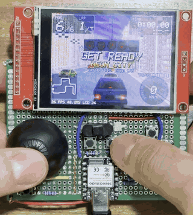
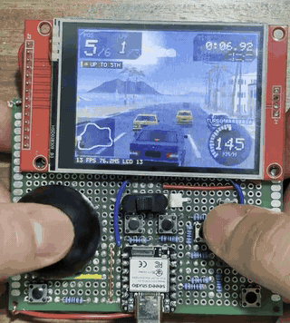
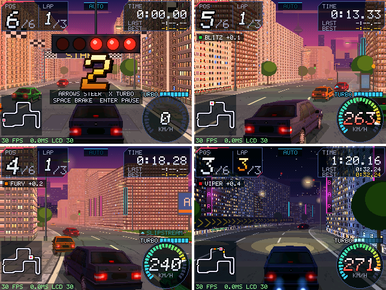
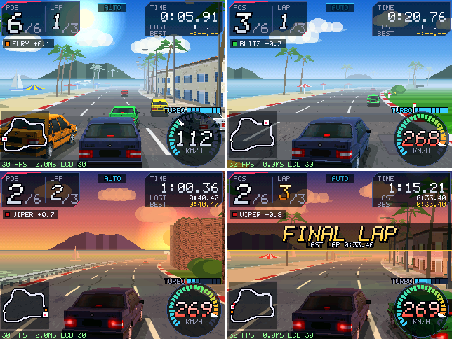
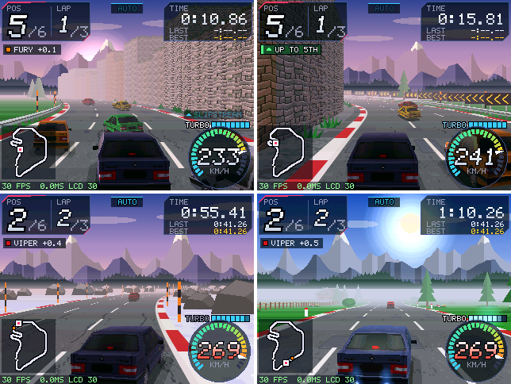
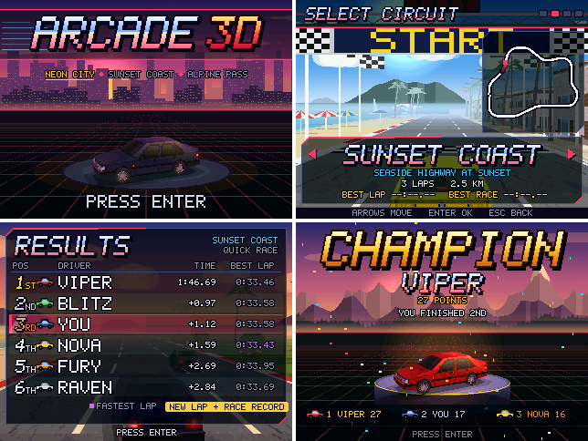

# ARCADE 3D — a pseudo-3D racing game for the ESP32-S3

An arcade racer in the spirit of the 80s and 90s classics for the ESP32-S3 with an ILI9341 320×240 SPI display:
three circuits, five rivals, a Grand Prix, a countdown with start lights, procedural textures and a day that
turns into night while you race. The same source compiles for the ESP32 hardware and for the PC (a Raylib
emulator and a headless renderer).

---

## On the real handheld

<table>
  <tr>
    <td></td>
    <td></td>
  </tr>
  <tr>
    <td align="center"><b>Neon City</b>: the start lights and the race</td>
    <td align="center"><b>Sunset Coast</b>: the coast road</td>
  </tr>
</table>

Filmed on the handheld: XIAO ESP32-S3 Sense, an ILI9341 panel, a stick and buttons. The video shows the menu, the start lights, a race against the rivals, a crash, the results and a second circuit. Watch the [full video (2:48, MP4)](img/arcade-3d-handheld.mp4).

---

## Screenshots

Real frames from the game (headless PC build, the same pixels the panel receives):

**Neon City** — downtown at dusk, into the night



**Sunset Coast** — the seaside highway into the sunset



**Alpine Pass** — hairpins, snow and tunnels at dawn





---

## Features

- **A real race** — title, main menu, **Grand Prix** (3 circuits in a row, points 10-7-5-3-2-1, standings, champion) or **quick race** on any circuit, grid + five start lights and **3-2-1-GO**, 3 laps against **5 rivals**, finish, results with gaps and best laps, pause (resume / restart / quit), attract demo, difficulty EASY / NORMAL / HARD, saved records and GP wins
- **Three designed circuits** — *Neon City* (towers, offices, brick and sandstone blocks, shops with neon, zebra crossings, traffic lights, an underpass, the harbour), *Sunset Coast* (beaches, a promenade of villas, sea walls, cliffs, a lighthouse, a tunnel through the headland), *Alpine Pass* (switchback hairpins under rock walls, rails over the drop, forests, a snowy high road, a lake, two tunnels); each has its own palette through its time of day, a background, 30+ kinds of scenery and a minimap that is its true plan
- **Rivals that race** — the player's car repainted, drawn exactly like it; each follows a racing line with its own personality, keeps a gap, overtakes on the side with room and never steers into a car alongside; bumps instead of crashes, slipstream, turbo, brake and tail lights
- **Procedural textures** — generated at boot from code, no image files: concrete, glass, brick, sandstone, dark towers, shopfronts, villas, rock, retaining walls, tunnel linings, asphalt with patches and cracks, pavements, sand, animated water, snow; windows light up one by one at dusk
- **Pseudo-3D road** — anti-aliased per-scanline road, textured near rows fading into flat bands, ground materials, kerbs, markings, start gantry, guard rails, street lamps, tunnels with portals, per-row fog
- **3D cars** — OBJ mesh, perspective-correct texture mapping, smoothed normals with diffuse + specular + sky reflection, contact shadow, lights, turbo flame, three levels of detail
- **Day / night** — the time of day follows race progress (each circuit has its own range): sky, sun / moon and its glitter on the sea, stars, clouds, lit windows, lamps, headlights
- **Physics** — frame-rate independent engine model, braking, turbo and rocket start, centrifugal drift, hill gravity, drag per ground material, solid walls / rails / tunnel walls / scenery, bumps between all cars, crash and reset
- **HUD** — position and lap, gap to the car ahead, race / last / best lap times, minimap with every car, speed dial, turbo meter, slipstream tag, position-change and lap banners, FPS counter
- **ESP32-S3 engine** — own software renderer into an internal-SRAM framebuffer, SPI DMA scanout on core 0 (from the MGS / SOTN ports), raster loops in IRAM, big buffers in PSRAM

---

## Hardware

Two boards are supported; pick one in `board.h` (`BOARD`).

**Handheld console (default)** — the same unit as the [mgs_reversing](https://github.com/davidmonterocrespo24/mgs_reversing) / [sotn-decomp](https://github.com/davidmonterocrespo24/sotn-decomp) ports:

| Component | Details |
| --------- | ------- |
| MCU | Seeed XIAO ESP32S3 Sense, 240 MHz dual-core, 8 MB octal PSRAM |
| Display | ILI9341 320×240 SPI @ 40 MHz — SCK=7, MOSI=9, CS=4, DC=43, RST=5 |
| Input | Analog stick (GPIO1 X steers, GPIO2 Y menus), A = D5 (GPIO6) brakes, B = D7 (GPIO44) turbo / confirm, six-button resistor ladder on GPIO3 (START, SELECT, CROSS, CIRCLE, ...) |

**Original dev board** — ESP32-S3, ILI9341 on SCK=12, MOSI=11, MISO=13, CS=10, DC=9, RST=8, backlight GPIO39, buttons GPIO17 (left) / GPIO16 (right).

### Building for the hardware (Arduino IDE)

1. Board: **XIAO_ESP32S3** (or *ESP32S3 Dev Module* for the dev board), Arduino-ESP32 core 4.0.0 (compile-verified)
2. **Tools → PSRAM → OPI PSRAM**
3. **Tools → USB CDC On Boot → Enabled** (mandatory on the XIAO: GPIO43 is the panel's D/C line, and with CDC disabled `Serial` would take it)
4. Compile and upload. **No TFT_eSPI library is needed**: the panel is driven with ESP-IDF's `esp_lcd` SPI + DMA.

The serial monitor prints where each buffer was placed (`[mem] ...`, `gfx: ... framebuffer in internal SRAM`, `tex: ...`), whether the raster loops are in IRAM (`iram: ... yes`) and, once per second, the frame rate and the free memory (`[st] ...`).

---

## Controls

| Action | Handheld | Dev board | Emulator |
| ------ | -------- | --------- | -------- |
| Steer | Stick X | GPIO 17 / 16 buttons | ← / → |
| Menu up / down | Stick Y | one button (on release) | ↑ / ↓ |
| Change a value / the circuit | Stick X | (confirm cycles values) | ← / → |
| Brake | A (D5) | — | Space or ↓ |
| Turbo (press it just as the lights go green for a rocket start) | B (D7) | — | X or Left Shift |
| Confirm | START, B or CROSS (ladder) | both buttons | Enter |
| Back | SELECT or CIRCLE (ladder) | — (every menu has BACK) | Esc / Backspace |
| Pause | START | both buttons held 250 ms | Enter or P |
| Throttle | Automatic | Automatic | Automatic |

Every menu has an explicit BACK item, so the dev board (steer + both buttons) can use all of them.

---

## Build — PC

### Emulator (Windows, Raylib)

```bash
cd emulator/
make
./car_game_emu.exe
```

Kill and rebuild:

```bash
taskkill /F /IM car_game_emu.exe 2>nul
rm -f car_game_emu.exe && make
```

### Headless renderer (any OS with g++, no Raylib)

Runs the game on a virtual 30 Hz clock and writes frames as PPM images — used to check rendering and race logic without the hardware:

```bash
cd emulator/
make headless
./car_game_headless out 900 --race 0 --auto --dump 300 200 400     # race on Neon City, autopilot
./car_game_headless out 11000 --gp --auto                         # a whole Grand Prix
./car_game_headless out 60 --state RESULTS:1 50                   # jump to a screen
./car_game_headless out 46 --race 2 --nocd --cycle 3.6 --pos 40000 --in 0:46:brake 45
python tools/sheet.py sheet.png 1 out/frame_0200.ppm out/frame_0400.ppm
bash tools/balance.sh            # autopilot vs rivals on every circuit and difficulty
bash tools/check_circuits.sh     # circuit rules and determinism
```

All options and test recipes are in [wiki/10-game-architecture.md](wiki/10-game-architecture.md).

---

## Project Structure

```text
├── car_game.ino            # setup() -> game_setup(), loop() -> game_loop()
├── game.cpp/.h             # State machine: title, menus, GP, countdown, race, pause, results, demo
├── ui.cpp/.h               # UI toolkit and every screen: title, menus, select, countdown, banners, results
├── render_hud.cpp/.h       # Race HUD (position, lap, gap, times, minimap, speed dial, turbo)
├── save.cpp/.h             # Records and GP wins (NVS on the ESP32, a file on the PC)
├── race.cpp/.h             # Racers, grid, progress, laps, places, results
├── rivals.cpp/.h           # Rival AI: racing line, speed profile, personalities, overtaking
├── physics.cpp/.h          # Car physics, contacts, walls, turbo, slipstream, autopilot, crash
├── circuits.cpp/.h         # The three designed circuits, decoration, minimap
├── track.cpp/.h            # Segment buffer and low-level builders
├── structs.h               # Segment (20 B), ground materials, building types, flags
├── config.h                # Shared constants (screen, world, lateral limits)
├── colors.cpp/.h           # RGB565 helpers, day/sunset/night/dawn palettes per theme
├── rendering.cpp/.h        # Sky, sun/moon, stars, clouds, theme backgrounds
├── textures.cpp/.h         # Procedural textures: facades, ground, tunnels, banners
├── render_road.cpp/.h      # Road pass: textured ground, markings, gantry, rails, lamps, tunnels, cars
├── render_building.cpp/.h  # Textured buildings of every type, villas, cliffs, walls
├── render_scenery.cpp/.h   # 33 sprite types with LODs (+ footprints and collision widths)
├── render_cars.cpp/.h      # Rivals in the road pass (camera blend, culling, LOD)
├── render_traffic.cpp/.h   # One car seen from a blended camera
├── render_player.cpp/.h    # Textured 3D car renderer and the player's car
├── gfx.cpp/.h              # Software framebuffer, rasterizer, textured spans, font
├── display.h, display_esp32.cpp   # ILI9341 over SPI DMA, scanout task on core 0
├── input.h, input_esp32.cpp       # Stick, buttons, resistor ladder (ADC task)
├── platform.h, platform_esp32.cpp # IRAM/allocation/logging/status/save helpers
├── board.h                 # Pin maps: XIAO handheld / original dev board
├── utils.cpp/.h            # Math helpers, deterministic Rng
├── car2_mesh.h, car2_texture.h    # Generated assets
├── assets/                 # Car2.obj, car2.png, generators
├── wiki/                   # Documentation; 10-game-architecture.md is the module contract
└── emulator/               # Raylib + headless frontends, tools/ (sheets, balance, checks)
```

---

## Memory layout (ESP32-S3)

| Buffer | Where | Size | Why |
| ------ | ----- | ---- | --- |
| Framebuffer | internal SRAM | 150 KB | every fill writes here; no cache traffic |
| Procedural textures | internal SRAM (PSRAM fallback) | 23 KB | read per pixel by the wall / road loops |
| Car texture | internal SRAM | 16 KB | 8-bit indices into an exact palette, random texel reads |
| DMA bands ×2 | internal, DMA-capable | 2×5 KB | ping-pong SPI transfers |
| Track segments | PSRAM | 48 KB | 2400 × 20-byte segments, touched ~200 times a frame |
| Racing line + speed profile | PSRAM | 19 KB | read a few times per car per frame |
| Scanout snapshots ×2, pause snapshot | PSRAM | 3×150 KB | immutable frame copies |
| Mesh, texture source, palettes, font | flash | ~60 KB | read-only |

Hot raster loops are placed in IRAM (`HOT`) and the scanout runs on core 0 while the game runs on core 1 — the
same split as in the MGS/SOTN ports. Every placement is logged at boot; the full map is in
[wiki/10-game-architecture.md](wiki/10-game-architecture.md#108-memory-map-esp32-s3-8-mb-octal-psram).

---

## Regenerating Asset Headers

```bash
# OBJ mesh -> C header with smoothed normals (Python 3)
python assets/obj_to_header.py assets/Car2.obj > car2_mesh.h

# PNG texture -> RGB565 C header (requires Pillow)
python assets/png_to_rgb565.py assets/car2.png > car2_texture.h
```
