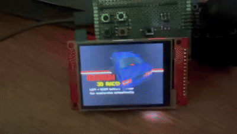
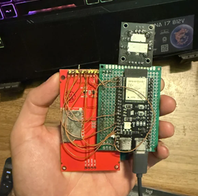
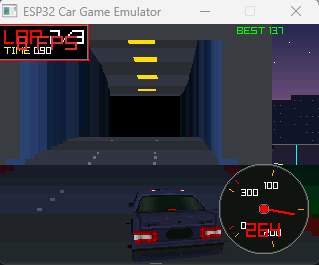

# ESP32 Pseudo-3D Racing Game

An arcade-style pseudo-3D racing game for the ESP32-S3 microcontroller with an ILI9341 320×240 SPI display. The same source compiles for the ESP32 hardware and for the PC (a Raylib emulator and a headless renderer).

---

## Screenshots

### Video Demo



### Images






---

## Features

- **A real race** — title, main menu, **Grand Prix** (3 circuits in a row, points 10-7-5-3-2-1, standings, champion) or **quick race** on any circuit, grid + **3-2-1-GO countdown** with start lights, 3 laps against **5 rivals**, finish, results with times and best laps, pause menu, attract demo, saved records
- **Three circuits** — *Neon City* (downtown at dusk turning into night: buildings, sidewalks, zebra crossings, street lamps, an underpass), *Sunset Coast* (beach and sea, sea walls with guard rails, palms, villas, rocky headlands, a tunnel), *Alpine Pass* (rock walls, guard rails, snowy pines, two tunnels, hairpins, steep climbs) — generated from fixed seeds, each with its own palette tint, background and minimap
- **Rivals** — the player's textured mesh repainted, seen from their real angle, yawed by their motion, brake lights; they follow a racing line, keep a gap, overtake on the free side and share the player's car physics (difficulty EASY / NORMAL / HARD)
- **Pseudo-3D road** — per-scanline road with anti-aliased edges, ground materials (grass, sidewalk + kerb, beach + sea, water, rock, snow, dirt), lane dashes, per-scanline exponential fog
- **Software renderer** — own RGB565 framebuffer and rasterizer (`gfx.cpp`): gap-free polygons, alpha blending, additive lights, dithered gradients, bitmap font
- **3D cars** — OBJ mesh, perspective-correct texture mapping, smoothed normals with Gouraud diffuse + specular + sky reflection, contact shadow, tail/brake lights, turbo flame
- **Day / night** — the time of day moves with race progress (each circuit has its own start and end), smooth palette blending of sky, sun/moon, stars, clouds, windows, lamps, headlights
- **Physics** — frame-rate independent acceleration, braking, turbo, centrifugal drift, hill gravity, off-road drag per material, solid walls / rails / tunnel walls / scenery, bumps with rivals, crash and reset
- **HUD** — position, lap, race time, best lap, lap bar with a dot per car, minimap, turbo meter, speedometer, FPS counter

---

## Hardware

Two boards are supported; pick one in `board.h` (`BOARD`).

**Handheld console (default)** — the same unit as the [mgs_reversing](https://github.com/davidmonterocrespo24/mgs_reversing) / [sotn-decomp](https://github.com/davidmonterocrespo24/sotn-decomp) ports:

| Component | Details |
| --------- | ------- |
| MCU | Seeed XIAO ESP32S3 Sense, 240 MHz dual-core, 8 MB octal PSRAM |
| Display | ILI9341 320×240 SPI @ 40 MHz — SCK=7, MOSI=9, CS=4, DC=43, RST=5 |
| Input | Analog stick (GPIO1 X steers, GPIO2 Y menus), A = D5 (GPIO6) brakes, B = D7 (GPIO44) turbo / confirm, six-button resistor ladder on GPIO3 (START, SELECT, CROSS, CIRCLE, ...) |

**Original dev board** — ESP32-S3, ILI9341 on SCK=12, MOSI=11, MISO=13, CS=10, DC=9, RST=8, backlight GPIO39, buttons GPIO17 (left) / GPIO16 (right).

### Building for the hardware (Arduino IDE)

1. Board: **XIAO_ESP32S3** (or *ESP32S3 Dev Module* for the dev board), Arduino-ESP32 core 4.0.0 (compile-verified)
2. **Tools → PSRAM → OPI PSRAM**
3. **Tools → USB CDC On Boot → Enabled** (mandatory on the XIAO: GPIO43 is the panel's D/C line, and with CDC disabled `Serial` would take it)
4. Compile and upload. **No TFT_eSPI library is needed**: the panel is driven with ESP-IDF's `esp_lcd` SPI + DMA.

The serial monitor prints where each buffer was placed (`[mem] ...`, `gfx: ... framebuffer in internal SRAM`).

---

## Controls

| Action | Handheld | Dev board | Emulator |
| ------ | -------- | --------- | -------- |
| Steer | Stick X | GPIO 17 / 16 buttons | ← / → |
| Menu up / down | Stick Y | left / right | ↑ / ↓ |
| Brake | A (D5) | — | ↓ or Space |
| Turbo | B (D7) | — | X or Left Shift |
| Confirm | START, B or CROSS (ladder) | both buttons | Enter |
| Back | SELECT or CIRCLE (ladder) | — | Esc / Backspace |
| Pause | START | both buttons | Enter |
| Throttle | Automatic | Automatic | Automatic |

Every menu has an explicit BACK item, so the dev board (steer + both buttons) can use all of them.

---

## Build — PC

### Emulator (Windows, Raylib)

```bash
cd emulator/
make
./car_game_emu.exe
```

Kill and rebuild:

```bash
taskkill /F /IM car_game_emu.exe 2>nul
rm -f car_game_emu.exe && make
```

### Headless renderer (any OS with g++, no Raylib)

Runs the game on a virtual 30 Hz clock and writes frames as PPM images — used to check rendering and race logic without the hardware:

```bash
cd emulator/
make headless
./car_game_headless out 900 --race 0 --auto --dump 300 200 400     # race on Neon City, autopilot
./car_game_headless out 13500 --gp --auto                         # a whole Grand Prix
./car_game_headless out 60 --race 2 --nocd --cycle 2.3 --pos 120000 50
python tools/sheet.py sheet.png 1 out/frame_0200.ppm out/frame_0400.ppm
```

All options (`--race`, `--nocd`, `--gp`, `--auto`, `--diff`, `--cycle`, `--pos`, `--in`, `--dump`, `--every`, `--title`, `--save`, `--segs`) are documented in [wiki/10-game-architecture.md](wiki/10-game-architecture.md).

---

## Project Structure

```text
├── car_game.ino            # setup() -> game_setup(), loop() -> game_loop()
├── game.cpp/.h             # State machine: title, menus, GP, countdown, race, results
├── ui.cpp/.h               # Title, menus, circuit select, countdown, results, pause, banners
├── render_hud.cpp/.h       # Race HUD (position, lap, times, minimap, speedometer)
├── save.cpp/.h             # Records and GP wins (NVS on the ESP32, a file on the PC)
├── race.cpp/.h             # Racers, grid, progress, laps, places, results
├── rivals.cpp/.h           # Rival AI (racing line, gaps, overtaking)
├── physics.cpp/.h          # Player car physics, bumps, walls, turbo, autopilot, crash
├── circuits.cpp/.h         # The three circuits (layout generator + themes) and minimap
├── track.cpp/.h            # Segment buffer and low-level builders
├── structs.h               # Segment (20 B), ground materials, building types, flags
├── config.h                # Shared constants (screen, world, lateral limits)
├── colors.cpp/.h           # RGB565 helpers, day/sunset/night/dawn palettes, themes
├── rendering.cpp/.h        # Sky, sun/moon, stars, clouds, theme backgrounds
├── render_road.cpp/.h      # Road pass: ground, tunnels, buildings, rails, lamps, cars
├── render_building.cpp/.h  # Buildings, villas, cliffs, walls
├── render_scenery.cpp/.h   # Trees, palms, rocks, posts (+ collision widths)
├── render_cars.cpp/.h      # Rivals in the road pass
├── render_traffic.cpp/.h   # One car at a road-projected position (mesh + LOD)
├── render_player.cpp/.h    # Textured 3D car renderer and the player's car
├── gfx.cpp/.h              # Software framebuffer, rasterizer, font
├── display.h, display_esp32.cpp   # ILI9341 over SPI DMA, scanout task on core 0
├── input.h, input_esp32.cpp       # Stick, buttons, resistor ladder
├── platform.h, platform_esp32.cpp # IRAM/allocation/logging/save helpers
├── board.h                 # Pin maps: XIAO handheld / original dev board
├── utils.cpp/.h            # Math helpers, deterministic Rng
├── car2_mesh.h, car2_texture.h    # Generated assets
├── assets/                 # Car2.obj, car2.png, generators
├── wiki/                   # Design notes; 10-game-architecture.md is the module contract
└── emulator/               # Raylib + headless frontends, tools/sheet.py
```

---

## Memory layout (ESP32-S3)

| Buffer | Where | Size | Why |
| ------ | ----- | ---- | --- |
| Framebuffer | internal SRAM | 150 KB | every fill writes here; no cache traffic |
| Car texture copy | internal SRAM | 32 KB | random texel reads; flash/PSRAM share the cache |
| DMA bands ×2 | internal, DMA-capable | 2×5 KB | ping-pong SPI transfers |
| Track segments | PSRAM | 48 KB | 2400 × 20-byte segments, touched ~200 times a frame |
| Scanout snapshots ×2 | PSRAM | 2×150 KB | immutable copy for the panel, written once per frame |
| Mesh, palettes, font | flash | ~45 KB | read-only |

Hot raster loops are placed in IRAM (`HOT`), and the scanout runs on core 0 while the game runs on core 1 — the same split used in the MGS/SOTN ports.

---

## Regenerating Asset Headers

```bash
# OBJ mesh -> C header with smoothed normals (Python 3)
python assets/obj_to_header.py assets/Car2.obj > car2_mesh.h

# PNG texture -> RGB565 C header (requires Pillow)
python assets/png_to_rgb565.py assets/car2.png > car2_texture.h
```
