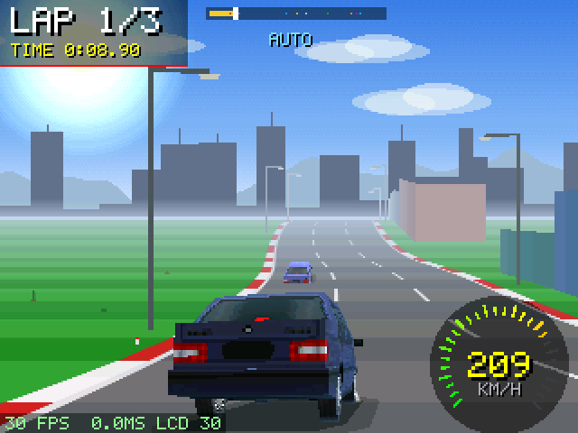

# 5. The 3D car renderer — why the car looked crooked

## 5.1 Causes in the original code

| # | Cause | Effect |
| --- | --- | --- |
| C1 | `rotY = playerX * 0.5` — yaw from the **lateral position** | Whenever the car was off-centre (the autopilot in every curve) it was drawn turned up to ~23°, even when driving straight |
| C2 | Eye at 6.5 units from a 6.5-unit-long model | Rear bumper ~3× nearer than the nose: the car looked like a wedge |
| C3 | Shadow at `centerX + playerX * 30` while the car stayed centred | Shadow and car did not line up |
| C4 | Scanlines wider than 160 px skipped; triangles with any vertex > 20 px off screen discarded | Holes in the car near the screen edges |
| C5 | Affine UVs, integer edge positions, `(int)` truncation | Swimming texture, cracks between triangles |
| C6 | Flat lighting from object-space face normals | Lighting never changed when the car turned; faceted look |
| C7 | `spr.drawPixel()` per texel, texture read from flash | Slow (see [audit](01-original-code-audit.md)) |

## 5.2 What the new renderer does (`renderCar(const CarRender&)`)

1. **Transform** every vertex with `R = Rx(pitch) · Ry(yaw) · Rz(roll)` about
   the car's ground centre, then perspective with `camDist` (eye distance in
   model units) and `pxPerUnit` (size at the anchor).
2. **Cull and sort**: back-face cull in screen space, reject off-screen
   triangles, insertion-sort by depth (sum + max of the three depths, so long
   triangles sort by their far end).
3. **Light only the vertices that will be drawn**: smoothed normals (from the
   mesh generator) rotated with the car; Gouraud **diffuse** in the palette's
   light colour + **ambient** + **Blinn specular** (~n·h²⁰) + a **sky
   reflection** at grazing angles (clear-coat look) + **fog** folded into the
   per-vertex terms (free per pixel).
4. **Rasterize** each triangle: gradients of all 9 attributes from the plane
   equation once per triangle; per scanline only the two edge x positions;
   **perspective-correct UVs** exact every 8 pixels; light in 16.16 fixed
   point; pixel-centre coverage (no cracks), proper clipping (no skipped
   triangles).
5. **Tail/brake lights**: additive glows projected from (±0.85, 1.22, −3.2);
   on at night, in tunnels, and brighter when braking.
6. **Contact shadow**: the car's footprint projected through the same
   transform, two blended polygons (soft edge).

### Player car parameters (`drawPlayerCar`)

| Parameter | Value | Note |
| --- | --- | --- |
| `pxPerUnit` | 27 | car ≈ 1/4 of the screen width |
| `camDist` | 11 | milder perspective than the old 6.5 |
| `pitch` | 0.30 + smoothed road slope | |
| `yaw` | `steerVisual * 0.20 + driftAngle * 0.35` | **from steering**, not from `playerX` |
| `roll` | lean into curves | |
| bounce | small, stronger on grass | |

Inside tunnels the light comes from the ceiling lamps and pulses as each lamp
passes overhead. At night a headlight pool is drawn on the road ahead.

## 5.3 Mesh data

`assets/obj_to_header.py` now also writes `car2_normals[]` (int8 × 3 per
vertex): area-weighted face normals averaged only across faces that bend less
than 50° (crease angle), so panel edges stay sharp and curved panels shade
smoothly. The vertex and index arrays are byte-for-byte the same values as
before (checked).

## 5.4 Repainting (traffic and `PLAYER_PAINT`)

At boot the texture is copied to internal RAM and every **paint texel** (the
navy body colour) gets the **green LSB set as a flag** — no extra memory.
Drawing with a paint colour maps flagged texels through a 64-entry luminance
→ colour LUT built per car. `PLAYER_PAINT` in `config.h` repaints the player
car (0 keeps the original navy).

## 5.5 Traffic

Traffic uses the same renderer. Each car is placed at its exact z inside its
segment (no more stepping), clipped by hills, with
`yaw = road heading − 0.7 × viewing angle` (so you see the side of a car you
are passing) and `pitch = real elevation of the eye`. Cars narrower than 9 px
fall back to a few rectangles (LOD).
