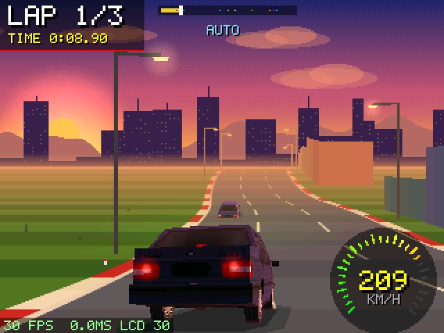
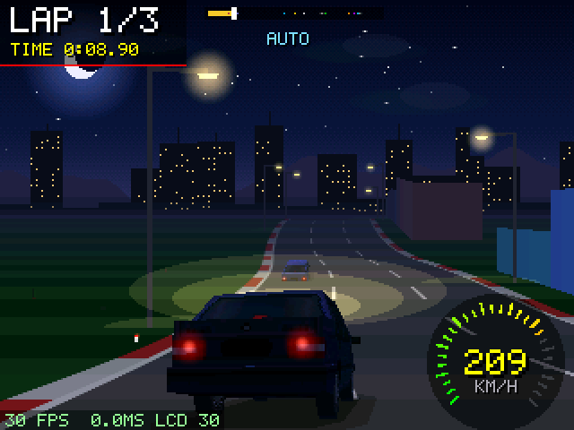
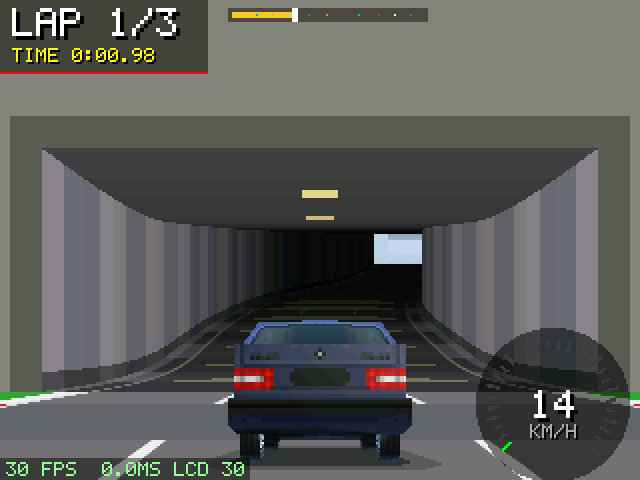
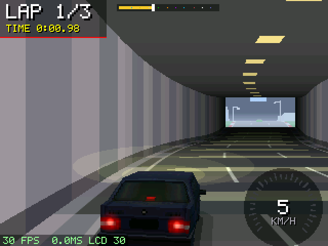

# 6. World rendering: sky, day/night, road, buildings, tunnels

## 6.1 Day / night cycle (`colors.cpp`)

Four palettes in RGB888 — **day, sunset, night, dawn** — each with sky
gradient stops, fog, grass/road/rumble/lane colours, skyline colours, window
colours, sun/moon colours, tunnel colours, foliage, lamp light, and the
lighting used by the 3D cars (light colour, ambient colour, light direction),
plus `night` (0..1), sun height and star visibility.

- `dayCycle` runs 0 → 4 and advances with distance travelled
  (`CYCLE_PHASE_DIST` = 1.25 laps per phase).
- Each phase holds, then blends into the next during its last
  `CYCLE_BLEND` (30 %) with a smoothstep. Blending happens in 8-bit per
  channel before packing to RGB565.
- `setDayCycle()` rebuilds `pal` (RGB565 + light vectors + per-facade building
  shades). It runs every frame only inside a blend window, otherwise every
  1/64 of a phase.

 

## 6.2 Sky (`rendering.cpp`)

Drawn every frame from the active palette (the old sky was a fixed bitmap):

1. Three-stop vertical gradient, **ordered-dithered** (no RGB565 banding).
2. Stars fading in with the night, some twinkling.
3. Sun with an additive glow; at night a moon with a crescent cut in the local
   sky colour.
4. Soft clouds (blended ellipses), tinted and dimmed by the palette.
5. Far hills and a city skyline, both **parallax** layers stored as height maps
   (640 columns, ~2 KB total instead of a 150 KB sprite). Skyline windows light
   up at night.
6. Horizon haze.

## 6.3 Road (`render_road.cpp`)

Two passes over `DRAW_DIST = 90` segments (was 40):

- **Front to back**: project each segment boundary once (with real near-plane
  clipping) and record `clipRow` — the screen row below which nearer road
  already covers everything.
- **Back to front**: for each segment, with the clip set to its `clipRow`:
  road scanlines → buildings → tunnel walls/ceiling → scenery and lamps →
  traffic → tunnel portal.

Road scanlines use `gfx_rowRegions`: grass | rumble | edge line | road | lane
dashes | road | … with **anti-aliased boundaries**, exact edge interpolation
per row, and **per-row fog** from the true depth (1/z interpolation, LUT).
Beyond the last segment the ground is filled with the fog colour so the
horizon is seamless.

## 6.4 Buildings (`render_building.cpp`)

- Faces shaded from the palette's sun direction: the face towards the road is
  lit on one side of the road and shaded on the other; front facades get a
  middle shade; roofs only when they are below eye level.
- Windows per floor (LOD: only when a floor is ≥ 4 px tall): reflective by
  day, about half lit at night; styles: individual windows, ribbon windows,
  glass tower floor lines, sparse windows with neon trim at night.
- Front facades with a window grid and a lit entrance at night.
- Everything fogged by distance (no more pop-in).

## 6.5 Tunnels

 

- Two tunnels (60 and 40 segments), height 2800 (was 4500).
- Striped walls with a dark skirting, dark ceiling, a lamp strip every 4
  segments with a light pool on the road.
- Inside, distance fades to **black**, not to the sky haze.
- **Portal**: a concrete face with grass on top and a frame around the mouth,
  drawn at the first tunnel segment, hiding the tunnel walls from outside.
- When the tunnel continues past the draw distance its far opening is dark.

## 6.6 Scenery

- Pines (shaded halves), round trees, bushes, rocks — with ground shadows by
  day.
- Roadside marker posts whose reflectors glow at night.
- **Street lamps** every 9 segments in the city, alternating sides: glowing
  head and a light pool on the road at night.

## 6.7 Player effects and HUD

- Headlight pool ahead of the car at night and in tunnels; tail lights.
- HUD: translucent panels, lap / time, best / last lap, lap progress bar with
  traffic dots, segmented speedometer (geometry precomputed), `AUTO` badge in
  demo mode, `FPS / MS / LCD` counter (`SHOW_FPS` in `config.h`).
- Title screen: palette sky, showroom floor, rotating car with shadow and
  lights.
