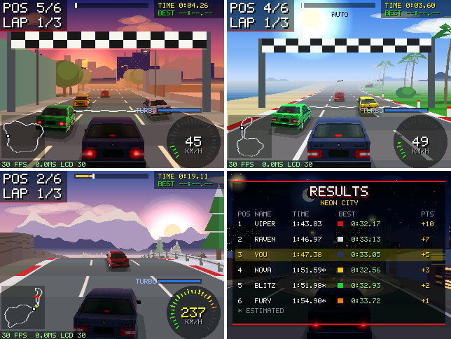

# 10. Game architecture — the module contract

This page is the **authoritative contract** for the feature phase. It documents
what the Core phase built on branch `full-game`: the module split, the shared
interfaces (the real header declarations, injected verbatim from the code),
who owns which file, the frame order every module relies on, the headless
harness, test recipes, the memory map, measurements, and every deviation from
the design brief.

The game runs end to end: **title → menu → circuit select → grid + countdown →
race against 5 rivals → finish → results → back**, plus the Grand Prix
(3 races, points, standings, champion), pause, the attract demo and save data.
Everything is deliberately *basic but working*; the four feature agents make
it good.



## 10.1 Flow

```
TITLE ──any key──> MAIN MENU ──GRAND PRIX──> (3 circuits in a row) ───────────┐
  │ idle 10 s        │   └──QUICK RACE──> CIRCUIT SELECT ─────────────────────┤
  v                  └──DIFFICULTY (cycles) / BACK                            v
 DEMO (autopilot, "DEMO" banner, circuits 0→1→2)          COUNTDOWN (GET READY, 3-2-1, GO)
  │ any input / 45 s -> TITLE                                                 v
                                                RACE <──> PAUSE (RESUME / QUIT RACE -> MENU)
                                                  v  player finishes the last lap
                                                FINISH (banner, autopilot cool-down 4 s)
                                                  v
                                                RESULTS (places, times, *estimated, best lap, GP points)
                                                  v
                                   GP: STANDINGS → next circuit … → CHAMPION → TITLE
                                   QUICK: back to CIRCUIT SELECT
```

`game.cpp` owns the state machine (`GameState`), `ui.cpp` draws every screen.
Fades: each screen except RACE / PAUSE / FINISH fades in from black over 0.3 s.

## 10.2 Ownership (feature phase)

Every agent edits **only** the files it owns. Headers of §10.4 are frozen: an
owner may ADD declarations to its headers but never rename, remove or change
the meaning of an existing one.

| Area | Owns (may edit) |
| --- | --- |
| **ai** | `race.*`, `rivals.*`, `physics.*`, `render_cars.*`, `render_traffic.*`, `render_player.*` |
| **city** | `textures.*` (new), `render_building.*`, `render_road.*`, `gfx.*` (additive only) |
| **themes** | `circuits.*`, `track.*`, `colors.*`, `rendering.*`, `render_scenery.*`, `utils.*` (additive only) |
| **ui** | `game.*`, `ui.*`, `render_hud.*`, `save.*`, `input.*`, `input_esp32.cpp`, `platform*.{h,cpp}` (additive only), `car_game.ino`, `emulator/*` |
| nobody (frozen; integrator only) | `structs.h`, `config.h`, `board.h`, `display.h`, `display_esp32.cpp`, `car2_mesh.h`, `car2_texture.h`, `assets/*`, `CLAUDE.md`, `readme.md`, `wiki/README.md`, this page |

Division of labour between **themes** and **city**: themes PLACES things
(segment flags, ground materials, building type/variant/height per side,
sprites), city RENDERS the structural ones (every `BuildingType`, every
`GroundMat`, kerbs, crosswalks, the start gantry, rails, lamps, tunnels) and
themes renders the sprites (`render_scenery`). Physics (ai) treats building
faces, rails and tunnel walls as solid at the limits of §10.5.

Need a change in a file you do not own? Do not make it — describe it under
"integratorNotes" in your report. Add your own wiki page (`11-ai.md`,
`12-city.md`, `13-themes.md`, `14-ui.md`).

## 10.3 Frame order (what every module may rely on)

`game_loop()` (game.cpp), every frame:

1. `sPrev = sIn; sIn = input_read();` — edges are derived from consecutive snapshots.
2. Update (race states RACE / FINISH / RESULTS / STANDINGS / DEMO):
   ```cpp
   if (!crashed) { handleInput(dt, in); updatePhysics(dt); checkCollisions(dt); }
   else updateCrash(dt);
   rivals_update(dt);
   race_update(dt);                       // mirrors the player into racers[PLAYER_ID]
   skyOffset += curve * (speed / maxSpeed) * 150 * dt;
   applyDayCycle(lerp(cycleStart, cycleEnd, playerProgress / race_distance()));
   ```
   COUNTDOWN only runs `rivals_update` + `race_update` (cars held on the grid);
   GO calls `race_go()`. PAUSE, CHAMPION and the menus do not update the race.
3. Render (race states):
   ```cpp
   drawSky(skyOffset, timeSec);
   drawRoad(position, playerX, playerZdist, cameraDepth);  // calls cars_prepare(position) after
                                                            // pass 1, cars_drawSlice(n, fog, tunnel)
                                                            // per slice in pass 2
   drawPlayerCar(timeSec);
   cars_drawNear();                                         // rivals nearer than the player car
   drawHUD(timeSec, fps, lcdFps, frameMs);
   ui_* overlays (countdown, GO, banners, crash, pause, finish, results ...)
   ```
4. `display_present(gfx_fb)`.

Starting a race: `buildCircuit(c)` → `race_init()` (grid, names, paints,
`physics_placePlayer`, `rivals_init`) → COUNTDOWN → `race_go()`.
`autopilot` is set by the game: demo, the finish cool-down, and `--auto`.
There is no idle autopilot during a race any more.

## 10.4 Shared interfaces (real header declarations)

Banner comments and include guards are stripped; everything else is verbatim.

### structs.h — track data (frozen)

```cpp
#include <stdint.h>

#define MAX_SEGS 2400          // capacity; each circuit uses segCount <= MAX_SEGS

// What lies beyond the road edge on each side (rendered by render_road,
// slows the car in physics; layout constants in config.h). MAT_SAND is a
// beach: sand next to the road, then the sea further out. MAT_WATER is water
// just past a narrow sea wall at the road edge (put a guard rail there).
// MAT_SIDEWALK is kerb + sidewalk up to the building line, street beyond.
enum GroundMat : uint8_t {
  MAT_GRASS = 0, MAT_SIDEWALK, MAT_SAND, MAT_WATER, MAT_ROCK, MAT_SNOW, MAT_DIRT, MAT_COUNT };

// Segment::style = type | (variant << 4), variant 0..15
enum BuildingType : uint8_t {
  BLD_NONE = 0,
  BLD_OFFICE,   // concrete office block, regular window grid
  BLD_GLASS,    // glass curtain-wall tower: sky reflection, mullions
  BLD_BRICK,    // brick apartments, punched windows, ledges
  BLD_STONE,    // sandstone classic building, cornices, tall windows
  BLD_MODERN,   // dark slate tower, vertical light strips / neon at night
  BLD_SHOPS,    // 2-4 floors, shopfronts with awnings / signs at street level
  BLD_VILLA,    // coast: white stucco villa, small windows, terracotta roof
  BLD_CLIFF,    // natural rock wall (cuttings, mountain side), no windows
  BLD_WALL,     // concrete retaining wall / sound barrier
  BLD_TYPE_COUNT };

#define SEGF_TUNNEL    0x01
#define SEGF_LAMP_L    0x02    // street lamp on the left at this segment
#define SEGF_LAMP_R    0x04
#define SEGF_CROSSWALK 0x08    // zebra crossing across the road
#define SEGF_START     0x10    // start/finish line at the NEAR edge of this segment (segment 0)
#define SEGF_RAIL_L    0x20    // guard rail along the left road edge (solid for physics)
#define SEGF_RAIL_R    0x40
#define SEGF_SPARE     0x80    // free; circuits.cpp uses it as scratch while generating (cleared after)

struct Segment {               // 20 bytes
  float   curve;
  float   y;                   // elevation at the FAR end of the segment
  uint8_t flags;               // SEGF_*
  uint8_t ground;              // left material | (right material << 4)
  uint8_t build[2];            // [0] left, [1] right: height / BUILDING_H_UNIT, 0 = none
  uint8_t style[2];            // BuildingType | variant << 4
  int8_t  spr[2];              // scenery sprite type per side, -1 = none
  uint8_t sprOff[2];           // distance of the sprite from the road centre, road half-widths * 16
  uint8_t deco;                // reserved (unused for now; every placeable prop is a sprite)
  uint8_t pad;
  bool  isTunnel() const { return flags & SEGF_TUNNEL; }
  int   mat(int side) const  { return side ? (ground >> 4) : (ground & 15); }
  float sprX(int side) const { return (side ? 1.0f : -1.0f) * sprOff[side] * (1.0f / 16.0f); }
};

static_assert(sizeof(Segment) == 20, "Segment must stay 20 bytes");

// Packing helpers (side: 0 = left, 1 = right)
static inline uint8_t groundPack(int left, int right) { return (uint8_t)((left & 15) | ((right & 15) << 4)); }
static inline uint8_t bldStyle(int type, int variant) { return (uint8_t)((type & 15) | ((variant & 15) << 4)); }
static inline int     bldType(uint8_t style)    { return style & 15; }
static inline int     bldVariant(uint8_t style) { return style >> 4; }
```

### config.h — shared constants (frozen)

```cpp
// ═══════════════════════════════════════════════════════════════
//  SCREEN
// ═══════════════════════════════════════════════════════════════
#define SCR_W       320
#define SCR_H       240
#define SCR_CX      (SCR_W / 2)
#define SCR_CY      (SCR_H / 2)

// Show a small FPS / frame-time readout in the bottom-left corner
#define SHOW_FPS    1

// ═══════════════════════════════════════════════════════════════
//  WORLD
//  The track has segCount segments (track.h); MAX_SEGS (structs.h)
//  is only the capacity of the segment buffer.
// ═══════════════════════════════════════════════════════════════
#define SEG_LEN     200       // length of each segment (world units)
#define RUMBLE_LEN  3         // segments per rumble/stripe colour
#define DRAW_DIST   90        // draw distance in segments
#define ROAD_W      2000      // road half-width (world units)
#define LANES       3         // number of lanes
#define FOV_DEG     100       // field of view in degrees
#define CAM_HEIGHT  1000      // camera height
#define FOG_DENSITY 4.0f      // exponential fog density over DRAW_DIST
#define TUNNEL_H    2800      // tunnel ceiling height above the road

// ═══════════════════════════════════════════════════════════════
//  LATERAL LIMITS (road half-widths from the centre line).
//  Contract between the renderer and the physics: what is drawn
//  at these offsets is solid at these offsets.
// ═══════════════════════════════════════════════════════════════
#define ROAD_EDGE_X     1.00f  // tarmac ends here
#define RAIL_X          1.18f  // guard rails (SEGF_RAIL_L/R)
#define TUNNEL_WALL_X   1.20f  // tunnel walls
#define BUILDING_OFFSET 1.5f   // building / cliff / wall faces (Segment::build > 0)
#define OFFROAD_MAX_X   2.40f  // hard limit when nothing solid is closer

// Ground material layout beyond the road edge (render_road draws it this
// way, physics drags the car accordingly):
//   MAT_SIDEWALK: kerb up to SIDEWALK_KERB_X, sidewalk up to BUILDING_OFFSET,
//                 side-street asphalt beyond
//   MAT_SAND    : beach up to BEACH_WATER_X, the sea beyond
//   MAT_WATER   : sea-wall top up to SEAWALL_X, water beyond
//   others      : rumble strip, then the material
#define SIDEWALK_KERB_X 1.07f
#define BEACH_WATER_X   2.60f
#define SEAWALL_X       1.26f

// ═══════════════════════════════════════════════════════════════
//  BUILDINGS (geometry shared by the circuit generator, the
//  building renderer and the physics)
// ═══════════════════════════════════════════════════════════════
#define BUILDING_H_UNIT    2048    // Segment::build stores height / BUILDING_H_UNIT
#define BUILDING_FLOOR_H   11000   // height of one floor (same units)
#define BUILDING_W         400000  // depth of a building away from the road (px * scale)

// ═══════════════════════════════════════════════════════════════
//  PLAYER CAR LOOK
//  0 = original texture paint (navy). Otherwise an RGB565 colour that
//  replaces the paint, e.g. 0xD000 (red) or 0xFD20 (orange).
// ═══════════════════════════════════════════════════════════════
#define PLAYER_PAINT 0
```

### track.h — segment buffer and builders (themes)

```cpp
#include "structs.h"
#include "config.h"

// ═══════════════════════════════════════════════════════════════
//  GLOBAL TRACK STATE
// ═══════════════════════════════════════════════════════════════
extern Segment* segments;     // MAX_SEGS entries (PSRAM preferred)
extern int      segCount;     // segments in the current circuit
extern float    trackLength;  // segCount * SEG_LEN

// Allocate the segment buffer (once; PSRAM first, internal fallback,
// placement logged). Returns false when there is no memory at all.
bool track_init();

// Start a new circuit: segCount = 0.
void track_clear();

// Wrap any index into [0, segCount) (0 when the track is empty).
static inline int segWrap(int i) {
  if (segCount <= 0) return 0;
  i %= segCount;
  return i < 0 ? i + segCount : i;
}
static inline Segment& segAt(int i) { return segments[segWrap(i)]; }

// ═══════════════════════════════════════════════════════════════
//  BUILDERS
// ═══════════════════════════════════════════════════════════════
float lastY();
// Append a plain segment (grass both sides, no flags, no sprites).
// Returns its index, or -1 when the buffer is full.
int  addSeg(float curve, float y);
// Section with eased curve entry/exit and an eased elevation change of
// hillY * SEG_LEN spread over the whole section.
void addRoad(int enter, int hold, int leave, float curve, float hillY);
// Place a sprite on one side (0 left, 1 right) at |x| = dist half-widths.
void setSprite(int idx, int side, int type, float dist);
// Done building: trackLength = segCount * SEG_LEN.
void track_finish();
```

### circuits.h — circuits, minimap (themes)

```cpp
#include <stdint.h>

enum Theme : uint8_t { THEME_CITY = 0, THEME_COAST, THEME_MOUNTAIN, THEME_COUNT };

struct CircuitInfo {
  const char* name;            // "NEON CITY"
  const char* tagline;         // one short line for the select screen
  uint8_t theme, laps;
  float cycleStart, cycleEnd;  // day-cycle position at the start and at the end of the race
};

#define NUM_CIRCUITS 3
extern const CircuitInfo CIRCUITS[NUM_CIRCUITS];
extern int currentCircuit;
void buildCircuit(int id);     // segments, flags, materials, buildings, scenery, minimap; setTheme; initBackground
const CircuitInfo& curCircuit();

#define MINIMAP_PTS 128        // closed outline, points evenly spaced along the lap
extern uint8_t minimapX[MINIMAP_PTS], minimapY[MINIMAP_PTS];   // 0..255, aspect ratio preserved
void minimapAt(float z, float& u, float& v);                   // track position -> 0..1 map coordinates
```

### colors.h — palette, themes, day cycle (themes)

```cpp
#include <stdint.h>
#include "structs.h"

// Named colours (RGB565) used across the game
#define COL_BLACK   0x0000
#define COL_WHITE   0xFFFF
#define COL_RED     0xF800
#define COL_YELLOW  0xFFE0
#define COL_ORANGE  0xFD20
#define COL_GREEN   0x07E0
#define COL_GREY    0x7BEF
#define COL_CYAN    0x07FF

// ═══════════════════════════════════════════════════════════════
//  DAY / NIGHT CYCLE
//  0 = day, 1 = sunset, 2 = night, 3 = dawn (wraps at 4). Each phase
//  holds, then blends into the next during its last CYCLE_BLEND.
//  Races drive the cycle by race progress (circuit cycleStart ->
//  cycleEnd); the demo / free modes advance it by distance.
// ═══════════════════════════════════════════════════════════════
#define CYCLE_PHASE_DIST   250000.0f  // distance per phase in free mode
#define CYCLE_BLEND        0.30f      // last 30% of each phase blends to the next

// ═══════════════════════════════════════════════════════════════
//  RGB565 HELPERS
// ═══════════════════════════════════════════════════════════════
static inline uint16_t rgb(uint8_t r, uint8_t g, uint8_t b) {
  return (uint16_t)(((r & 0xF8) << 8) | ((g & 0xFC) << 3) | (b >> 3));
}

// alpha in 0..32 (32 = fg only). Classic packed-channel blend.
static inline uint16_t blend565(uint16_t fg, uint16_t bg, uint32_t a32) {
  uint32_t f = (fg | ((uint32_t)fg << 16)) & 0x07E0F81Fu;
  uint32_t b = (bg | ((uint32_t)bg << 16)) & 0x07E0F81Fu;
  uint32_t r = ((((f - b) * a32) >> 5) + b) & 0x07E0F81Fu;
  return (uint16_t)(r | (r >> 16));
}

// Saturating add (for glows / lights)
static inline uint16_t add565(uint16_t a, uint16_t b) {
  uint32_t r = (a & 0xF800u) + (b & 0xF800u); if (r > 0xF800u) r = 0xF800u;
  uint32_t g = (a & 0x07E0u) + (b & 0x07E0u); if (g > 0x07E0u) g = 0x07E0u;
  uint32_t l = (a & 0x001Fu) + (b & 0x001Fu); if (l > 0x001Fu) l = 0x001Fu;
  return (uint16_t)(r | g | l);
}

// Scale a colour by s/32 (s in 0..32)
static inline uint16_t scale565(uint16_t c, uint32_t s32) {
  return blend565(c, 0, s32);
}

uint16_t darkenCol(uint16_t c, float f);
uint16_t lerpCol(uint16_t c1, uint16_t c2, float t);

// ═══════════════════════════════════════════════════════════════
//  ACTIVE PALETTE (RGB565, recomputed when the time of day moves)
// ═══════════════════════════════════════════════════════════════
// Facade base colours, shaded per face from the palette light
enum FacadeColor : uint8_t {
  FAC_CONCRETE = 0, FAC_BRICK, FAC_SANDSTONE, FAC_BLUEGLASS, FAC_TEAL, FAC_SLATE,
  FAC_CREAM, FAC_RUST, FAC_STUCCO, FAC_TERRACOTTA, FAC_ROCK, FAC_WALLGREY,
  BUILDING_PALETTE };

struct ColorSet {
  uint16_t skyTop, skyMid, skyHorizon, fog;
  uint16_t grassL, grassD, roadL, roadD;
  uint16_t rumbleL, rumbleD, lane, edgeLine;
  uint16_t skylineFar, skylineNear, windowLit, windowDay;
  uint16_t sun, sunGlow, cloud;
  uint16_t tunnelWallL, tunnelWallD, tunnelCeil, tunnelLight, portal;
  uint16_t foliageL, foliageD, trunk, rock;
  uint16_t lampPole, lampLight;
  uint16_t ground[MAT_COUNT][2];          // light / dark band per material (no fog)
  uint16_t kerbL, kerbD;                  // city kerb (instead of the red/white rumble)
  uint16_t facadeLit[BUILDING_PALETTE];   // face turned to the sun
  uint16_t facadeShade[BUILDING_PALETTE]; // face away from the sun
  uint16_t facadeFront[BUILDING_PALETTE]; // face towards the camera
  uint16_t roof[BUILDING_PALETTE];
  // Lighting for the 3D cars, linear 0..1 per channel
  float lightR, lightG, lightB;     // directional (sun/moon) colour
  float ambR, ambG, ambB;           // ambient colour
  float sunDirX, sunDirY, sunDirZ;  // direction TO the light, view space
  float night;                      // 0 = full day .. 1 = full night
  float sunY;                       // sun/moon height on screen (pixels)
  float stars;                      // star visibility 0..1
};

extern ColorSet pal;
extern int   timeOfDay;     // 0=day 1=sunset 2=night 3=dawn (dominant phase)
extern float dayCycle;      // continuous cycle position in [0, 4)
extern int   colorTheme;    // theme set by setTheme (Theme in circuits.h)

// Choose the circuit theme (tints the four time-of-day palettes and sets
// the ground materials). Call before setDayCycle; buildCircuit does it.
void setTheme(int theme);
// Set the cycle position (0..4, wraps) and rebuild `pal` now.
void setDayCycle(float cycle);
// Set the cycle position, rebuilding `pal` only when it can visibly change
// (inside a blend window, or every 1/64 of a phase). Cheap to call per frame.
void applyDayCycle(float cycle);
// Advance the cycle by distance travelled (demo / free mode).
void advanceDayCycle(float distance);
```

### rendering.h — sky and background (themes)

```cpp
#include "config.h"
#include "gfx.h"
#include "colors.h"

// Parallax background scroll (advanced by curves * speed)
extern float skyOffset;

// Generate the background of a circuit theme (Theme in circuits.h):
// city skyline / sea horizon with islands / mountain ranges, stars and
// clouds. Deterministic per theme. Call once per circuit (buildCircuit).
void initBackground(int theme);

// Sky gradient, sun/moon, stars, clouds and the background layers of the
// theme chosen at init, with the current palette.
void drawSky(float skyOffset, float timeSec);
```

### render_scenery.h — sprites (themes)

```cpp
#include <stdint.h>

enum SpriteType : int8_t {
  SPR_PINE = 0,     // conifer, shaded halves
  SPR_TREE,         // round deciduous tree
  SPR_BUSH,         // low bush (not solid)
  SPR_ROCK,         // boulder
  SPR_POST,         // roadside marker post with a reflector
  SPR_PALM,         // palm tree (coast)
  SPR_PINE_SNOW,    // snowy conifer (mountain, high up)
  /* themes add more */
  SPR_COUNT };

// Sprite anchored at its base (sx, sy) on screen. scale = road projection
// scale at that depth (ProjPt::scale); fog 0..1 towards pal.fog.
void  drawSceneSprite(int type, float sx, float sy, float scale, float fog);

// Collision width in road half-widths (full width of the solid part, e.g.
// a trunk), 0 = not solid (bushes, grass).
float spriteHitWidth(int type);
```

### render_road.h — road pass, shared camera (city)

```cpp
#include <stdint.h>
#include "config.h"
#include "structs.h"

// A projected road point: centre x, y, half-width (px), scale, camera z
struct ProjPt { float x, y, w, scale, z; };

// Shared camera/projection for the frame (so other modules project exactly
// like the road). Valid from the start of drawRoad() until the next frame.
struct RoadCam { float camX, camY, camDepth; };
extern RoadCam roadCam;

#define ROAD_NEAR_Z 30.0f    // near plane (camera-space z, world units)

static inline void roadProject(ProjPt& p, float wx, float wy, float wz) {
  p.z = wz;
  p.scale = roadCam.camDepth / wz;
  p.x = SCR_CX + p.scale * (wx - roadCam.camX) * SCR_CX;
  p.y = SCR_CY - p.scale * (wy - roadCam.camY) * SCR_CY;
  p.w = p.scale * ROAD_W * SCR_CX;
}

// Per-frame boundary data, valid during and after drawRoad: world x offset
// of the road centre / elevation / camera z of boundary n (boundary n is the
// near edge of segment roadBaseIdx + n).
extern float roadBX[DRAW_DIST + 1], roadBY[DRAW_DIST + 1], roadBZ[DRAW_DIST + 1];
extern int   roadBaseIdx;        // segment index of boundary 0
extern float roadPosOff;         // camera position inside the base segment

// Draws the whole road pass for the frame. Calls cars_prepare(position)
// after pass 1 and cars_drawSlice() per segment in pass 2 (render_cars.h).
void drawRoad(float position, float playerX, float playerZdist, float cameraDepth);
```

### render_building.h (city)

```cpp
#include <stdint.h>
#include "render_road.h"

// One segment-long slice of a building beside the road.
//   pn / pf    : projected road centre at the near / far end of the segment
//   heightUnits: Segment::build[side] (height / BUILDING_H_UNIT)
//   style      : Segment::style[side] (BuildingType | variant << 4)
//   showFront  : first slice of this building -> draw its front facade
//   fog        : 0..1 haze towards pal.fog
void drawBuilding(const ProjPt& pn, const ProjPt& pf, int heightUnits, uint8_t style,
                  int sIdx, bool isLeft, bool showFront, float fog);
```

### race.h — racers, laps, places, results (ai)

```cpp
#include <stdint.h>

#define NUM_RIVALS 5
#define NUM_RACERS (NUM_RIVALS + 1)
#define PLAYER_ID  0

// Car footprint in world terms, derived from the renderer (not guessed):
// a car is drawn with pxPerUnit = scale * 27000 and the road half-width is
// scale * ROAD_W * SCR_CX px, so the 2.9 x 6.5-unit model is 0.245 road
// half-widths wide and ~1100 world units (~5.5 segments) long.
#define CAR_HALF_W   0.12f              // road half-widths
#define CAR_LEN      1100.0f            // world units
#define GRID_X       0.45f              // grid columns at x = -0.45 / +0.45
#define GRID_ROW     (CAR_LEN * 1.5f)   // distance between cars of the same column
#define GRID_FRONT   (CAR_LEN * 0.5f + 150.0f)   // pole car centre behind the line

struct Racer {
  char     name[8];
  uint16_t paint;              // RGB565 (player: PLAYER_PAINT, 0 = texture paint)
  float    z;                  // track position of the car centre, [0, trackLength)
  float    x;                  // lateral offset, road half-widths
  float    speed;
  float    yaw;                // visual heading relative to the road (radians, + = nose right)
  float    progress;           // race distance from the start line (negative on the grid)
  int      lap;                // completed laps
  float    lapStart, lastLap, bestLap;
  bool     finished;
  float    finishTime;
  int      place;              // 1-based, updated every frame
  bool     braking, boosting;
};

extern Racer racers[NUM_RACERS];
extern float raceTime;         // seconds since GO (0 during the countdown)
extern bool  raceRunning;      // false on the grid / countdown
extern int   difficulty;       // 0 easy, 1 normal, 2 hard

void  race_init();             // after buildCircuit(): grid positions, names, paints, reset times/laps
void  race_go();               // the countdown says GO
void  race_update(float dt);   // after physics + rivals: progress, laps, finish, places
float race_distance();         // laps * trackLength
int   race_order(int place);   // racer index at 1-based place

// Final classification, in place order: finished racers by finish time,
// the others with an estimated time (remaining distance / average pace).
struct ResultRow {
  uint8_t racer;
  bool    finished;            // false: time is an estimate
  float   time;
  float   bestLap;
};
void  race_results(ResultRow out[NUM_RACERS]);
// Start progress of a grid slot (0 = pole ... NUM_RACERS-1 = last) and its column
float race_gridProgress(int slot);
float race_gridX(int slot);
```

### rivals.h — rival AI (ai)

```cpp
void rivals_init();            // per-rival skill, line preferences, start reaction
void rivals_update(float dt);  // drive the rivals (idle until race_go)

// Shared driving helpers (the player's autopilot uses them too)
// Racing-line x (road half-widths) at track position z, plus a lateral bias.
float ai_lineTarget(float z, float bias);
// Fraction of maxSpeed the corners just ahead of z allow (0.6 .. 1).
float ai_cornerSpeed(float z);
```

### physics.h — player car (ai)

```cpp
#include "input.h"

// ═══════════════════════════════════════════════════════════════
//  TUNABLES (per-frame factors are defined at 60 Hz and rescaled by
//  dt, so the handling does not depend on the frame rate)
// ═══════════════════════════════════════════════════════════════
#define SPEED_MULTIPLIER   65.0f   // maxSpeed = SEG_LEN * SPEED_MULTIPLIER (~246 km/h)
#define ACCEL_TARGET       0.9f    // targetAccel = maxSpeed * ACCEL_TARGET
#define ACCEL_RAMP         420.0f  // how fast acceleration ramps up (u/s^3)
#define ACCEL_NEAR_MAX     0.90f   // speed threshold to reduce acceleration
#define ACCEL_DAMPING      0.97f   // multiplier when approaching maxSpeed (per 60 Hz frame)
#define FRICTION           0.996f  // friction per 60 Hz frame (~3.3 s coast-down)
#define BRAKE_DECEL        9000.0f // brake deceleration (u/s^2)
#define GRAVITY_FACTOR     1600.0f // effect of slopes on speed
#define CENTRIFUGAL        0.18f   // centrifugal force in curves
#define CURVE_FORCE        3.0f    // lateral force multiplier in curves
#define LATERAL_FRICTION   0.90f   // lateral velocity damping per 60 Hz frame
#define STEER_AUTO         1.8f    // autopilot response
#define STEER_MANUAL       2.2f    // manual steering speed (road half-widths / s)
#define CENTRIFUGAL_DX     1.5f    // lateral centrifugal push factor
#define TURBO_BOOST        0.12f   // +12 % top speed while boosting
#define TURBO_ACCEL        1.6f    // acceleration multiplier while boosting
#define TURBO_DRAIN        (1.0f / 3.0f)    // a full meter lasts 3 s
#define TURBO_REFILL       (1.0f / 20.0f)   // and refills in ~20 s
#define CRASH_TIME         2.0f    // seconds of spin before the reset

// ═══════════════════════════════════════════════════════════════
//  STATE
// ═══════════════════════════════════════════════════════════════
extern float cameraDepth;
extern float playerZdist;      // camera -> player car distance
extern float position;         // camera track position [0, trackLength)
extern float playerX;          // lateral, road half-widths
extern float speed;
extern float maxSpeed;
extern float centrifugal;
extern bool  crashed;
extern float crashTime;        // seconds since the crash (while crashed)

extern float velocityX;        // lateral velocity (drift)
extern float acceleration;     // current throttle acceleration
extern float driftAngle;       // drift angle (visual)
extern float steerVisual;      // smoothed steering for the car's yaw (-1..1)
extern bool  braking;
extern bool  boosting;         // turbo active this frame
extern float turboMeter;       // 0..1
extern bool  autopilot;        // the AI drives the player car (demo, after the finish)
extern float offRoad;          // 0 on tarmac .. 1 on rough ground (visual shake)

// ═══════════════════════════════════════════════════════════════
//  FUNCTIONS
// ═══════════════════════════════════════════════════════════════
void initPhysics();                              // constants + a car at rest at 0
void physics_placePlayer(float camPos, float x); // put the car at rest (grid, reset)
void handleInput(float dt, const InputState& in);// steering, brake, turbo, autopilot
void updatePhysics(float dt);                    // speed, gravity, drift, materials
void checkCollisions(float dt);                  // rivals, walls, rails, scenery
void updateCrash(float dt);                      // while crashed: spin, then reset
```

### render_cars.h / render_traffic.h / render_player.h (ai)

```cpp
void cars_prepare(float position);              // pick visible rivals and sort them far -> near
void cars_drawSlice(int n, float fog, bool tunnel);
// Rivals whose centre is nearer to the camera than the player's car are
// skipped by the road pass and drawn here, AFTER drawPlayerCar(), so they
// correctly cover it.
void cars_drawNear();
```

```cpp
#include <stdint.h>

// Pixels per model unit relative to the road projection scale. Chosen so a
// car at the player's distance is exactly the size of the player car.
#define TRAFFIC_PX_PER_SCALE 27000.0f

// (sx, sy): projected ground position, scale: road projection scale,
// yaw: heading relative to the line of sight, pitch: viewing elevation,
// camDistModel: distance from the eye in model units (perspective),
// paint: RGB565 (0 = texture paint), brake: brake lights on.
void drawTrafficCar(float sx, float sy, float scale, uint16_t paint, float fog,
                    float yaw, float pitch, bool inTunnel, float camDistModel, bool brake);
```

```cpp
#include <stdint.h>

struct CarRender {
  float ax, ay;          // screen anchor: the car's ground centre
  float pxPerUnit;       // screen pixels per model unit at the anchor
  float yaw;             // + turns the nose right
  float pitch;           // camera elevation + road slope (radians)
  float roll;            // body lean (radians, + leans right)
  float camDist;         // eye -> anchor distance in model units (perspective)
  uint16_t paint;        // 0 = texture paint, else RGB565 paint colour
  float fog;             // 0..1 blend towards fogColor
  uint16_t fogColor;
  float lightScale;      // global light multiplier (tunnels)
  bool  tunnelLight;     // light from the tunnel ceiling instead of the sun
  bool  lights;          // tail lights on
  bool  brake;           // brake lights (brighter)
  bool  shadow;          // draw the contact shadow
};

// Viewpoint the player's car is drawn from (rivals near the camera use it too)
#define PLAYER_VIEW_PITCH 0.30f   // radians
#define PLAYER_VIEW_DIST  11.0f   // eye distance in model units
#define PLAYER_PX_PER_UNIT 27.0f

// Copy the texture to internal RAM and tag its paint texels (call once).
void initCarRenderer();

// Draw one car with the current palette lighting.
void renderCar(const CarRender& cr);

// The player's car at its fixed screen position (after drawRoad)
void drawPlayerCar(float timeSec);
```

### input.h (ui)

```cpp
struct InputState {
  float steer;     // -1 .. +1
  float stickY;    // -1 up .. +1 down (menus)
  bool  brake, turbo;
  bool  start;     // pause / skip
  bool  confirm;   // menu accept
  bool  back;      // menu back
  bool  any;       // any control touched
};

void input_init();
InputState input_read();
```

### platform.h (ui, additive only)

```cpp
#include <stdint.h>
#include <stddef.h>

#if defined(ARDUINO_ARCH_ESP32)
  #include <esp_attr.h>
  #define PLATFORM_ESP32 1
  // Per-pixel loops must not run from flash: executing XIP through the
  // instruction cache while the same cache serves PSRAM and texture reads
  // thrashes it (lesson from the SOTN/MGS ports on this same chip).
  #define HOT IRAM_ATTR
  // Small hot tables kept in internal DRAM instead of flash-mapped rodata.
  #define FAST_DATA DRAM_ATTR
#else
  #define PLATFORM_ESP32 0
  #define HOT
  #define FAST_DATA
#endif

// Allocation helpers. On the ESP32-S3:
//   internal SRAM : ~1 cycle access, DMA-capable, scarce (~300 KB free)
//   PSRAM (octal) : 8 MB, goes through the shared 32/64 KB cache
// The render target lives in internal SRAM when it fits; big, rarely-touched
// buffers (scanout snapshots) go to PSRAM.
void* plat_alloc_internal(size_t bytes);
void* plat_alloc_psram(size_t bytes);
void  plat_log(const char* fmt, ...);
void  plat_report_memory(const char* tag);

// Persistent storage of one small blob (save data).
//   ESP32   : Preferences / NVS (namespace "arcade3d", key "save")
//   PC      : a small file next to the binary
//   headless: disabled unless the harness passes --save
// plat_load returns false when nothing (or a blob of another size) is stored.
bool  plat_save(const void* data, size_t n);
bool  plat_load(void* data, size_t n);
```

### save.h (ui)

```cpp
#include <stdint.h>
#include "circuits.h"

#define SAVE_MAGIC   0x44335241u   // "AR3D"
#define SAVE_VERSION 1

struct SaveData {
  uint32_t magic;
  uint16_t version;
  uint8_t  difficulty;               // last chosen difficulty
  uint8_t  lastCircuit;              // last circuit raced in QUICK RACE
  float    bestLap[NUM_CIRCUITS];    // 0 = none
  float    bestRace[NUM_CIRCUITS];   // 0 = none
  uint16_t gpWins[3];                // per difficulty
  uint16_t races;                    // races finished
  uint32_t checksum;
};

extern SaveData saveData;

void save_init();                              // load, or defaults when missing / corrupt
bool save_commit();                            // write now (between races only)
bool save_recordLap(int circuit, float t);     // true = new record (not written yet)
bool save_recordRace(int circuit, float t);    // true = new record (not written yet)
void save_recordGPWin(int difficulty);
```

### game.h (ui)

```cpp
#include <stdint.h>

enum GameState : uint8_t {
  GS_TITLE = 0, GS_DEMO, GS_MENU, GS_SELECT, GS_COUNTDOWN, GS_RACE, GS_PAUSE,
  GS_FINISH, GS_RESULTS, GS_STANDINGS, GS_CHAMPION, GS_COUNT };

void game_setup();
void game_loop();

GameState   game_state();
const char* game_stateName(GameState s);
float       game_stateTime();      // seconds in the current state
bool        game_isGP();
int         game_gpRace();         // 0-based race of the current Grand Prix
int         game_gpPoints(int racer);

// ═══════════════════════════════════════════════════════════════
//  HARNESS HOOKS (emulator/main_headless.cpp)
// ═══════════════════════════════════════════════════════════════
struct GameDebug {
  bool  autoDrive;     // --auto: the autopilot drives the player for the whole run
  bool  freezeCycle;   // --cycle: keep the day cycle at `cycle`
  float cycle;
  float teleportZ;     // --pos: >= 0 teleports the camera here right after GO
  bool  noCountdown;   // --nocd: GO at once
};
extern GameDebug gameDebug;

void game_debugStartRace(int circuit);   // --race C: straight to the grid + countdown
void game_debugStartGP();                // --gp: a Grand Prix from the first circuit
```

### ui.h (ui)

```cpp
#include <stdint.h>
#include "race.h"

#define UI_COUNTDOWN_GO 4.0f      // seconds from the start of the countdown to GO

// ---- full screens ----
void ui_drawTitle(float t);                       // sky, showroom car, logo, PRESS START
void ui_drawMenuBackdrop(float t);                // showroom without the logo (behind menus)

// ---- overlays ----
// Vertical list: title + items, the selected one highlighted.
void ui_drawMenu(const char* title, const char* const* items, int count, int sel, float t);
// Circuit list + BACK (sel == NUM_CIRCUITS), with the selected circuit's
// tagline, laps, records and minimap (the circuit must be built).
void ui_drawCircuitSelect(int sel, float t);
// Start lights and 3-2-1 (t = seconds since the countdown began, GO at UI_COUNTDOWN_GO)
void ui_drawCountdown(float t);
void ui_drawGo(float sinceGo);                    // "GO!" fading out
void ui_drawPause(int sel);                       // RESUME / QUIT
void ui_drawFinish(float t, int place);           // FINISH banner + final place
// Results table (place order). points: per racer index, or nullptr outside a GP.
void ui_drawResults(const ResultRow* rows, const int* points, float t);
// GP standings: order = racer indices sorted by points; raceNo 1..3
void ui_drawStandings(const int* order, const int* points, int raceNo, int races, float t);
void ui_drawChampion(int winner, int points, float t);
void ui_drawDemoBanner(float t);
void ui_drawCrash(float sinceCrash);
void ui_drawBanner(const char* text, uint16_t color, float t);   // centred, slides in
void ui_fade(float t, float dur);                 // fade from black over [0, dur)
// Outline of the current circuit in a size x size box at (x, y); with
// racer dots (player last, on top) when dots is true.
void ui_drawMinimap(int x, int y, int size, bool dots);

// Time as M:SS.CC
void ui_fmtTime(char* out, int n, float t);
```

### render_hud.h (ui)

```cpp
// fps: game frames per second, lcdFps: frames actually shown on the panel,
// frameMs: CPU time spent producing the last frame.
void drawHUD(float timeSec, float fps, float lcdFps, float frameMs);
```

### utils.h — helpers and the deterministic Rng (themes, additive only)

```cpp
#include <stdint.h>

#ifndef PI
#define PI 3.1415926535897932384626433832795
#endif

// Portable min/max (Arduino-ESP32 3.x maps min/max to std:: templates that
// refuse mixed int/float arguments; the emulator does the same).
static inline int   imin(int a, int b)   { return a < b ? a : b; }
static inline int   imax(int a, int b)   { return a > b ? a : b; }
static inline int   iclamp(int v, int lo, int hi) { return v < lo ? lo : (v > hi ? hi : v); }
static inline float fminF(float a, float b) { return a < b ? a : b; }
static inline float fmaxF(float a, float b) { return a > b ? a : b; }

// Clamp a value between a minimum and maximum
float clampF(float v, float lo, float hi);

// Linear interpolation
float lerpF(float a, float b, float t);

// Ease-in interpolation
float easeIn(float a, float b, float t);

// Ease-in-out interpolation
float easeInOut(float a, float b, float t);

// Increment a value with wrap-around into [0, mx)
float loopIncrease(float v, float inc, float mx);

// Fraction of the way through the current cycle (0..1)
float percentRemaining(float v, float total);

// Segment index of track position z (wraps; 0 when no track is loaded)
int findSegIdx(float z);

// Calculate exponential fog
float expFog(float d, float density);

// Check overlap between two objects (centres and full widths)
bool overlapChk(float x1, float w1, float x2, float w2);

// Signed shortest distance a -> b on a loop of length len, in [-len/2, len/2)
float wrapDelta(float a, float b, float len);

// Deterministic integer hash (window patterns, star twinkle, ...)
static inline uint32_t hash32(uint32_t x) {
  x ^= x >> 16; x *= 0x7FEB352Du;
  x ^= x >> 15; x *= 0x846CA68Bu;
  x ^= x >> 16;
  return x;
}

// ═══════════════════════════════════════════════════════════════
//  DETERMINISTIC RANDOM NUMBERS
//  Circuits, scenery and backgrounds are generated from a seeded Rng,
//  never from Arduino's random(), so a circuit is identical every time
//  and headless runs are reproducible. (xorshift32; never yields 0.)
// ═══════════════════════════════════════════════════════════════
struct Rng {
  uint32_t s;
  explicit Rng(uint32_t seed = 1u) { setSeed(seed); }
  void setSeed(uint32_t seed) { s = hash32(seed ^ 0xA5A5F00Du); if (!s) s = 0x9E3779B9u; }
  uint32_t next() {
    uint32_t x = s;
    x ^= x << 13; x ^= x >> 17; x ^= x << 5;
    return s = x;
  }
  // integer in [lo, hi) — returns lo when the range is empty
  int range(int lo, int hi) {
    if (hi <= lo) return lo;
    return lo + (int)(next() % (uint32_t)(hi - lo));
  }
  // float in [0, 1)
  float uniform() { return (float)(next() >> 8) * (1.0f / 16777216.0f); }
  // float in [lo, hi)
  float frange(float lo, float hi) { return lo + (hi - lo) * uniform(); }
  bool  chance(float p) { return uniform() < p; }
  // -1 or +1
  int   sign() { return (next() & 0x100) ? 1 : -1; }
};
```

`gfx.h` (software renderer) and `display.h` are unchanged from the graphics
overhaul (see [architecture](03-architecture.md)).

## 10.5 Conventions every module shares

**Coordinates.** `x` is lateral in road half-widths (road edge at |x| = 1),
`z` runs along the track in world units, `SEG_LEN` = 200 per segment,
`trackLength = segCount * SEG_LEN`. Segment `n` spans boundary `n` (near) to
`n+1` (far); `Segment::y` is the elevation of its far end. The start/finish
line is the near edge of segment 0 (`SEGF_START`). Positive `curve` turns
right. Every index wraps with `segCount` (`segWrap`, `segAt`, `findSegIdx`).

**Camera vs car.** `position` (physics.h) is the camera; the player's car is
at `position + playerZdist` (~839 units ahead). `racers[i].z` is a car
**centre** in `[0, trackLength)`.

**Car footprint** (derived from the renderer: `pxPerUnit = scale * 27000`,
road half-width `scale * ROAD_W * SCR_CX`): `CAR_HALF_W` = 0.12 road
half-widths, `CAR_LEN` = 1100 world units (~5.5 segments). Collision boxes,
grid spacing and following distances use these.

**Lateral limits** (renderer ↔ physics): road edge |x| = 1.0; guard rails
(`SEGF_RAIL_*`) at `RAIL_X` 1.18; building / cliff / wall faces
(`build[side] > 0`) at `BUILDING_OFFSET` 1.5; tunnel walls at `TUNNEL_WALL_X`
1.20; otherwise a hard limit at `OFFROAD_MAX_X` 2.4. The car centre stays one
`CAR_HALF_W` inside any solid limit. Rivals drive within |x| ≤ 0.8. Physics
looks at every segment under the car's footprint (±2.75 segments): a limit
that appears more than 0.15 inside the car at > 30 % speed is a frontal hit
(crash), otherwise the car scrapes along it.

**Ground materials** (`Segment::mat(side)`), as drawn by render_road and
dragged by physics:

| Material | From the road edge outwards |
| --- | --- |
| `MAT_SIDEWALK` | kerb (`kerbL/kerbD`) to `SIDEWALK_KERB_X` 1.07, sidewalk slabs to `BUILDING_OFFSET` 1.5, side-street asphalt beyond |
| `MAT_SAND` | rumble, beach to `BEACH_WATER_X` 2.6, then the sea |
| `MAT_WATER` | rumble, sea-wall top to `SEAWALL_X` 1.26, then water (put `SEGF_RAIL_*` there) |
| `MAT_GRASS`, `MAT_ROCK`, `MAT_SNOW`, `MAT_DIRT` | rumble (0.11), then the material |

Colours: `pal.ground[mat][0/1]` (light/dark band, every `RUMBLE_LEN`
segments), no fog applied (render_road fogs per row).

**Buildings.** `build[side]` = height / `BUILDING_H_UNIT` (2048), `style[side]`
= `BuildingType | variant << 4`. Core mapping (render_building.cpp):
OFFICE concrete/cream punched or ribbon windows, GLASS blue/teal floor lines,
BRICK brick/rust, STONE sandstone/cream, MODERN slate + neon at night, SHOPS
lit shopfront + awning, VILLA white stucco + terracotta roof, CLIFF rock with
strata, WALL concrete. Facade colours are `FacadeColor` entries of `pal`.

**Sprites.** `spr[side]` (`SpriteType`, -1 none) stands at the near boundary
of its segment at |x| = `sprOff[side]` / 16. Sizes are world units (a pine is
~3200 units tall); `spriteHitWidth(type)` is the solid width (trunk), 0 = soft.

**Grid and race rules.** Rivals 1..5 start in slots 0..4, the player last
(slot 5, P6). Staggered grid: slot k centre at progress
`-(GRID_FRONT + k * GRID_ROW / 2)` (`GRID_FRONT` = 700, `GRID_ROW` = 1650 =
1.5 car lengths between cars of the same column), columns x = ∓0.45.
`progress` = distance since the start line (negative on the grid);
`lap` = completed laps = line crossings after the start; a racer finishes when
`progress >= race_distance()` (sub-frame crossing time). Places: finished by
finish time, then by progress. Rivals keep driving after they finish (70 %
pace). `race_results()` estimates unfinished racers as
`raceTime + remaining / average pace` (marked `*` on the results screen).
GP points 10-7-5-3-2-1; champion = most points, ties broken by the better place
in the last race.

**Rival pace.** Rivals use exactly the player's longitudinal model (throttle
ramp, damping above 90 % of top speed, friction, gravity, brake) with a
per-rival top speed `pace * maxSpeed`; pace 1.0 = a car identical to the
player's. Base pace EASY 0.955 / NORMAL 0.995 / HARD 1.025, spread
+0.025 … −0.015 down the grid (the pole sitter is the quickest).

**Day cycle.** `CircuitInfo::cycleStart → cycleEnd` by race progress through
`applyDayCycle()` (rebuilds `pal` only when it can change). City 1.4 → 2.4
(dusk → night), coast 0.5 → 1.4 (afternoon → sunset), mountain 3.3 → 4.3
(dawn → morning, wraps). Title / menus use 1.25. `--cycle` freezes it.

**Rival look.** Near rivals are drawn from the player car's viewpoint
(`PLAYER_VIEW_PITCH` 0.30, eye ≥ `PLAYER_VIEW_DIST` 11 model units) so they
look exactly like the player's car; far ones converge to the true angle. Each
rival is drawn in the slice of its **rear bumper** (nearer road never paints
over it); rivals nearer to the camera than the player's car are drawn after it
(`cars_drawNear`).

**Determinism.** Circuits, scenery and backgrounds come from `Rng` with fixed
seeds; rivals from `Rng(circuit, difficulty)`; the headless clock is virtual.
Two runs with the same options are identical.

## 10.6 Headless harness

```
car_game_headless <outdir> <frames> [options] [frame numbers to save...]
```

| Option | Meaning |
| --- | --- |
| `--race C` | skip title/menus and go straight to circuit C's grid + countdown |
| `--nocd` | with `--race` / `--gp`: skip the countdown (GO at frame 1) |
| `--gp` | start a Grand Prix from the first circuit; the harness confirms the results and standings screens (1.5 s after they appear) so the whole GP runs |
| `--auto` | the player car is driven by the autopilot for the whole run |
| `--diff D` | difficulty 0/1/2 |
| `--cycle C` | override the day cycle (and freeze it) |
| `--pos Z` | teleport the player (camera) to track position Z right after GO (progress is not credited for jumps over a quarter lap) |
| `--in A:B:SPEC` | input from frame A to B (inclusive); SPEC = comma list of `L`,`R`,`U`,`D`,`steer=V`,`brake`,`turbo`,`start`,`confirm`,`back`. Menus react to press edges: a 1-frame press is `--in 50:50:D` |
| `--dump N` | every N frames print state, state time, raceTime, day cycle, and name/place/lap/z/x/speed (km/h) of every racer |
| `--every N` | save every Nth frame |
| `--title` | no automatic presses (the title falls into the demo after 10 s idle) |
| `--save` | enable save data (`car_game_save.bin` in the current folder) |
| `--segs F` | at frame F print the 40 segments ahead of the camera (curve, y, flags, ground, buildings, sprites) |
| `--steer A:B:V`, `--brake A:B` | older forms of `--in` |

Without `--race` / `--gp` / `--title` the harness walks title → menu →
QUICK RACE → circuit 0 with presses at frames 30 (confirm), 50 (D),
60 (confirm), 80 (confirm). The virtual clock runs at 30 Hz (33 ms per frame):
frame = seconds × 30. At the end it prints the state, the classification when
a race ran, and the average host time per frame.

Examples (from `emulator/`, in WSL):

```bash
make headless
./car_game_headless out 600 --dump 30 10 40 70 90 150 200 300          # menus -> countdown -> race
./car_game_headless out 4400 --race 0 --auto --dump 600               # full 3-lap race, results
./car_game_headless out 13500 --gp --auto --dump 1500                  # whole Grand Prix
./car_game_headless out 1080 --race 1 --nocd --auto --every 90         # a tour of the coast
./car_game_headless out 41 --race 2 --nocd --cycle 2.3 --pos 120000 40 # one still at night
./car_game_headless out 420 --race 1 --nocd --in 200:200:start --in 240:240:D --in 270:270:back
./car_game_headless out 760 --title --dump 60                          # title -> demo
python tools/sheet.py sheet.png 1 out/frame_0040.ppm out/frame_0070.ppm
```

## 10.7 Test recipes

| Check | Recipe | Expected |
| --- | --- | --- |
| Build | `make headless` (WSL) | no warnings (`-Wall`) |
| Flow | default run, `--dump 30`, frames 10 40 70 90 150 200 | TITLE, MENU, SELECT, COUNTDOWN (GET READY, 3, 2, 1), RACE |
| Full race | `--race C --auto --dump 600`, 4400 frames | 3 laps, best laps, FIN for every racer, RESULTS, classification printed |
| Difficulty | `--race 0 --auto --diff 0/1/2` | autopilot P1 on EASY, around P2-P4 on NORMAL, behind the leader on HARD |
| Grand Prix | `--gp --auto`, 12000 frames | 3 COUNTDOWN states (one per circuit), STANDINGS, CHAMPION; points sum to 84 |
| Pause | `--in` start / D / back / confirm presses (see 10.6) | PAUSE freezes everything; RESUME; QUIT RACE → MENU |
| Demo | `--title`, 760 frames | TITLE until ~f 300, then DEMO with the autopilot |
| Walls | `--race 0 --nocd --in 150:700:R --dump 25` | scrapes at x = 1.38 along buildings, passes trees, CRASH on a building front, reset |
| Save | run with `--save` in an empty folder twice | 44-byte `car_game_save.bin`, second run logs `save: loaded` |
| Visual | `--every`, `--pos` + `--cycle` stills, `tools/sheet.py` | look at the sheets |
| ESP32 | arduino-cli, both FQBNs (brief §2), own staging folder | no warnings; report flash / static RAM |
| Raylib | `g++ -fsyntax-only -I<raylib include> emulator/main.cpp` | compiles (Raylib is not installed on the dev machine) |

## 10.8 Memory map (ESP32-S3, 8 MB octal PSRAM)

| Buffer | Placement | Size |
| --- | --- | --- |
| Framebuffer `gfx_fb` | internal SRAM (PSRAM fallback, logged) | 153,600 B |
| Car texture copy | internal SRAM (PSRAM fallback, logged) | 32,768 B |
| DMA bands ×2 | internal, `MALLOC_CAP_DMA` | 2 × 5,120 B |
| Track `segments` (`MAX_SEGS` 2400 × 20 B) | **PSRAM** (internal fallback, logged), allocated once by `track_init()` | 48,000 B |
| Scanout snapshots ×2 | PSRAM | 2 × 153,600 B |
| Mesh work arrays | internal `.bss` | ~17 KB |
| Background height maps (4 × 640) | internal `.bss` | 2,560 B |
| Minimap (2 × 128) + build scratch | internal `.bss` | ~1.3 KB |
| Racers (6 × 64 B) + AI brains | internal `.bss` | < 1 KB |
| Save data | `.bss` + NVS (`Preferences`, namespace `arcade3d`) | 44 B |

Static RAM of the XIAO build dropped from 69,728 B to 57,136 B (the track
moved to PSRAM). Allocation order: `display_init()` (DMA + PSRAM snapshots) →
`gfx_init()` (150 KB internal while the heap is unfragmented) →
`initCarRenderer()` → `track_init()`. The log shows every placement:

```
gfx: 320x240 framebuffer (153600 B) in internal SRAM
car: texture 128x128 (32768 B) in internal SRAM
track: 2400 segments (48000 B) in PSRAM
```

## 10.9 Measurements (end of the Core phase)

| Item | Result |
| --- | --- |
| Headless build (g++ 13, `-Wall`) | no warnings |
| ESP32 XIAO (`esp32:esp32:XIAO_ESP32S3:PSRAM=opi`, core 4.0.0) | no warnings; 442,969 B flash (13 %), 57,136 B static RAM (17 %), 270,544 B left for the heap |
| ESP32 dev board (`esp32:esp32:esp32s3:PSRAM=opi`, `-DBOARD=2`) | no warnings; 472,277 B flash (36 %), 57,568 B static RAM |
| Circuits | NEON CITY 1900 segments, SUNSET COAST 2200, ALPINE PASS 2100 |
| Autopilot best laps | 33.0 s / 38.2 s / 39.9 s (rival best laps 32-41 s) |
| Autopilot result, NORMAL | P3 city, P2 coast, P2 mountain; EASY city P1; HARD city P2 |
| Grand Prix `--gp --auto` | VIPER 30, YOU 19, BLITZ 12, RAVEN 10, NOVA 9, FURY 4 |
| Host loop (WSL, noisy, best of 3) | before: 0.62 ms (old traffic demo); after: 0.85 ms (city race start, 5 rivals in view), coast 0.55 ms, mountain 0.70 ms |

## 10.10 Deviations from the brief (and why)

1. **`config.h` holds only shared constants.** Module tunables moved to their
   owner so the feature agents can tune them: physics → `physics.h`, day cycle
   → `colors.h`, car footprint / grid → `race.h`, building generation ranges →
   `circuits.cpp`. Removed: `TOTAL_SEGS`, `TOTAL_LAPS` (now `CircuitInfo::laps`),
   `RANDOM_TRACK`, `CYCLE_START` (now per circuit), `MAX_CARS`,
   `BUILDING_H_MIN/MAX`, `BUILDING_SEG/GAP_*`.
2. **New shared constants** in `config.h`: `ROAD_EDGE_X`, `RAIL_X`,
   `TUNNEL_WALL_X`, `OFFROAD_MAX_X`, `SIDEWALK_KERB_X`, `BEACH_WATER_X`,
   `SEAWALL_X` — the renderer/physics contract of §10.5 as code.
3. **Material semantics** chosen for one material per side: `MAT_SAND` is a
   beach that ends in the sea, `MAT_WATER` is water behind a sea wall,
   `MAT_SIDEWALK` is kerb + sidewalk + side street (table in §10.5).
4. **`cars_drawNear()`** added to `render_cars.h`: without it the player's car
   (drawn after the road) covered rivals that were between it and the camera.
5. **Physics API**: `checkCollisions(float dt)` takes `dt`; `updateCrash(dt)`,
   `physics_placePlayer()`, `boosting`, `turboMeter`, `crashTime` (seconds)
   added; `crashTimer`, `lastFrameMs` and the lap/time globals removed (laps
   and times live in `race.h`). Turbo is implemented (basic): +12 % top speed,
   ×1.6 acceleration, 3 s meter, 20 s refill; no rocket start yet.
6. **No idle autopilot in races** (the old 8 s rule): the game sets
   `autopilot` (demo, finish cool-down, `--auto`).
7. **`race.h` additions**: `CAR_HALF_W`, `CAR_LEN`, `GRID_*`, `ResultRow`,
   `race_results()`, `race_gridProgress()`, `race_gridX()`. The grid is
   staggered (slots half a row apart) — rows are still 1.5 car lengths apart
   per column.
8. **`rivals.h` additions**: `ai_lineTarget()`, `ai_cornerSpeed()`, shared
   with the player's autopilot so it drives like a rival.
9. **`render_traffic.h`**: `drawTrafficCar()` gains `brake`;
   `TRAFFIC_PX_PER_SCALE` moved to the header. **`render_player.h`**:
   `PLAYER_VIEW_PITCH`, `PLAYER_VIEW_DIST`, `PLAYER_PX_PER_UNIT`; the title
   screen and crash overlay moved to `ui.cpp`.
10. **`colors.h` additions**: `applyDayCycle()`, `colorTheme`, `FacadeColor`
    (12 facades incl. stucco, terracotta, rock, wall grey).
11. **`track.h`**: `segWrap()`, `segAt()`, `setSprite()`, `track_clear()`,
    `track_finish()`; `addSeg()` returns the index; `addRoad()` now ends
    exactly at the target elevation; `buildTrack()` and the old random track
    are gone (circuits replace them).
12. **`utils.h` additions**: `wrapDelta()`; the `Rng` API is `setSeed`, `next`,
    `range(lo, hi)` [lo, hi), `uniform`, `frange`, `chance`, `sign`.
13. **Sprites** are sized in world units (the old ones were car-sized, a pine
    was ~1 m tall); `SPR_PALM` and `SPR_PINE_SNOW` added.
14. **Harness extras**: `--save`, `--segs F`, the legacy `--steer` /
    `--brake`; `--gp` auto-confirms the results/standings screens.
15. **Title** leaves on any control (the dev board has no single START
    button); menus also move with steer left/right, on the dev board on
    release only when the other button never joined (both = confirm).
16. **Rival pace** is defined relative to the player's car (identical
    longitudinal model with a per-rival top speed) instead of a fraction of
    `maxSpeed`: the player's car cruises at ~90 % of `maxSpeed` (throttle
    damping above `ACCEL_NEAR_MAX`), so absolute fractions made rivals 10 %
    faster than the player.
17. **Laps**: the circuits are 1900 / 2200 / 2100 segments; best laps
    33-40 s, the upper half of the 30-40 s target (the first lap includes the
    standing start).

## 10.11 Known limitations (for the feature agents)

- **ai**: rivals bunch at the start (cars behind a slow reactor follow it);
  rival-rival contact is positional only; rivals never use turbo; no rocket
  start; near-rival look is matched to the player's viewpoint by a pitch cap,
  not by a shared camera model; rival LOD switches at 9 px wide.
- **city**: buildings are flat-shaded (no textures); glass towers show only
  floor lines; the start line is one segment deep (thin); one concrete portal
  style for every tunnel; no textured asphalt / sidewalks / tunnel walls.
- **themes**: layouts are generated, not designed; the coast minimap is an
  irregular outline; only 7 sprite types (no lighthouse, billboards, traffic
  lights, bus stops); the coast and mountain have no near background layer
  beyond simple ridges.
- **ui**: screens are functional but plain; no position-change banners; the
  HUD minimap is drawn with ~256 `gfx_line` calls per frame; no sound.
- **ESP32**: nothing of this phase has run on the hardware; five textured
  rivals may be expensive on the S3 — measure (`FPS / MS / LCD` in the HUD).
