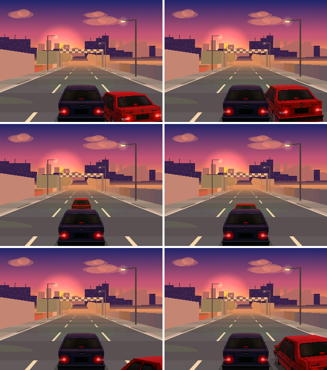
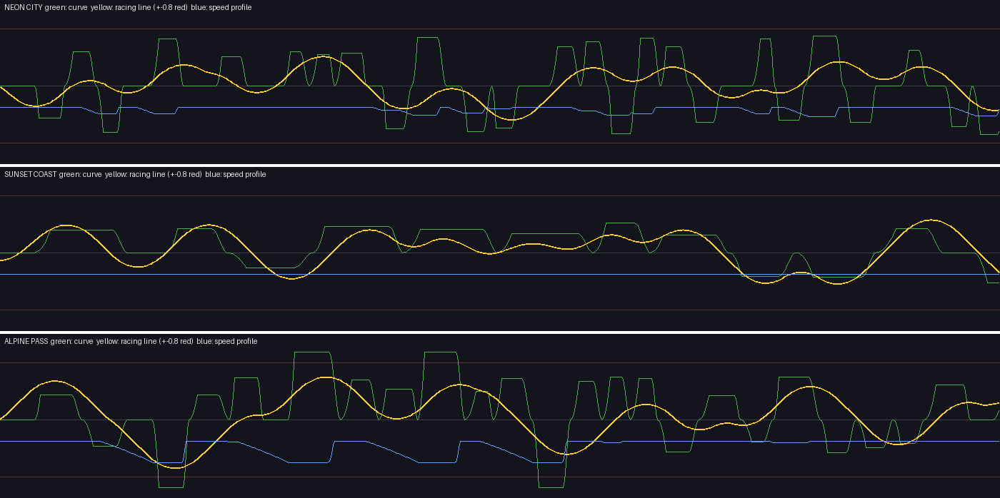
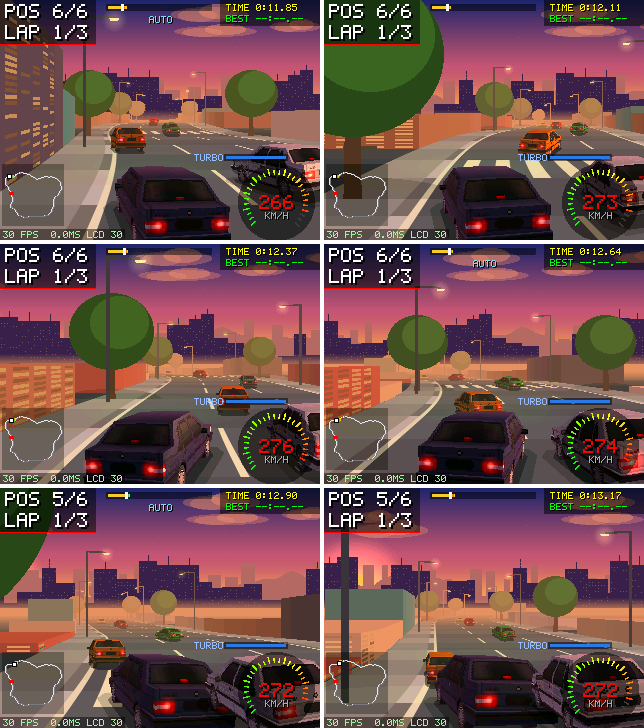

# 11. Rivals, race logic and car physics

This page documents the **ai** area of the feature phase (branch `feat/ai`):
the rival driving AI, the race logic, the player car's physics (bumps, walls,
turbo, slipstream, autopilot) and how the rivals are drawn. It says what was
built, how it works, how it was verified and how to tune it.

Files: `rivals.h/.cpp`, `race.h/.cpp`, `physics.h/.cpp`, `render_cars.h/.cpp`,
`render_traffic.h/.cpp`, `render_player.h/.cpp`. All interfaces of
[page 10](10-game-architecture.md) §10.4 are unchanged; everything new is an
addition (listed in §11.10).



*Left: the Core renderer. Right: this branch. Top: a rival exactly beside the
player was 13 px lower. Middle: touching nose to tail showed a ~20 px gap.
Bottom: a rival alongside but 300 units behind was invisible.*

## 11.1 What was wrong before

The owner never shipped his first rivals (`origin/other_cars`) because they
"looked and behaved weird": they reused the player's centrifugal drift (so all
of them converged on one line and overlapped), never avoided the player and
were drawn with the old renderer. The Core phase replaced them with basic
rivals; measuring those showed more problems, all fixed here:

| Problem | Cause | Fix |
| --- | --- | --- |
| A brake tap at speed cost ~5 s of sagging speed (player and rivals) | braking set the throttle state to 0 and it re-ramps at `ACCEL_RAMP` 420 u/s³ | braking keeps the throttle state (`BRAKE_ACCEL_KEEP`) |
| After a turbo burst the car sagged to ~235 km/h | above the cruise point the throttle decayed towards 0 | it decays only to the throttle that holds the cruise speed (`physics_cruiseAccel`) |
| Bumps compared positions one frame apart (~400 units at full speed) | player-rival contacts were resolved before the rivals moved | `physics_resolveContacts()` runs after everybody moved |
| Cars "bumped at a distance" / invisible alongside | rivals near the player used the road camera, the player's car a flatter one | rivals near the player use the player's car camera (§11.7) |
| The race was decided at the start, then a procession | rival reaction 0.1-0.45 s while the player's throttle is automatic, rocket start worth 20 car lengths | small reactions, a rocket start worth ~3 car lengths, slipstream |

Scale that matters for every number below: at top speed a car covers
**~58 segments per second**, so **1 s = ~10 car lengths**, and a lateral move
across a 20-segment corner would need 5 half-widths per second.

## 11.2 Module map and frame order

```
game.cpp (unchanged order, §10.3):
  handleInput(dt, in)        physics.cpp  manual input, or ai_drivePlayer() when autopilot
  updatePhysics(dt)          physics.cpp  engine, gravity, drift, materials, slipstream cap
  checkCollisions(dt)        physics.cpp  rails / tunnel walls / building faces, scenery, water
  rivals_update(dt)          rivals.cpp   race_syncPlayer(); think() for every rival on the same
                                          snapshot; moveRival() for every rival;
                                          physics_resolveContacts(dt)  <- all car-car bumps
  race_update(dt)            race.cpp     race_syncPlayer(); progress, laps, finish, places
render:
  drawRoad -> cars_prepare(position)      render_cars.cpp  views, culling, LOD, slice of each car
           -> cars_drawSlice(n, ...)      draws the rivals assigned to slice n
  drawPlayerCar(t)                        render_player.cpp (turbo flame, bump jolt)
  cars_drawNear()                         rivals behind the player's car centre
```

The player's autopilot (demo, finish cool-down, `--auto`) calls the same
`think()` as the rivals and only converts its output into the player's inputs.

## 11.3 Racing line and speed profile (per circuit, `rivals_init`)



*First 700 segments of each circuit. Green: `Segment::curve`. Yellow: the
racing line (red lines at ±0.8). Blue: the speed profile (higher = faster;
the mountain shows the braking ramps before the hairpins).*

Built once per race into two `float[MAX_SEGS]` tables (19.2 KB, **PSRAM**,
allocated once, placement logged):

1. **Ideal line** = band-pass of the curvature:
   `clamp(LINE_GAIN * (G12 ⊛ c - 0.85 * G36 ⊛ c), ±0.70)` smoothed with G10
   (Gaussians of 12 / 36 / 10 segments). Inside at the apex, outside before
   and after; long corners stay on the inside; S-bends cross over.
2. **Feasible line**: a reference car drives three laps of the ideal line at
   90 % of `maxSpeed` with feed-forward + feedback and lateral limits of
   1.15 half-widths/s and 3.4 half-widths/s² (a bit below the rivals' own);
   its third lap is stored. Without this step the city line needed 2.9
   half-widths/s of sideways speed: the cars would have snaked.
3. **Speed profile**: `cornerFraction(max |curve| under the car)` is the speed
   at which **the player's own car** can still hold the corner — the outward
   drift of `updatePhysics` (velocity and direct terms) equals 92 % of the
   steering authority (`CORNER_MARGIN`). Then braking zones are propagated
   backwards at 55 % of `BRAKE_DECEL` (`PROFILE_BRAKE`). Values: flat out up
   to |curve| ≈ 6, 0.89 at 7, 0.74 at the 9.5 hairpins.

`ai_lineTarget(z, bias)` and `ai_cornerSpeed(z)` (the frozen helpers) now read
these tables; without them (no memory) they fall back to the curvature ahead.

## 11.4 The driver (`think()`, every frame, every rival and the autopilot)

**Personality** (`PERSONA[]`, index = racer) scaled by the difficulty:

| Racer | Style | pace | corner | aggression | consistency | side | line use |
| --- | --- | --- | --- | --- | --- | --- | --- |
| VIPER | AGGRESSIVE | +0.025 | 1.00 | 0.90 | 0.85 | +0.12 | 1.00 |
| NOVA | SMOOTH | +0.015 | 1.03 | 0.35 | 0.95 | −0.22 | 0.90 |
| BLITZ | WILD | +0.005 | 0.98 | 1.00 | 0.55 | +0.28 | 1.10 |
| RAVEN | DEFENSIVE | −0.005 | 1.01 | 0.50 | 0.90 | −0.08 | 0.80 |
| FURY | ERRATIC | −0.015 | 0.97 | 0.75 | 0.65 | −0.30 | 1.00 |
| autopilot | BALANCED | (player's car) | 1.00 | 0.55 | 1.00 | 0 | 1.00 |

| Difficulty | base pace | corner | aggression × | mistakes / check | reaction (s) | rocket start | rubber band ahead / behind |
| --- | --- | --- | --- | --- | --- | --- | --- |
| EASY | 0.955 | −0.03 | 0.60 | 0.55 | 0.10-0.35 | 10 % | −3.5 % / +0.5 % |
| NORMAL | 1.000 | 0 | 0.85 | 0.15 | 0.02-0.16 | 30 % | −2.0 % / +1.2 % |
| HARD | 1.030 | +0.01 | 1.00 | 0.03 | 0.00-0.10 | 55 % | −1.0 % / +2.0 % |

Pace is the top speed relative to the player's car (1.0 = identical car).
Consistency drives a slow form variation (±1.2 % × (1 − consistency)), a
lateral wander and the mistake rate; the side and line use spread the cars
over the road so they never sit on one line.

**Every frame** (all rivals decide on the same snapshot, then all move):

1. *Speed wanted*: `min(top speed, corner profile × corner skill)`; ×0.93
   during a "lift" mistake. Top speed = pace × form × rubber band × slipstream
   (× 0.70 after finishing).
2. *Preferred line*: racing line × line use + personal bias (+ an offset to
   the outside while "running wide"); the first ~4 s after GO the car holds its
   grid column and merges in.
3. *Look around* (every other car, player included):
   * **alongside** (longitudinal overlap) or **diagonally just ahead**: a
     **hard** lateral bound at `SEP_MIN` 0.30 from it, moved by its lateral
     speed × 0.3 s — never move into it;
   * **diagonally just behind**: a **soft** bound — do not cut in front of it,
     but it never pushes me aside nor slows me down (it is its job to avoid me);
   * the nearest car **in my lane** ahead (|dx| < 0.28, really in front) →
     gap control; the nearest car **in my path** → overtaking candidate.
4. *Overtake*: only if this car really is quicker (closing now, or its cruise
   speed beats the other car's speed). Side = the one with room (road limit
   ±0.8 and no car within 0.33 from my rear to beyond the passed car), else
   the inside of what comes (the racing-line side), then the nearer one,
   then the personal side. The car commits to a passing line 0.38 beside the
   passed car; it aborts when that lane closes, when the other pulls away, or
   after 3.5 s side by side without gaining (cool-down 0.5-1.6 s by aggression).
5. *Gap*: bumper gap wanted `180 + speed × (0.16 … 0.07 s by aggression)`,
   speed = car ahead ± 2.2/s × gap error; backing off is limited to −700 u/s
   (a lift) unless the gap is unsafe (< 270 units).
6. *Lateral control*: target clamped to the bounds; wanted lateral speed =
   line slope × speed (feed-forward) + 3/s × error, limited to 1.30
   half-widths/s (1.65 when passing / making room), never faster towards a
   bound than what can still stop before it, and the change of lateral speed
   limited to 4 half-widths/s². Below 30 % speed the limit scales down (no
   sideways slide at a standstill).
7. *Turbo*: bursts on straights (profile ≥ 0.99 now and 25 segments ahead,
   meter > 55 %, not stuck behind a car), more willingly when passing; chance
   per second `0.08 + 0.45 × aggression`; never into a braking zone.
8. *Pedals*: brake when more than `AI_CORNER_TOL` (330 u/s) over the corner
   speed — exactly how the player must drive, since the throttle is automatic
   — or 220 u/s over the gap speed; ease off (foot up) above the gap speed.

**Motion of a rival** (`moveRival`): exactly the player's engine (ramp below
the cruise point, ease to the cruise throttle above it, friction, gravity on
slopes, turbo ×1.6 ramp and +12 % top) with its own top speed. Lifting holds
the engine state (the driver's foot, not the engine); braking is proportional
(2500-9000 u/s²); brake lights on braking or any deceleration > 2600 u/s²,
held 0.25 s. The visual yaw is `atan2(lateral speed × ROAD_W, speed)`, eased.

**Start**: on the grid the rivals hold the brake (brake lights on). After GO
each one waits its reaction time, some get a rocket start (§11.6).

**Mistakes** (EASY 1-4 per rival per race, NORMAL 0-2, HARD ~0): every 6-14 s
a check; a corner ahead → runs wide by 0.18-0.32 for 1-1.8 s, otherwise lifts
for 0.6-1.2 s.

**Rubber band**: beyond 2500 units from the player, the pace changes linearly
up to the table values at 17 500 units. Off once the player finishes.

**Cool-down**: finished rivals drive at 70 % pace on their side of the road;
the autopilot (after the player's finish) at most 62 % of `maxSpeed`.

## 11.5 Car-to-car contacts and solid limits (`physics.cpp`)

`physics_resolveContacts(dt)` runs at the end of `rivals_update`, when every
car is at the same time step, for all 15 pairs (player included), two passes.
Footprint: `CAR_HALF_W` 0.12 × `CAR_LEN` 1100 (from the renderer). The axis of
the smaller overlap **in world units** decides the kind of contact:

* **Nose to tail**: impulse `J = closing × (1 + 0.30) / 2`; the rear car loses
  `J` (and 1 %), the front car gains `0.5 J` ("a small push"); positions are
  separated 60/40. A closing speed above `BUMP_CRASH` (0.5 × `maxSpeed`)
  crashes the player (spin + reset).
* **Side by side**: pushed apart, both get a lateral bounce of 0.35
  half-widths/s (rivals visibly correct it; the autopilot does not cancel it)
  and lose 0.4 % per 60 Hz frame of rubbing.
* Afterwards everybody is clamped to the solid limits again. Rivals scrape
  along rails, tunnel walls and building faces like the player (never crash),
  and a shoved rival stops at `RIVAL_EDGE_X` 1.08 (rumble strip): rivals do
  not look at the roadside scenery.

The player alone: `checkCollisions` keeps the walls of §10.5 (a limit that
appears > 0.15 inside the car at > 30 % speed is a frontal hit → crash), solid
sprites via `spriteHitWidth()`, and water: fully in the sea (`MAT_WATER`
beyond `SEAWALL_X`, `MAT_SAND` beyond `BEACH_WATER_X`) resets like a crash.
During a crash the car now slides on with its decaying speed instead of
stopping dead, so the cars behind are not faced with a wall.

## 11.6 Engine, turbo, slipstream, autopilot (`physics.cpp`)

* **Engine**: unchanged model (ramp, `ACCEL_NEAR_MAX` cruise, friction,
  gravity on speed) with two fixes: `BRAKE_ACCEL_KEEP` 0.985 per 60 Hz frame
  while braking, and above the cruise point the throttle eases only down to
  `physics_cruiseAccel(maxSpeed)`.
* **Turbo**: meter `turboMeter` (3 s full, 20 s refill), +12 % top speed,
  ×1.6 ramp. Flame: `renderCarFlame()` (exhaust jets + their light on the
  rear bumper, which stays on screen for the player's car).
* **Rocket start**: a *new* TURBO press within `ROCKET_WINDOW` 0.30 s after GO
  gives `ROCKET_TIME` 0.45 s of free boost (`rocketTime`, `rocketStarted` for
  a HUD banner). Holding TURBO through the countdown does not count (the first
  race frame only records the input). Measured at 10.9 s after GO: no turbo
  z = 46 956, rocket start 50 159 (+3 car lengths), turbo held through GO
  49 222, pressed 0.5 s late 48 243.
* **Slipstream** (new, player and rivals): within 2.5 car lengths behind a car
  in the same lane (|dx| < 0.30) at > 50 % speed, top speed +3.5 % fading with
  the gap (`physics_draftOf`, smoothed; `draft` for the HUD). It is what lets
  a slightly quicker car get past instead of sitting behind forever.
* **Autopilot**: `ai_drivePlayer()` returns the rival controller's lateral
  speed, brake and turbo; `handleInput` steers for that lateral speed within a
  human's steering authority, compensating the curve drift that
  `updatePhysics` is about to add (but not a contact bounce). It brakes like a
  human (binary brake) and uses the turbo like the rivals.

## 11.7 Drawing the rivals (`render_cars.cpp`, `render_traffic.cpp`, `render_player.cpp`)



**Two cameras.** The road camera is high (it sees the player's car from ~50°).
The player's car is drawn from a flatter **car camera**: pitch 0.30, eye
11 model units (≈ 1860 world units) behind, anchor at `PLAYER_ANCHOR_Y`. A
rival is computed in both:

* car camera: eye 1777 units behind and 550 above the player's car; the rival's
  offset (`dX`, `dY`, `dz` from the player's car, road curve included)
  projected with the same focal length the player's car uses (27 px per model
  unit × 11);
* road camera: the true road projection (as the road, scenery and buildings).

`w = 1` up to 1.1 car lengths ahead, smoothstep to `w = 0` at 4.5 car lengths;
anchor, size, eye distance, pitch and yaw are blended. So a rival beside the
player is exactly its twin, nose-to-tail bumpers touch on screen when the
footprints touch, a car half a length behind is still visible, and far away
everything is the true projection on the road.

* **Pitch**: depression angle of the view + the road slope between the two
  axles (car camera: like the player, 0.6 × slope relative to the player's).
* **Yaw**: road heading at the rival − the view angle + the rival's own yaw
  from its lateral motion.
* **Order**: each rival goes into the road slice whose near boundary is at or
  below its lowest drawn row (the rear of its shadow), so nearer road never
  paints over it; sorted far → near, a nearer car never lands in a farther
  slice. Rivals behind the player's car centre are drawn after the player's car.
* **Culling before any vertex is transformed**: beyond the draw distance, more
  than 1.3 car lengths behind the player, absurd sizes, off screen, or its
  roof below the slice's clip row (behind a crest).
* **LOD** with ±12 % hysteresis per racer: full mesh above 40 px wide,
  `CAR_LOD_MID` (no specular / sky reflection, one shadow ring) down to 10 px,
  then a few shaded quads with tail lights. At the draw distance the fog is
  98 %, so cars fade in instead of popping.
* **Lights**: tail lights at night and in tunnels, brake lights, turbo flame;
  tunnel lighting and black fog inside tunnels.

**Renderer cost on the ESP32 side** (`render_player.cpp`):

* the texture is stored as **8-bit indices + a 234-entry palette** (exact:
  after the paint flag the texture has 234 distinct values) → 16 KB of internal
  RAM instead of 32 KB, identical pixels;
* triangles are sorted with a **256-bucket counting sort** instead of an
  insertion sort (O(n²) per car, six cars a frame);
* the mesh arrays (11.7 KB) are copied to internal RAM only when more than
  96 KB of internal heap would remain (logged; otherwise read from flash);
* triangles wider than two screens (near-plane cases) are dropped.

## 11.8 Verification

All with the headless harness (frames = seconds × 30). Helper scripts live in
the session scratchpad (`scratchpad/ai/`): `analyze.py` (parses `--dump 1`),
`matrix.sh` (all circuits × difficulties), `scene.cpp` (a test driver that
places cars exactly and renders one frame; `scene phys` runs contact unit
tests), `perf.sh` / `perf2.sh`.

**Traces** (`--race C --auto --dump 1`, 4700 frames, NORMAL):

| Check | City | Coast | Mountain |
| --- | --- | --- | --- |
| frames with overlapping footprints after resolution | 0 | 0 | 0 |
| contact events (touching) | 0 | 1 (4 frames) | 0 |
| largest lateral step per frame, any car | 0.06 | 0.06 | 0.06 |
| frames with 3 lateral reversals (jitter) | 0 | 1 | 2 |
| place changes | 11 | 12 | 11 |
| lap counter steps other than +1 / finish times out of order | 0 / no | 0 / no | 0 / no |

**Balance** (the autopilot standing in for a decent driver, `--auto --diff D`):

| | City | Coast | Mountain | Target |
| --- | --- | --- | --- | --- |
| EASY | P1 (+2.6 s) | P1 (+2.3 s) | P1 (+2.7 s) | P1-P2 |
| NORMAL | P4 (1.2 s behind) | P2 (0.8 s) | P2 (0.04 s) | P2-P4 |
| HARD | P5 | P5 | P6 | P4-P6 |

Grand Prix `--gp --auto` (NORMAL): VIPER 25, NOVA 22, YOU 17, BLITZ 11,
RAVEN 5, FURY 4 (sum 84).

**Contact unit tests** (`scene phys`): rear-end at 0.2 × max closing → the rear
car loses 1777 u/s, the front gains 845, separated; at 0.7 × max → crash; side
contact → separated to 0.25 with 0.8 % speed loss; a rival shoved to 1.45 in
the city is held at 1.08.

**Frames looked at**: rival beside the player (both sides), nose to tail,
half a car behind, the grid at the countdown, the start, an overtake, hill
crests, a tunnel from outside (portal occlusion) and inside, night, turbo
flames, brake lights, LOD full vs mid (identical at a glance), the demo.

**Host loop** (WSL, process CPU time on identical static scenes, best of 7):

| Scene | Before (Core) | After |
| --- | --- | --- |
| road + player only | 0.53 ms | 0.61 ms (noise ±0.1) |
| 5 rivals 1.6k-11k ahead | 0.83 ms | 0.98 ms |
| 5 rivals 0.3k-4k ahead | 1.37 ms | 1.95 ms |
| the grid (5 rivals 0.8k-4k, staggered) | 1.12 ms | 1.06 ms |

Near rivals cost more because they are now drawn at the player's size
(1.7-2.3× the pixels); the grid is cheaper thanks to culling, the bucket sort
and the mid LOD. Whole-run wall-clock averages: grid countdown 2.00 → 0.87 ms,
30 s of racing 0.95 → 1.33 ms (city), 0.77 → 0.96 (coast), 0.91 → 1.28
(mountain) — the races differ, rivals now stay close to the player.

## 11.9 Tuning guide

| To change | Knob |
| --- | --- |
| how hard the race is | `BASE_PACE[]` (rivals.cpp); 1 % pace ≈ 1 s over a race ≈ 10 car lengths |
| who wins | `PERSONA[].pace` |
| rival corner speeds | `PERSONA[].corner`, `CORNER_ADJ[]`, `CORNER_MARGIN` |
| how visible the racing line is | `LINE_GAIN`, `LINE_MAX`; smoothness `LINE_REF_VMAX/AMAX` |
| spacing / spreading on the road | `PERSONA[].side`, `.amp`, the wander in `updateDriver` |
| following distance | `HEADWAY_CALM/AGGR`, `GAP_MIN` |
| overtaking eagerness | `PASS_SEP`, stalemate time (3.5 s), `passCool` |
| side-by-side safety | `SEP_MIN`, `SEP_LOOKAHEAD`, `LAT_VMAX(_PASS)`, `LAT_AMAX` |
| catch-up | `RB_AHEAD/BEHIND[]`, `RB_DEAD`, `RB_RANGE` |
| mistakes | `MISTAKE_P[]`, the 6-14 s check interval |
| starts | `REACT_MIN/MAX[]`, `LAUNCH_P[]`, `ROCKET_TIME`, `ROCKET_ACCEL` |
| bumps | `BUMP_REST`, `BUMP_PUSH`, `BUMP_CRASH`, `SIDE_KICK`, `SIDE_RUB_KEEP` |
| slipstream | `DRAFT_BOOST`, `DRAFT_RANGE`, `DRAFT_WIDTH` |
| near-car look | `CC_NEAR`, `CC_FAR` (render_cars.cpp) |
| LOD | `CAR_MIDLOD_W`, `CAR_SPRITE_W`, `LOD_HYST` |

Debugging: build the headless harness with `-DAI_DEBUG` and run with
`AI_DEBUG=<racer>` to print that driver's decisions every frame (speeds, mode,
followed / blocking car, target, bounds, throttle, turbo, slipstream, mistakes).

When the circuits change (themes), re-run the balance matrix: the corner
profile adapts by itself, the pace table may need a nudge.

## 11.10 Interface additions (all additive)

* `race.h`: `race_syncPlayer()`, `race_lapTime(i)`.
* `rivals.h`: `AiCmd`, `AI_CORNER_TOL`, `ai_drivePlayer()`, `ai_latVel()`,
  `ai_kickLatVel()`, `ai_turboMeter(i)`, `ai_style(i)`.
* `physics.h`: `BRAKE_ACCEL_KEEP`, `ROCKET_*`, `BUMP_*`, `SIDE_KICK`,
  `SIDE_RUB_KEEP`, `RIVAL_EDGE_X`, `DRAFT_*`; `rocketTime`, `rocketStarted`,
  `bumpShake`, `draft`; `physics_resolveContacts()`, `physics_maxX()`,
  `physics_draftOf()`, `physics_cruiseAccel()`. `checkCollisions()` no longer
  handles car-car contacts (they are resolved in `rivals_update`, later in the
  same frame).
* `render_traffic.h`: `CarView`, `drawCarView()`, `CAR_VIEW_*`,
  `CAR_SPRITE_W`, `CAR_MIDLOD_W` (`drawTrafficCar()` is a wrapper).
* `render_player.h`: `PLAYER_ANCHOR_Y`, `PLAYER_STEER_PX`, `CarLod`,
  `renderCarLod()`, `renderCarFlame()`, `playerViewSlope()`. `CarRender` and
  `renderCar()` are unchanged (ui.cpp fills `CarRender` field by field).

## 11.11 Known limitations

* Nothing has run on the hardware. Near rivals are drawn at full size now;
  check the HUD's FPS / MS with five rivals close to the player.
* Rivals do not defend (no blocking) and do not react to a faster car behind.
* Rival-rival contact uses the same bump model but rivals seldom touch, so it
  is little exercised in the traces.
* A scenery sprite on the near boundary of the slice a rival is drawn in is
  painted before the rival (render_road calls `cars_drawSlice` after the
  slice's sprites); see the integrator notes.
* The balance was measured on the provisional circuits; the themes' circuits
  will need a re-run of the matrix.
