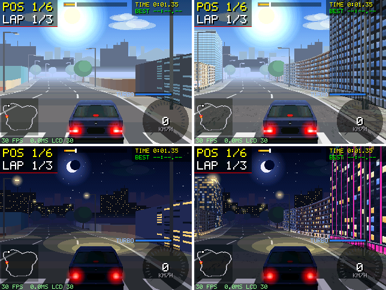
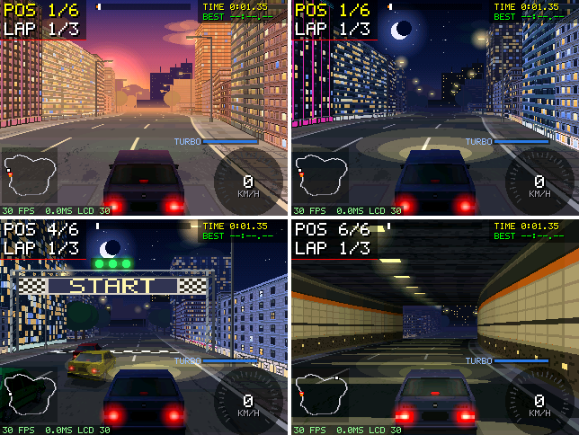
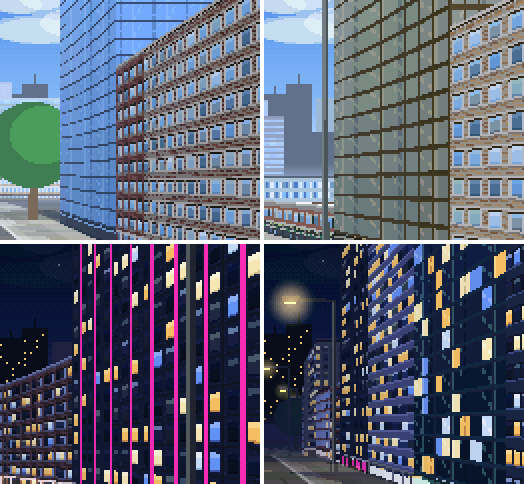
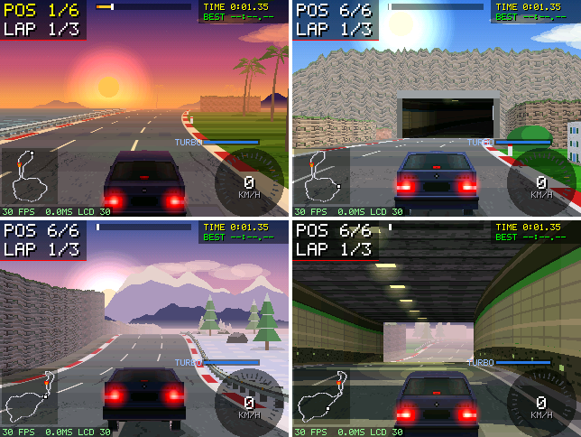

# 12. City graphics — procedural textures, buildings and road surfaces

The owner asked to *"improve the graphics of the city, make it look as good as
possible, invent textures"*. This page documents what the **city** feature
phase built on branch `feat/city`: textures synthesised at boot from code
(no image files), textured buildings of every `BuildingType`, textured road
surfaces for every `GroundMat`, markings, the start gantry, rails, lamps,
tunnels and portals — how each part works, what it costs and how to tune it.

Files: `textures.h/.cpp` (new), `render_building.h/.cpp`, `render_road.cpp`,
`gfx.h/.cpp` (additive). Every exported interface of
[the contract](10-game-architecture.md) is unchanged; only additions.



*Left: Core phase. Right: this phase. Same position, same time of day.*

## 12.1 What changed at a glance

| Area | Before (Core) | Now |
| --- | --- | --- |
| Building scale | a floor was ~1/17 of a lamp post: lamps and trees taller than 9-floor blocks, a toy town | heights drawn at `BLD_V_SCALE` = 3: a downtown canyon, towers leave the top of the screen |
| Facades | flat colour + window quads (moiré at grazing angles) | 10 procedural facade textures × 4 colour variants, mip-mapped, perspective-correct |
| Night | about half of the windows lit, all the same colour | windows light up one by one at dusk, warm / white / cool / TV colours, 20–60 % lit per building, neon strips, crowns, lit lobbies and shop windows, sign halos, ground floors uplit by street lights |
| Roofs | one flat quad | flat roofs with a parapet and rooftop boxes; terracotta tile courses, ridge and gable on villas; scrub on cliffs, coping on walls |
| Road | flat bands | textured asphalt (aggregate, patches, sealed seams, cracks, oil), kerb + slab pavement, grass, sand, rock, snow, dirt, animated water |
| Coast | sea fogged to grey | the sea reflects the sky, keeps its colour to the horizon, waves wash the beach, foam lines, sun glitter column |
| Markings | thin start band | 2-segment chequered line, stop lines before zebras, 9-bar zebras |
| Gantry | two posts + chequer | lattice towers, truss, START / FINISH banner texture, start lights mirroring the countdown |
| Tunnels | striped quads, one portal style | tiled lining per theme, concrete ceiling, LED markers; concrete underpass portal in the city, rock portals with a jagged skyline on the coast and in the mountains |



## 12.2 Procedural textures (`textures.h/.cpp`)

### Semantic slots

Every texel is an 8-bit index into **16 semantic slots** (`TexSlot`), not a
colour: `TS_DARK, TS_SHADE, TS_BASE, TS_LIGHT` (material shades), `TS_ALT,
TS_ALT2` (mortar, spandrel, patch...), `TS_TRIM, TS_TRIMD` (sills, cornices,
coping), `TS_ACC, TS_ACC2` (awnings, shutters, signs, vegetation),
`TS_FRAME` (window frames, mullions), `TS_WINA/B/C` (window panes) and
`TS_EMITA/B` (emissive: light strips, shop interiors, letters). The renderer
turns slots into a 16-entry RGB565 palette per face / slice / row with the sun
shading, the time of day, the night lights and the fog baked in, so the
per-pixel work is one texel load + one palette load + one store.

Because slots carry meaning, one texture serves many looks:

* **colour variants** (`TexColors`, 4 per texture: concrete / cream / warm
  grey / white offices, red / brown / tan / dark brick, ...) are just
  different albedo tables;
* **window cells** are re-coloured per window and floor (day reflections or
  lights at night) by swapping 3 palette entries;
* **asphalt details** (patches, seams, cracks, oil) are shown or hidden per
  4-segment period by giving their slots the base colour.

### The textures

| Id | Size (level 0) | Design |
| --- | --- | --- |
| `WT_OFFICE` | 16 × 48 | concrete grid: slab bands, piers, recessed windows with soffit and reveal shadows, mullion, sill; parapet with coping; granite lobby |
| `WT_RIBBON` | 16 × 48 | office with continuous ribbon windows, mullions every 4 texels, spandrel panels |
| `WT_GLASS` | 32 × 48 | curtain wall: mullions, floor lines, spandrels, vertical reflection bands + glint streaks; metal crown |
| `WT_BRICK` | 16 × 48 | running bond (mortar courses, head joints, per-brick shade), two windows per bay with stone lintels and sills, dentil cornice, soldier course, plinth |
| `WT_STONE` | 16 × 48 | ashlar blocks, string course, tall windows with hoods and transoms, grand cornice with dentils and frieze, rusticated base with an arched opening |
| `WT_MODERN` | 16 × 48 | dark panels, narrow windows, a vertical light strip per bay, double crown light band, double-height lobby |
| `WT_SHOPS` | 32 × 48 | two shopfronts per period: fascia, sign board with letters, striped awning with a scalloped edge, lit display window, door; flats above with shutters or balconies |
| `WT_VILLA` | 16 × 48 | stucco, small windows with surrounds and slatted shutters, eave shadow, stone plinth, potted plants |
| `WT_CLIFF` | 32 × 48 | strata 8 texels thick split into blocks by fissures, lit ledges, shadowed undersides, tufts; scrub on the top edge |
| `WT_WALL` | 32 × 48 | retaining wall: two cast panels with different tones, deep joints, form-tie holes, rust / water stains, coping with a drip shadow, dirty footing with weep holes and moss |
| `WT_TUNNEL` | 16 × 64 | cable tray, coloured stripe, 8 × 6 tiles with grout, second stripe, skirting with LED markers, walkway kerb |
| `WT_ROOF` | stub | terracotta colour variants for villa roofs (drawn as tile courses) |
| `RT_ASPHALT` | 64 × 32 | aggregate (noise + speckle), repair patch with edges, sealed seam, wandering crack, oil drip |
| `RT_PAVEMENT` | 32 × 16 | gutter, granite kerb with joints, 4 slabs across with joints, stains (u = 0 at the road edge, 32 at the building line) |
| `RT_GRASS`, `RT_SAND`, `RT_ROCK`, `RT_SNOW`, `RT_DIRT` | 16 × 16 | blades + flowers, wind ripples + shells, gravel, soft shading + sparkle, pebbles |
| `RT_WATER` | 32 × 32 | crests roughly parallel to the shore, troughs, glints (animated) |
| banners | 128 × 16 × 2 | `START` and `FINISH` from the 5×7 font at 2×, chequered ends, frame |

Wall textures are **column-major** (a screen column walks a texture column)
and stacked from the top in three modules: **cap** (top of the wall:
parapet, cornice, coping), **body** (repeats: one floor; for rock and walls a
32 / 16-texel period) and **base** (ground floor / footing). Ground textures
are **row-major** (a screen row walks a texture row). Widths and module
heights are powers of two.

### Generation and mip levels

Each texture is an *analytic design*: `evalWall()` / `evalRow()` return the
slot at level-0 coordinates `(u, v)`. Every mip level (4 levels) is generated
by point-sampling the same design at its own texel centres, with noise
octaves finer than the texel footprint dropped. Thin details (mortar, grout,
frames) drop out on coarse levels and windows survive as **window dots** —
the far LOD the brief asks for, without blurring a semantic index. Every wall
level also gets an **averaged column**: per row the majority slot, window
slots winning at ≥ 35 % of the row. Noise is tileable value noise from
`hash32` (deterministic, no `random()`). About 23 K texels, generated once.

### Memory

```
tex: 12 wall + 8 ground textures with 4 mips (23143 B) in internal SRAM, banners (4096 B) in PSRAM
```

One block, **internal SRAM first** (read per pixel by the hottest loops),
PSRAM fallback, placement logged. The banners (drawn a few seconds per lap)
go to PSRAM. If no memory can be found at all, every texture falls back to a
1-texel stub and the renderers draw flat colours.

`textures_init()` is idempotent; `drawRoad()` calls it lazily on its first
frame. Integrator: call it in `game_setup()` right after `track_init()` so
the block is allocated while the heap is unfragmented and the line appears
in the boot log (see 12.8).

### Palettes, lighting, windows

* `tex_beginFrame()` (once per frame, from `drawRoad`) caches the per-face
  light (`ambient + light × k`, k = 0.85 lit / 0.30 shade / 0.55 front / 0.70
  roof, as `colors.cpp`), a tunnel-lamp light (`TF_TUNNEL`, independent of
  the time of day) and the **day window looks** built from the *current* sky
  (`windowDay`, `skyMid`, `skyHorizon`, `skyTop`): reflections, blinds,
  curtains, dark interiors — they darken with the sky, so an unlit window at
  night reflects the night sky.
* Curtain walls use a graded set instead: street reflection on low floors →
  sky on high floors.
* **Lights**: warm (4/8), white (2/8), cool (1/8), TV blue (1/8), not shaded,
  only fogged. `tex_pickWindow()` hashes (seed, window cell, floor): a window
  is lit when it is one of the building's `litPct` % *and* the night has
  passed its own threshold (12..75 %), so lights come on one by one during
  the city's dusk → night race.
* Emissive slots blend from their day colour to their glow with the night.
* `tex_buildUplitPalette()` adds the street-lamp colour to the ground floor
  at night (warm uplight).

## 12.3 Buildings (`render_building.cpp`)

### Scale

`BLD_V_SCALE` (render_building.h, default **3**) multiplies building heights
on screen. In the shared units a floor (`BUILDING_FLOOR_H`) was about 1/17 of
a street lamp (lamps 3600 vertical world units = 1.35 road half-widths on
screen, a floor 11000 px·scale = 0.034 road half-widths), so 9-floor blocks
were shorter than trees and the camera looked down from the 11th floor. At 3×
a floor is a third of a lamp, the eye is at ~3.6 floors (roofs show on shops
and villas, not on towers), floors are 10–12 px tall where walls first enter
the view, and the streets read as a city. Physics never reads heights; the
circuit generator still places floors and units as before.
`BLD_DEPTH_SCALE` (1.6 × `BUILDING_W`) widens front facades and roofs;
`BLD_RIDGE_FLOORS` sets the villa ridge height.

### Style → look

`Segment::style = type | variant << 4`. Variant bits pick the colour variant
(bits 0–1), the office window type (bit 2: ribbon) and the lit share:

| Type | Texture | Colour variants | Lit at night | Extras |
| --- | --- | --- | --- | --- |
| `BLD_OFFICE` | `WT_OFFICE` / `WT_RIBBON` | concrete, cream, warm grey, white | 26–46 % | lobby lit at night |
| `BLD_GLASS` | `WT_GLASS` | blue, teal, bronze, silver-green | 22–43 % | sky reflection graded by height |
| `BLD_BRICK` | `WT_BRICK` | red, brown, tan, dark red | 32–50 % | |
| `BLD_STONE` | `WT_STONE` | sandstone, limestone, granite, pink | 28–46 % | arched entrances lit |
| `BLD_MODERN` | `WT_MODERN` | slate / cyan, black / magenta, navy / white, graphite / amber | 20–38 % | light strips + crown glow, crown halo |
| `BLD_SHOPS` | `WT_SHOPS` | cream / red, brick / green, blue / blue, pink / orange awnings | 38–56 % | lit shop windows, neon letters, sign halo |
| `BLD_VILLA` | `WT_VILLA` | white, cream, yellow, pink + green / blue / teal / brown shutters | 40 % | pitched terracotta roof, gable |
| `BLD_CLIFF` | `WT_CLIFF` | ochre / red / brown on the coast, grey / brown in the mountains | — | jagged top, scrub |
| `BLD_WALL` | `WT_WALL` | grey, beige, dark, light | — | coping top |

### The column walker (`drawWallColumns`, exported for the tunnel walls)

A side wall slice is a vertical quad: per screen column the depth is constant,
so **v is linear down the column** and **u is perspective-correct across**
(`u/z` and `1/z` interpolated). Per column:

1. `u` and texels-per-pixel are evaluated **exactly every 8 columns** and
   interpolated in between (like the car renderer's spans): no divisions in
   most columns; the ground / top lines step linearly.
2. Mip level from the vertical density (floor height in pixels); below
   ~1.3 px per floor a flat LOD colour (`farCol`, material + window share).
3. **Grazing angles**: when one pixel covers more than 3 texels across, the
   *averaged column* is used — floors read as window bands instead of
   crawling, shimmering windows.
4. Window cells: `u >> winShift`, coarsened so a cell covers at least ~2
   columns (stable lights at grazing angles); window colours computed only
   for the floors the column shows and kept while the cell stays the same.
5. Three spans: cap (`gfx_texColumn`), body (`gfx_texColumnWin`: the floor's
   window colours switch *inside* the HOT loop), base (uplit palette).

Front facades (first slice of a building) are constant-depth: the same walker
with affine u (outwards from the road). Roofs below the eye: flat roof +
parapet coping + one of three rooftop boxes (hash per slice), pitched villa
roofs as five tile courses with overlap shadows, a ridge and a gable, natural
tops (scrub on cliffs, coping on walls). Cliffs get a jagged top edge from 1-D
noise along u. Painter's order and the road pass's `clipRow` clip are kept.

**Palette cache**: per frame, unfogged palettes per *look* (texture, colour
variant, face) in an 8-entry 2-way cache; per slice, fogged copies per side
and face (consecutive slices of a building with the same fog reuse them).



## 12.4 Road pass (`render_road.cpp`)

### Textured rows

Region specs (`BandSpec`) now carry a **texture kind** per region (road,
pavement L/R, ground L/R, water L/R, side street L/R, glitter). Per scanline,
for every kind the segment uses: u from the lateral position (mirrored on the
left for the pavement, so the kerb is always at the road edge), v from the
track position (`segment * SEG_LEN + offset`), and a **mip level from the
larger of the horizontal and vertical texel density**; rows nearer than 32
segments are textured, the coarsest levels are near-uniform so the texture
fades into the classic flat light / dark bands with distance (no shimmer).
`gfx_rowRegionsTex` fills textured regions with pixel pairs (32-bit stores);
boundary pixels keep the 1-px anti-aliasing of the flat colours.

| Material | From the road edge outwards |
| --- | --- |
| `MAT_SIDEWALK` | gutter + granite kerb + slabs (`RT_PAVEMENT`) to the building line; beyond it textured side-street asphalt where there is no building, flat behind buildings (hidden anyway) |
| `MAT_SAND` | rumble, beach (`RT_SAND`), wet sand, a foam line that washes up and down along the beach, the sea (`RT_WATER`) |
| `MAT_WATER` | rumble, sea-wall top, wall edge, foam at its foot, the sea |
| `MAT_GRASS`, `MAT_ROCK`, `MAT_SNOW`, `MAT_DIRT` | rumble, then the material texture |

**Asphalt**: the band colour (`roadL/roadD`) is the base, so day / night /
theme tints and the alternating bands carry through. Per 4-segment period a
hash shows patches (2/8), sealed seams (2/8), cracks (3/8) and oil (2/8).

**Water**: waves roll in (u and v offsets animated from `millis()` — the
headless virtual clock keeps runs deterministic), the sea colour mixes in
26 % of `skyHorizon` (it reflects the sunset), sea regions get lighter fog
(`SEA_FOG` 0.62) so the sea keeps its colour far out, and beyond the draw
distance `drawFarGround()` colours the horizon band **per side** (the sea on
its side down to a darker horizon line, fog elsewhere). The **glitter
column** under the sun / moon splits the water region of a row (brighter
crests), widening towards the camera; it follows `drawSky`'s sun position
(see 12.8).

### Markings and roadside

* **Lanes**: dashed lane lines on light bands, edge lines (unchanged look).
* **Zebra crossings** (`SEGF_CROSSWALK`): 9 bars; a **stop line** across the
  road in the segment before the first crosswalk segment.
* **Start / finish** (`SEGF_START`): a chequered line over the start segment
  and the next one (4 rows of half a segment, 14 checks across).
* **Gantry**: two lattice towers, a truss with zig-zag bracing, the
  **START / FINISH banner** (texture; FINISH on the player's final lap,
  floodlit at night) and three **start lights** mirroring the countdown (red
  one by one in `GS_COUNTDOWN`, green for 2.5 s after GO, then off).
* **Guard rails** at `RAIL_X` 1.18: W-beam (lit top, groove, shadowed
  bottom), a post every segment, reflectors every other post (white left,
  amber right) that glow at night.
* **Street lamps**: base plinth, tapered pole with a lit edge, rising arm,
  housing with a lens that lights up, glow and light pool at night.

### Tunnels and portals

* Walls: `WT_TUNNEL` through `drawWallColumns`, 8 texels per segment, lit by
  the tunnel lamps (`TF_TUNNEL`), fading to black with distance. Variants:
  orange stripe (city), blue (coast), green (mountain).
* Ceiling: rough concrete (`RT_ROCK`) per row with a dark rib at the near
  edge of every segment; lamp strips and light pools every 4 segments.
* Portals by theme: the city underpass is a concrete face (`WT_WALL`) with a
  parapet and a railing; coast / mountain portals are a rock face
  (`WT_CLIFF` at half texel density, tile rows shifted sideways so the repeat
  does not show) with a jagged skyline, around a concrete portal ring.



## 12.5 gfx additions (`gfx.h/.cpp`, additive)

| Function | Use |
| --- | --- |
| `gfx_texColumn(x, y0, y1, col, v, dv, mask, pal)` | one textured vertical span, 16.16 v |
| `gfx_texColumnWin(..., perShift, pal, slot, win, nWin)` | the same over a periodic module, swapping 3 palette entries whenever v enters a new period (floor) |
| `gfx_texSpan(y, x0, x1, row, u, du, mask, pal)` | one textured horizontal span (pixel pairs as 32-bit stores) |
| `gfx_rowRegionsTex(y, bounds, cols, n, sel, tex)` | `gfx_rowRegions` with textured regions |
| `gfx_fontGlyph(c)` | the 5×7 glyph bits (banner texture) |

The four span functions are `HOT` (each contains a whole per-pixel loop);
their helpers (`texRun`) are `static inline`. Inner loops are integer only.

## 12.6 Performance and memory

**Host CPU time per frame** (WSL, `/usr/bin/time` user + sys over a 900-frame
race start with `--auto`, minimum of 5 interleaved runs; the 5 rivals are in
view, so the car renderer dominates both columns):

| Scene | Before (Core) | After | Ratio |
| --- | --- | --- | --- |
| City, night (`--race 0 --cycle 2.2`) — worst case | 0.967 ms | 1.400 ms | 1.45 |
| City, sunset (`--cycle 1.0`) | 1.122 ms | 1.156 ms | 1.03 |
| City, day (`--cycle 0`) | 1.111 ms | 1.344 ms | 1.21 |
| Coast (`--race 1 --cycle 1.0`) | 0.856 ms | 0.978 ms | 1.14 |
| Mountain (`--race 2 --cycle 3.6`) | 0.889 ms | 0.956 ms | 1.07 |

Wall-clock numbers from the harness ("avg host loop") swing by ±50 % on the
shared WSL machine, hence CPU time and minima. In the gprof profile of the
night city the wall code is ~28 % of a frame (column setup ~17 %, per-pixel
~11 %), the textured rows ~5 %, the car renderer ~38 %.

**ESP32-S3** (Arduino-ESP32 4.0.0, no warnings):

| Board | Flash | Static RAM (IDE) | vs Core |
| --- | --- | --- | --- |
| XIAO handheld (`esp32:esp32:XIAO_ESP32S3:PSRAM=opi`) | 487,613 B (14 %) | 61,200 B | +44.6 KB flash, +4.1 KB static |
| Dev board (`esp32:esp32:esp32s3:PSRAM=opi`, `-DBOARD=2`) | 516,777 B (39 %) | 61,648 B | |

Internal RAM added by this phase: **23,143 B** texture block (heap, internal
first), **+4.1 KB** `.bss` (palette caches 1.5 KB, road specs and texture
sources 2 KB, texture descriptors), **+1.5 KB** IRAM (the four span
functions). Banners: 4 KB PSRAM. The texture tables (colours, factors) are
`const` in flash. Nothing here ran on the hardware yet: measure the city at
night with the HUD's FPS / MS readout. If the frame time is too long, the
cheapest knobs are `TEX_MAX_Z` (textured road rows), `BLD_V_SCALE` (fewer
wall pixels) and the 8-column block size (`WALL_BLOCK`).

## 12.7 Tuning guide

| Knob | Where | Effect |
| --- | --- | --- |
| `BLD_V_SCALE` | render_building.h | building height on screen (3) |
| `BLD_DEPTH_SCALE`, `BLD_RIDGE_FLOORS` | render_building.h | front facade / roof depth, villa ridge |
| `lookOf()` | render_building.cpp | type → texture, colour variant, lit %, roof kind, neon |
| `cliffTint()` | render_building.cpp | rock colours per theme |
| `COLORS[][]` | textures.cpp | albedo of every slot per texture and variant, night glow colours |
| `ROWF[]` | textures.cpp | ground texture slot factors relative to the palette colour |
| `*Eval()` | textures.cpp | the texture designs themselves (window sizes, brick bond, strata...) |
| `LIT[]`, `LIT_PICK` | textures.cpp / textures.h | night light colours and their mix |
| `TEX_*_U`, `TEX_*_V` | textures.h | texel density of walls and ground |
| `TEX_MAX_Z`, `SEA_FOG` | render_road.cpp | textured row distance, sea fog factor |
| `setupSegTex()` | render_road.cpp | asphalt detail frequency, water animation speed |
| `WALL_BLOCK`, grazing threshold (3 texels/px), flat LOD (12.8 texels/px) | render_building.cpp | walker cost / quality |

## 12.8 Notes for integration and the other areas

* **`textures_init()` at boot** (game.cpp, ui): call it after `track_init()`
  and before `plat_report_memory("ready")`; it is lazy otherwise (first race
  frame, ~23 K texel evaluations on the S3).
* **Heights** (themes): heights keep their meaning in floors / units, but are
  drawn 3× taller. Ranges tuned by eye on a 1× renderer will look 3× taller
  here — city floors were chosen in floors and look right; cliffs / walls in
  absolute units (26 000–150 000) now read as real rock walls.
* **Sun position** (themes): the glitter column recomputes `drawSky`'s sun x
  (`(SCR_W - skyOffset·0.25 - 40) mod 640 - 160`). If the sun moves in
  `rendering.cpp`, export its x (e.g. `float sky_sunX()`) and use it here.
* `render_road.cpp` now reads `game_state()` / `game_stateTime()` (start
  lights) and `racers[PLAYER_ID].lap`, `curCircuit().laps`, `raceRunning`,
  `raceTime` (banner, lights) — read-only.
* `drawWallColumns` is not `HOT` (its loop is per column and calls the HOT
  spans; 2.7 KB of IRAM was not worth it). Check with the integrator's
  `esp_ptr_in_iram()` log and move it if the profile says so.
* `BLD_WALL` and `MAT_DIRT` are fully textured but not placed by any circuit
  yet (verified with a local generator hack).

## 12.9 Verification

All checked by rendering with the headless harness and looking at contact
sheets (`emulator/tools/sheet.py`):

* city stills at day / sunset / night (`--race 0 --nocd --cycle 0|1|2.2 --pos Z`,
  brake held so the camera stays at Z) at 6 positions; consecutive frames at
  270 km/h at night (no flicker);
* close-ups of every building type (`BLD_WALL`, `BLD_VILLA` and `BLD_CLIFF`
  also in the city through a temporary, uncommitted generator change);
* the gantry (day / night, countdown), crosswalks with stop lines, the city
  underpass, coast and mountain tunnels and portals;
* coast water, sand, foam, rails, glitter at sunset; mountain cliffs, snow,
  rock verges; dirt (temporary hack);
* default flow, full 3-lap races on all circuits and a whole Grand Prix:
  identical race results to the Core phase (rendering only), no crashes;
* `make headless` with `-Wall`: no warnings; both ESP32 builds: no warnings.

## 12.10 Known limitations

* Villa roofs and the tunnel lamp strips are shaded polygons, not textured.
* At very grazing angles windows become bands (by design: the averaged
  column); individual lights there are ≥ 2 columns wide.
* Rock portals are wide; their strata still show a gentle repeat.
* The glitter column needs the sun over the sea; on this coast layout it
  mostly shows near the horizon.
* The far LOD (flat colour) only triggers below ~1.3 px per floor, i.e. beyond
  the draw distance for the default scale; mip level 3 (window dots) covers
  the far range.
