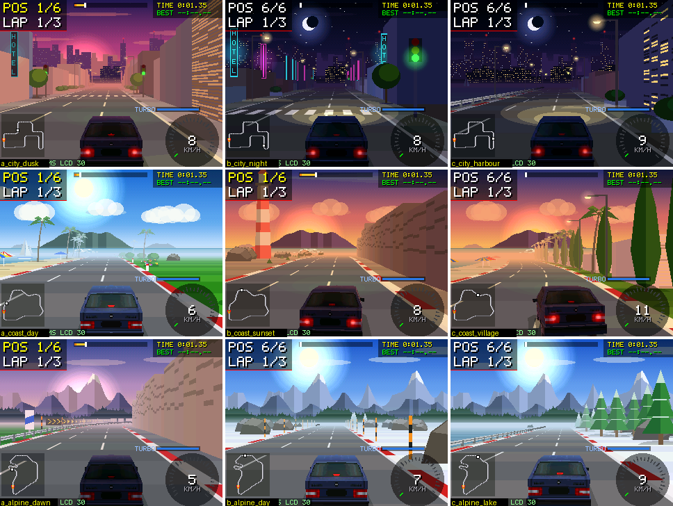
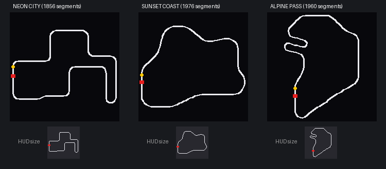

# 13. Circuits and themes

This page documents the **themes** feature phase (branch `feat/themes`): three
designed circuits, the theme palettes, the per-theme backgrounds and the
scenery sprites. Files: `circuits.h/.cpp`, `colors.h/.cpp`,
`rendering.h/.cpp`, `render_scenery.h/.cpp` (`track.*` and `utils.*` are
unchanged). The contract of [page 10](10-game-architecture.md) still holds;
everything new here is an addition.



*Real frames from the headless build: NEON CITY at dusk, at night on the
shopping street and on the harbour front; SUNSET COAST by day on the beach,
at sunset at the lighthouse and in the village; ALPINE PASS at dawn on the
switchbacks, by day on the snowy high road and at the lake.*



*The minimaps are the true plans: every layout closes on itself, so the
minimap code no longer has to bend the outline shut.*

## 13.1 The circuits

| | NEON CITY | SUNSET COAST | ALPINE PASS |
| --- | --- | --- | --- |
| Theme / cycle | city, 1.4 → 2.4 (dusk → night) | coast, 0.5 → 1.4 (afternoon → sunset) | mountain, 3.3 → 4.3 (dawn → morning) |
| Segments / sections | 1856 / 28 | 1976 / 23 | 1960 / 29 |
| Corners | 13: ten 90° corners (curve 7.1–7.5), a 180° hairpin (8.5), a chicane | 12 long sweepers (curve 1.5–3.1) | 15: two 180° hairpins (9.8), a 120° and a 140° corner (6.0 / 5.1), sweepers and kinks |
| Elevation | −600 … +800 (mild), the underpass dips 600 | 0 … 2800, rolling | 0 … 7600: one long climb and descent, max slope 0.168 |
| Tunnels | an underpass (56) | one through the headland (64) | two through the rock (64 + 56) |
| Autopilot best lap / race (NORMAL) | 34.9 s / 1:53.7, P3 | 33.9 s / 1:49.1, P2 | 37.3 s / 1:59.3, P1 |

**NEON CITY** — a downtown street circuit, clockwise, the start on the west
side heading north. The start/finish **boulevard** (sandstone and offices,
chequered flags, street trees) leads into T1 and the **avenue** through the
**financial district** (glass and dark towers up to 255 units, planters,
neon), a jog north and back east through the **old town** (brick, sandstone,
shops, neon blades), a **park** on the inside of the next jog (lawn, trees,
flowers, a billboard), the **shopping street**, then the **harbour front**:
166 segments with the water and a rail on the left and warehouses on the
right, ending in the **hairpin** round the end of a block (distance boards
before it). Back north through the shops, west into the **underpass** (retaining
walls down into a 56-segment tunnel), the old town again, the financial
district, a **chicane** and the last corner onto the pre-grid straight.
Cross streets with zebra crossings and traffic lights every 40–70 segments on
the straights, street lamps every 10 segments.

**SUNSET COAST** — clockwise round a headland, so the sea is always on the
left. The **promenade town** at the start (beach with umbrellas on the left,
white villas, palms and lamps on the right), **beaches** and a bay, the
**sea-wall** road round the cape (water and a rail on the left, a rock cutting
on the right that opens into coves), the **lighthouse** on the point, the
**tunnel** through the headland, the white **village** in a bay (villas,
cypresses), inland over the **hills** (S-bends, fields with fences, cypresses,
flowers), back to the sea on a long sea-wall sweeper and straight, beaches
again and the last sweeper into town.

**ALPINE PASS** — from the **valley** (meadows, pasture fences, chalets,
flowers) through the **forest** to the rock face: two **switchback hairpins**
climb north (rock wall on the uphill side = the inside of each hairpin, a
rail over the drop on the other side, chevrons and distance boards), then
**tunnel 1**, the snowy **high road** above the tree line (snow poles,
boulders, snowy pines), the **lake** (water and a rail on the left), the
descent on a cliff road, **tunnel 2**, the forest straight with a kink and
the valley sweeper back to the start. Snow covers the verges above 58 % of
the circuit's height range.

## 13.2 How a layout is described

`circuits.cpp` holds one table of `Sec` per circuit:

```cpp
struct Sec {
  int16_t len;     // segments
  int16_t turn;    // heading change in degrees, + = right, 0 = straight
  uint8_t ease;    // curvature ramp at each end of a corner (segments)
  int8_t  y;       // elevation key at the end of the section (Y_UNIT = 100), or Y_FREE
  uint8_t zone;    // decoration zone of the theme
  uint8_t flags;   // SF_TUNNEL, SF_STRETCH_A, SF_STRETCH_B
};
ST(len, y, zone)  STF(len, y, zone, flags)  CO(turn, len, ease, y, zone)
```

* **Curve from the angle.** The road's heading changes by `curve / SEG_LEN`
  radians per segment (the projection accumulates `dx += curve`), so a
  corner's peak curve is `turn(rad) * SEG_LEN / (len - ease)`. The curvature
  ramps linearly over `ease` segments at both ends (a clothoid); the ramps'
  weights add up to exactly `len - ease`, so the corner turns exactly `turn`.
* **Closure.** The turns add up to 360°. `closeLoop()` integrates the plan
  and stretches the two straights flagged `SF_STRETCH_A` / `SF_STRETCH_B`
  (they must not be parallel) by solving a 2×2 system, so the end of the lap
  lands on the start. The build log prints the residual (`closure 0.23/-0.46`
  segments). The minimap code still normalises the total turn and removes any
  residual, now only as a safety net.
* **Elevation.** Keys at the end of sections (`y`, in 100-world-unit steps;
  the start and the end of the lap are level 0), cosine-eased in between:
  keys are crests and dips; `Y_FREE` sections keep climbing or falling
  through. The log prints the steepest slope.
* **Rules of thumb.** A 90° corner at curve 7 takes ~45 segments. Up to
  |curve| 6.2 the AI drives flat out (`ai_cornerSpeed`), 7–8.5 costs a little
  speed, ~10 is a hairpin (70 % speed). A lap costs ~17–19 ms of autopilot
  time per segment (more with hairpins and climbs). The grid needs ≥ 30 flat,
  straight segments before the line (every circuit has 80) and some after it
  (40).

### Design tools (in the session scratchpad, not in the repo)

* `tools/dump.cpp` — compiles `circuits.cpp` in with the game's code and
  prints every section, segment, the minimap and the sprite counts.
* `tools/plot.py` — plan view with materials, buildings, rails, sprites,
  tunnels and crossings per side, the minimap at full and HUD size, the
  elevation and curvature profiles.
* `tools/validate.py` — checks every rule of 13.3 on all three circuits.
* `tools/gallery.cpp` — every sprite at a readable size and at LOD sizes,
  by day and by night.
* `tools/proto.py` — the layout math in Python for quick shape sketches.

## 13.3 Decoration

`buildCircuit()` runs the theme's painter over its zones, then generic passes:

| Theme | Zones (what they place) |
| --- | --- |
| City | `CZ_BOULEVARD` stone/office/shops, street trees, flags at the line · `CZ_FINANCE` glass/dark towers 170–255, planters, bus stops, neon · `CZ_OLDTOWN` brick/sandstone/shops, street trees, neon · `CZ_SHOPPING` shops, neon, planters · `CZ_PARK` lawn with trees, flowers, bushes, a billboard on the right · `CZ_HARBOUR` water + rail on the left, warehouses, sailboats · `CZ_UNDERPASS` retaining walls (BLD_WALL) both sides |
| Coast | `KZ_TOWN` sand + umbrellas / villas, palms, lamps · `KZ_BEACH` sand, umbrellas, palms, sailboats / grass, palms, bushes, flowers, posts · `KZ_SEAWALL` water + rail / rock cutting with coves · `KZ_CAPE` rocks, boulders / cliffs · `KZ_LIGHTHOUSE` the lighthouse on the point · `KZ_VILLAGE` beach / villas, cypresses, lamps · `KZ_HILLS` fences, cypresses, flowers, grass, billboards · `KZ_TUNNEL` |
| Mountain | `MZ_VALLEY` pasture fences, chalets, flowers, posts · `MZ_FOREST` pines (snowy higher up) · `MZ_WALL_L/R` rock face on one side, rail and an open view over the drop on the other · `MZ_HIGH` snow, snow poles, boulders · `MZ_LAKE` water + rail · `MZ_TUNNEL` |

* **Buildings.** Runs of 5–13 segments; type, height and variant per
  building from the district's weighted table; consecutive buildings differ
  in height so every one shows its front face; the inside of corners ≥ 60°
  opens into a small plaza at the apex; cross streets leave a gap on both
  sides. Variants are random 0–15 (their meaning belongs to the building
  renderer).
* **Heights use the full 1–255 range.** `BUILDING_FLOOR_H` (11000) is only
  ~0.4 m on the car's scale while a lamp is 3600 world units (~15 m), so the
  old floor-based heights made 30-floor towers shorter than a street lamp.
  Heights are now chosen for the look: towers 170–255 (a near tower fills the
  screen height), offices 110–210, brick/stone 70–160, shops 40–80, villas
  55–100, cliffs 120–255, retaining walls 34–44.
* **Generic passes.** `markTunnels` (tunnel sections, everything inside
  cleared) · `dressTunnelMouths` (rock faces 14 segments either side on the
  coast and in the mountains, concrete walls in the city) · `cornerSigns`
  (chevrons every 4 segments on the outside from 8 segments before a corner
  through 70 % of it — curve ≥ 6.5 city / 6.0 coast / 5.5 mountain; boards
  3-2-1 at 34/26/18 segments before the hardest — curve ≥ 8.0 / 8.0 / 8.5;
  never in the water) · `addLamp` (lamps only where no prop stands at the
  kerb) · the start flag, crossings cleared near the line.
* **Keep-out rules** (`spriteFits`, on the distance as stored in
  `sprOff`, 1/16 steps): nothing in a tunnel or in the first segment after
  one; footprint inner edge ≥ 1.12 (off the rumble); with a building on that
  side the outer edge ≤ 1.49 (in front of the facade); with a rail the inner
  edge ≥ 1.30 (behind it); with a lamp, a crossing or the start gantry the
  inner edge ≥ 1.62; land props never on water nor past the beach's water
  line (2.6); sailboats only on the water. `forceSprite` (signs) replaces an
  ordinary prop but still obeys the rules. `tools/validate.py` re-checks all
  of it independently: all three circuits pass.

## 13.4 Scenery sprites

All sizes in world units (vertical px = scale · H · 120, horizontal
px = scale · W · 160). Footprint = what must stay clear (crowns and boards may
overhang); hit = solid width for the physics (0 = soft).

| Type | H × W | Footprint / hit | LOD | Used |
| --- | --- | --- | --- | --- |
| `SPR_PINE`, `SPR_PINE_SNOW` | 3200 × 1300 | 0.24 / 0.10 | 1 tri < 8 px, cone < 34 px | forest, valley, high |
| `SPR_TREE`, `SPR_STREET_TREE` | 2600 × 1700, 1900 × 1000 | 0.24, 0.20 / 0.10, 0.08 | crown + trunk < 26 px | park, sidewalks |
| `SPR_PALM` | 3600 × 1800 | 0.20 / 0.08 | 4 fronds < 30 px | coast |
| `SPR_CYPRESS` | 3400 × 640 | 0.30 / 0.12 | 1 tri < 10 px | coast village, hills |
| `SPR_BUSH`, `SPR_FLOWERS`, `SPR_GRASS` | small | 0.50, 0.38, 0.26 / 0 | simple shapes | everywhere |
| `SPR_ROCK`, `SPR_BOULDER` | 750 × 1100, 1250 × 1700 | 0.55, 0.85 / 0.32, 0.60 | fewer facets | cape, mountain |
| `SPR_POST`, `SPR_SNOW_POLE` | 330, 1150 | 0.04 / 0.05, 0.04 | 1 rect | verges (reflectors glow at night) |
| `SPR_FENCE` | 430, runs along the road (`FENCE_LEN` 400) | 0.10 / 0 | — | fields (placed at 2.7, out of reach) |
| `SPR_CHEVRON_L/R` | board 420–1080 × 1000 | 0.34 / 0.34 | arrow heads < 18 px | outside of sharp corners |
| `SPR_BOARD_3/2/1` | 1500 × 440 | 0.22 / 0.06 | — | before hairpins |
| `SPR_BILLBOARD_A/B/C` | 2900 × 3000 | 1.50 / 1.20 | text when ≥ 12 px | parks, side streets, hills (floodlit at night) |
| `SPR_LIGHTHOUSE` | 9500 × 1300 | 0.70 / 0.60 | 2 shapes < 12 px | the cape (lantern, sweeping beam at dusk) |
| `SPR_UMBRELLA`, `_B` | 950 × 1200 | 0.60 / 0 | 1 tri < 14 px | beaches |
| `SPR_TRAFFIC_LIGHT` | 2300 | 0.14 / 0.05 | — | crossings (green / amber / red cycle) |
| `SPR_BUS_STOP` | 1050, 1500 along the road | 0.30 / 0.30 | — | sidewalks (lit ad panel) |
| `SPR_PLANTER` | 330 + shrub | 0.34 / 0.34 | — | sidewalks |
| `SPR_NEON_PINK/CYAN` | 1300–3700 × 300 | 0.10 / 0 | bar < 7 px | facades ("BAR", "HOTEL", glow at night) |
| `SPR_SAILBOAT` | 2700 × 1500 | 0.75 / 0 | — | sea, harbour (bobs) |
| `SPR_CHALET` | 2500, 3000 along the road | 1.25 / 1.20 | box < 10 px | valley (lit windows) |
| `SPR_FLAG` | 3400 | 0.06 / 0.04 | plain < 12 px | start (waving chequered flag) |

* Colours: plants use the palette foliage (`foliageL/D`, theme-tinted);
  man-made materials use the new **prop palette** `pal.prop[PropColor]`, lit
  by the palette's sun/moon and ambient light (no per-draw float maths).
  Everything is fogged with `pal.fog`.
* **Box props** (fences, bus shelters, chalets) extend along the road: the far
  end is the near end scaled towards the vanishing point by
  `camDepth / (camDepth + depth · scale)`, so they line up with the road.
* Animations (flags, the lighthouse beam, traffic lights, bobbing boats)
  run on `bgTime`, the clock of the last `drawSky()` call — deterministic in
  the headless build.
* Mind the visible lateral range: at camera depth z the screen edge is at
  |x| ≈ z / 1680 road half-widths (0.6 at z = 1000, 2.4 at z = 4000), so props
  beyond 2 are only seen from 20+ segments away.

## 13.5 Palettes

`colors.cpp` keeps the four base palettes and adds, per theme and phase,
`THEME_SKY` (sky top/mid/horizon, haze, sun glow, clouds, the far/mid/near
background layers) and per theme `THEME_GROUND` (day colours of every ground
material, the kerb, grass and foliage tints, how much water mirrors the sky).
Both are blended with the same smoothstep as the base palettes, so the cycle
stays smooth (checked at 0.05–0.1 steps across each circuit's range). Ground
materials follow the road's day → now ratio, the water also mirrors the
horizon. New `ColorSet` fields: `prop[PROP_PALETTE]`, `water`, `waterDeep`,
`seaGlint`, `skylineMid`, `snowCap`.

* City: urban haze by day, magenta dusk, a purple light-polluted night.
* Coast: deep blue by day, golden-orange sunset, warm sand, turquoise sea.
* Mountain: cold violet dawn, crisp blue day, blue ranges, blue-white snow.

## 13.6 Backgrounds

`initBackground(theme)` fills per-column height maps (deterministic Rng);
`drawSky()` draws the gradient, stars, sun/moon, the theme's clouds, then the
layers column by column without overdraw, then the horizon haze.

* **City**: hazy far towers (parallax 0.35), tall mid towers with setbacks
  (0.6) and dense near blocks (1.0); windows lit one by one at night (warm
  and cool), a TV tower with a lit pod, masts with blinking red aircraft
  lights; stratus streaks lit by the sunset.
* **Coast**: a 7-row band of open sea above the camera horizon with a crisp
  horizon line and the sun's (moon's) flickering glitter path below it,
  distant hazy islands and two headlands shaded on the sun's side; cumulus
  with flat shaded bases.
* **Mountain**: ridged peaks (sharp crests) with wavy snow caps, a darker
  middle range with snow on its tops, a forested near ridge with pine tips;
  each column lit or shaded by its precomputed slope facing; mist rising in
  the valleys; small lenticular clouds.

## 13.7 Memory and performance

| | Core | Themes |
| --- | --- | --- |
| XIAO flash / static RAM | 442,969 / 57,136 B | 472,589 / **53,680 B** |
| Dev board flash / static RAM | 472,277 / 57,568 B | 501,745 / **54,112 B** |

Static RAM went **down** by 3,456 B: the background maps (4,480 B) and the
build-time tables (1,796 B: the working section list, headings, minimap
points) are allocated once on first use in PSRAM (internal fallback, placement
logged: `circuit: build scratch (1796 B) in PSRAM`, `background: maps (4480 B)
in PSRAM`). The maps are read a few thousand times per frame, column by
column. Nothing new is `HOT`; sprites only call the existing gfx primitives.

Drawing work per frame (first 30 s of a race, counted with instrumented
copies of `gfx.cpp`; deterministic, unlike the host timings):

| Scene | Polygons Core → themes | Pixels written Core → themes |
| --- | --- | --- |
| City race start | 292 → 454 | 120 K → 138 K |
| City, shopping street at night | 296 → 433 | 117 K → 141 K |
| Coast race start / hills | 245 → 359 / 247 → 220 | 86 K → 108 K / 91 K → 99 K |
| Mountain race start / forest | 419 → 442 / 388 → 375 | 100 K → 113 K / 136 K → 112 K |

The mid-distance LODs (pines, trees, palms, chevrons) keep the mountain at or
below the Core despite 50 sprites in view on average (worst 105, 39 in the
near 30 segments); the city costs most (taller facades, street furniture,
neon). Host loop timings on the shared WSL machine were within noise of the
Core (e.g. 1.77 vs 1.78 ms per frame user CPU, city start).

## 13.8 Verification

* Headless build (`-Wall`): no warnings. Both ESP32 builds: no warnings.
* Layout: closure < 0.5 segment, total turn 360°, flat/straight grid area —
  checked by `validate.py` together with every keep-out rule.
* Determinism: each circuit's segment dump has the same MD5 built alone or
  after the other two.
* Full 3-lap autopilot races on all three circuits (13.1); title, menus and
  the circuit select screen show each theme's background and the true
  minimap.
* Frames looked at: complete laps every 1.5 s, special spots (crossings,
  hairpins, underpass, lighthouse, coves, lake, chalets), each circuit at
  6 points of its time-of-day range, the sprite gallery by day and night.

## 13.9 Tuning guide

* **Change a layout**: edit the circuit's `Sec` table. Keep the turns summing
  to 360°, keep `SF_STRETCH_A/B` on two non-parallel straights, rebuild and
  read the log line (`closure`, `max curve`, `slope`); plot it with
  `tools/plot.py`. Lap time ≈ segments × 18 ms.
* **A new zone**: add the enum value, use it in the table, paint it in the
  theme's `decorate*()` with `setMat`, `setBuilding`, `placeSprite`,
  `addLamp` and the rail flags; run `validate.py`.
* **A new sprite**: append to `SpriteType` (never reorder: the values are
  stored in segments), draw it in `drawSceneSprite()` with an LOD, give it a
  footprint in `spriteWidth()` and a solid width in `spriteHitWidth()`.
* **Palettes**: `THEME_SKY` / `THEME_GROUND` rows per theme; check with
  `--cycle` stills at several points of the circuit's range.
* **Backgrounds**: generator parameters in `initBackground()`, colours from
  the theme palette, parallax factors in `draw*Layers()`.

## 13.10 Additions to the interfaces

All additive (nothing renamed or removed):

* `render_scenery.h`: 26 `SpriteType` values after `SPR_PINE_SNOW`,
  `spriteWidth(type)`, `FENCE_LEN`.
* `colors.h`: `PropColor` and the `ColorSet` fields `prop[]`, `water`,
  `waterDeep`, `seaGlint`, `skylineMid`, `snowCap`.
* `rendering.h`: `bgTime`.
* `Segment::deco` and `pad` stay 0 (unused).
