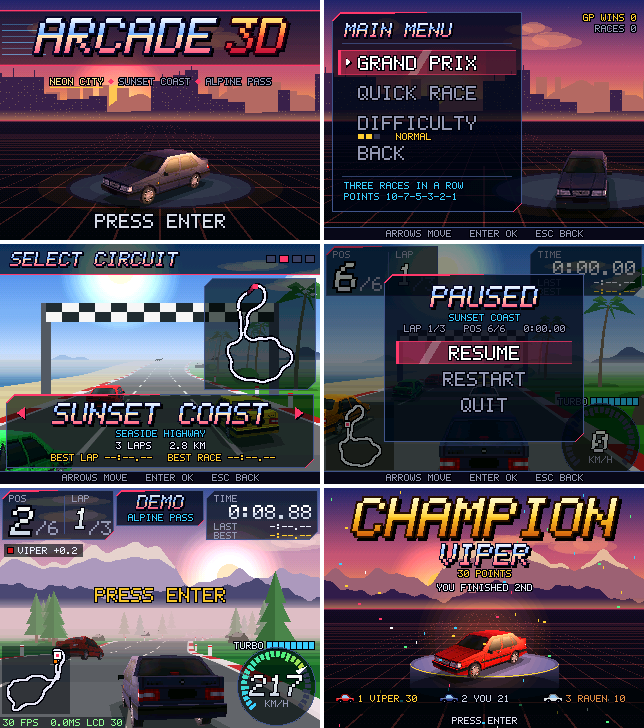
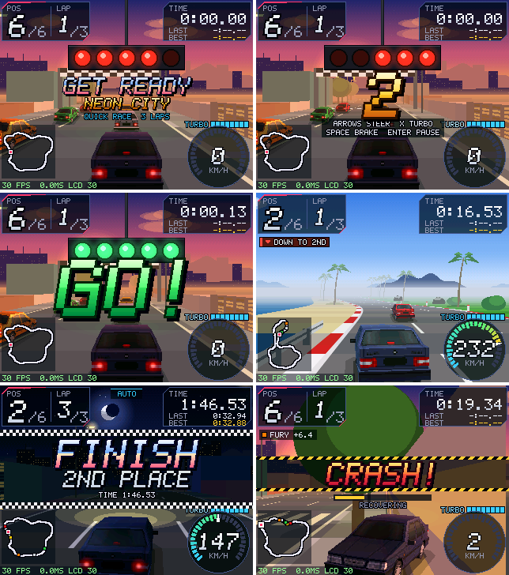
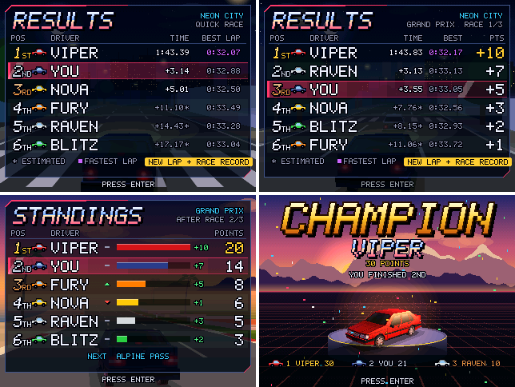
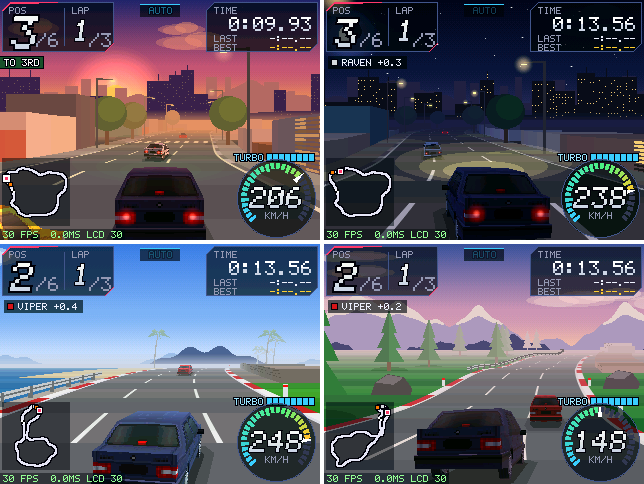

# 14. Game flow, screens, HUD, controls and saving

This page documents the UI phase (branch `feat/ui`): the state machine around
the race, every screen, the race HUD, the controls of the three targets, the
save data, the platform additions and the harness options added for testing.
Files: `game.h/.cpp`, `ui.h/.cpp`, `render_hud.h/.cpp`, `save.h/.cpp`,
`input.h`, `input_esp32.cpp`, `platform.h`, `platform_esp32.cpp`,
`car_game.ino`, `emulator/*`. The contracts of
[page 10](10-game-architecture.md) are unchanged; everything new is an
addition (listed in 14.9).



## 14.1 Flow

```
TITLE (features the 3 circuits, 5 s each) ──any button──> MENU
  │ 10 s idle                                         ├─ GRAND PRIX ──> race 1 ─┐
  v                                                   ├─ QUICK RACE ──> SELECT ─┤ (carousel + BACK)
 DEMO (countdown + autopilot on the featured circuit) ├─ DIFFICULTY  (value)    │
  │ any button / 45 s / finish -> TITLE               └─ BACK -> TITLE          v
                                         COUNTDOWN (5 lights, 3-2-1, GO, cars held)
                                                       v
                                         RACE <──> PAUSE (RESUME / RESTART / QUIT)
                                                       v  player crosses the line after the last lap
                                         FINISH (banner, autopilot cool-down 4 s)
                                                       v
                                         RESULTS ──GP──> STANDINGS ──> next race ... ──> CHAMPION ──> MENU
                                                 └─QUICK──> SELECT (same circuit)
MENU / SELECT idle 60 s -> TITLE (attract loop)
```

| State | Update | Leaves on |
| --- | --- | --- |
| `GS_TITLE` | features circuit k: `setTheme` + `initBackground` + its title light (`TITLE_CYCLES`), no track build | any deliberate press (after 0.5 s) → MENU; 10 s idle → DEMO |
| `GS_DEMO` | countdown (lights only) then the autopilot races the featured circuit; HUD, `DEMO` badge, `PRESS START` | any press, 45 s, or the finish → TITLE (featured circuit advances) |
| `GS_MENU` | showroom backdrop; GRAND PRIX / QUICK RACE / DIFFICULTY / BACK | confirm, back → TITLE, 60 s idle → TITLE |
| `GS_SELECT` | `buildCircuit` + `race_init` on every carousel move; live flyover from behind the grid | confirm (circuit → COUNTDOWN, BACK → MENU), back → MENU |
| `GS_COUNTDOWN` | `rivals_update` + `race_update` (cars held), `UI_COUNTDOWN_GO` = 4 s | GO → RACE (`race_go()`) |
| `GS_RACE` | `updateDriving`, day cycle by progress, lap banners | START → PAUSE; player finished → FINISH |
| `GS_PAUSE` | nothing moves; frozen frame from PSRAM | RESUME / back / START → RACE; RESTART → COUNTDOWN; QUIT → MENU |
| `GS_FINISH` | autopilot cool-down; records decided (RAM) | after 4 s → RESULTS (classification + one NVS write) |
| `GS_RESULTS` | race keeps running behind the panel | confirm after 0.8 s → STANDINGS (GP) / SELECT (quick) |
| `GS_STANDINGS` | race keeps running behind the panel | confirm after 0.8 s → next GP race / CHAMPION |
| `GS_CHAMPION` | winner's car on a podium, confetti | confirm after 1.5 s → MENU |

**Transitions.** A screen change that swaps the scene starts a *fade-out*
(0.2 s, `go(action)`): the old screen keeps animating, input edges are
ignored, and when it is black the action runs (`buildCircuit`, `startRace`...)
and the new state fades in (0.3 s). In-race overlays (PAUSE, FINISH, RESULTS,
STANDINGS) switch without a fade because the scene behind them continues.
The pending action is a plain function pointer, so the logic stays in
`update()` and nothing is re-entered while a fade runs.

**Grand Prix.** Points 10-7-5-3-2-1 are added when the results are computed;
the official order (`sStandOrder`, ties broken by the last race) is kept with
the order before the race (`sPrevOrder`) so the standings show who moved up
or down. The champion is `sStandOrder[0]`; a player win increments
`saveData.gpWins[difficulty]`. RESTART during a GP race restarts that race
(no points have been awarded yet).

## 14.2 Controls

| Action | XIAO handheld | Dev board (2 buttons) | PC emulator |
| --- | --- | --- | --- |
| Steer | stick X | left / right button | ← → |
| Menu move | stick Y (auto-repeat) | one button, **on release** | ↑ ↓ (auto-repeat) |
| Change value / carousel | stick X | (moves; confirm cycles values) | ← → |
| Brake | A (D5) | — | Space or ↓ |
| Turbo | B (D7) | — | X or Left Shift |
| Confirm | START, B or CROSS | both buttons | Enter |
| Back | SELECT or CIRCLE | (BACK items) | Esc / Backspace |
| Pause | START | both buttons held 250 ms | Enter or P |

* **Edges** come from consecutive `InputState` snapshots in `game.cpp`
  (`sPrev`/`sIn`). A key still held when a screen opens does not act on it.
* **Auto-repeat** (`axisRepeat`): first move on the press, then after
  `REPEAT_DELAY` 0.40 s every `REPEAT_EVERY` 0.12 s. Only the dominant stick
  axis acts, so a diagonal push never moves *and* changes a value.
* **Dev board**: a single button moves on release, and only if the other
  button never joined (both = confirm, a "chord"), so confirming never moves
  the selection. Every screen has a BACK item, so steer + confirm reach every
  screen (verified with `--devkit`, 14.8). START needs both buttons held for
  250 ms: a quick left-right overlap while racing never pauses.
* **XIAO ADC** (`input_esp32.cpp`): the five conversions (stick X and Y twice,
  the ladder once) run in the task `input_adc` (core 0, priority 3, 4 KB
  stack, creation checked, fallback to direct reads) every 4 ms and are
  published as volatile values; the game loop never waits for the ADC. The
  stick centre is calibrated at boot and the travel is learnt while used. A
  ladder window must read the same twice in a row: releasing START sweeps the
  voltage through the SELECT window, which would otherwise read as "back".
* **Serial**: `Serial.setTxTimeoutMs(0)` on USB CDC and a 1 KB TX buffer on a
  UART build, so logging never blocks the loop.

## 14.3 The UI toolkit (`ui.h`)

**Text (`ui_text`, `UiTextStyle`).** The 5x7 glyphs are drawn as horizontal
runs written straight into the framebuffer rows (no per-dot or per-span
calls): for each pixel row and glyph, the dots of the glyph rows that touch
it are OR-ed into a 5-bit mask and every run becomes one short fill. Styles
add:

| Field | Effect |
| --- | --- |
| `scale` | size of a font dot; integral scales run in integer arithmetic, fractional ones (zooming digits) in float |
| `outlinePx` | the dots grown by n pixels (union of the grown runs), drawn first in `outline` |
| `shadowDx/Dy` | the grown shape again, offset, in `shadow` |
| `slant` | italic shear, x shift per pixel of height (bottom row fixed) |
| `g[4]` | vertical gradient: `g0→g1` on the top half, `g2→g3` on the bottom half (a hard split gives the 80s chrome look) |
| `alpha` | 32 opaque, less blends (fades, pulsing prompts) |

Presets: `ui_style` (flat + 1 px outline), `ui_styleGrad`, `ui_styleChrome`
(headlines), `ui_styleGold` (digits, champion); `ui_label` is the everyday
outlined label. The glyph table is a copy of gfx's (448 B of flash) because
gfx keeps its own private.

**Shading (`ui_shadeRect`, `ui_shadeEllipse`, `ui_panel`).** Panels darken
the scene towards `UI_INK` with shifts and masks on two pixels per 32-bit
word: `alpha` ≤ 16 keeps 1/2 of the background, ≤ 21 keeps 3/8, more keeps
1/4. That is about four times cheaper than a generic alpha blend, which
matters because the HUD shades ~23 000 pixels per frame. `ui_panel` is a
chamfered panel (two corners cut at 45°) with an edge line and an optional
accent rule.

**Widgets.** `ui_selBar` (gradient body, edge marker, a shine sweeping across;
menus glide between rows), `ui_carIcon` (18x9 side view in a racer's paint),
`ui_arrow`, small tags ("NEW RECORD"), the board-specific hint lines
(`ui_hintNav`, `ui_hintConfirm`), `ui_dim`, `ui_fade`, `ui_fadeOut`.

**Colours.** `UI_INK`, `UI_EDGE`, `UI_ACCENT` (hot pink-red), `UI_ACCENT2`
(cyan), `UI_GOLD/SILVER/BRONZE` (places), `UI_TEXT`, `UI_DIM`, `UI_GOOD`,
`UI_BAD`, `UI_PURPLE` (fastest lap), all compile-time `UI_RGB()` constants.

## 14.4 Screens



* **Title**: the sky of the featured circuit's theme, a showroom floor with a
  scrolling neon perspective grid, a spotlight and the rotating car (a studio
  light: `lightScale` 1.35), the "ARCADE 3D" logo (chrome + hot gradient,
  italic, sliding in with speed streaks), the three circuit names with the
  featured one lit, and a breathing `PRESS START`. Every 5 s
  (`UI_TITLE_FEATURE_TIME`) the next circuit is featured behind a short dip
  to black that hides the theme swap.
* **Main menu**: panel on the left, car on the right; the DIFFICULTY item
  shows three pips and EASY / NORMAL / HARD (green / gold / red) with arrows
  when selected; two lines of help for the selected item; GP wins and races
  finished at the top right.
* **Circuit select**: a live flyover of the selected circuit at its race-start
  light, starting behind the grid (the rivals are parked on it) and cruising
  along the lap; header with pips, a minimap card with a comet running the
  lap (direction), and a carousel panel: name, tagline, laps, length (km, from
  the speedometer scale), best lap and best race. The last item is BACK.
* **Countdown**: a gantry with five lights hangs between the HUD panels.
  GET READY + circuit + race number; the lights switch on in a ripple
  (0.5–0.9 s), then go out one by one during 3-2-1 (1.6, 2.2, 2.8, 3.4 s) and
  the last one goes out on GO, when all five turn green. The digits pop in
  (gold, scale 12 → 8); two lines of driving help sit under them.
* **GO**: green lights, "GO!" zooming and fading, the gantry lifts away.
* **Banners**: LAP 2/3 (cyan) and FINAL LAP (gold) with the last lap time,
  plus a `NEW LAP RECORD` tag when the lap beats the record saved before the
  race; the strip opens and closes vertically below the HUD's gap line.
* **Position gained / lost** (HUD): `▲ UP TO 3RD` (green) / `▼ DOWN TO 4TH`
  (red) under the position panel. A new place must hold for 0.3 s, so the
  shuffle at the start and two quick losses show as one change.
* **Finish**: chequered strips sliding in, FINISH zooming, the place in its
  medal colour, the race time, and `NEW RACE RECORD` / `NEW LAP RECORD`.
* **Results**: place (medal colours), car icon, name, winner's time then gaps
  (`*` = estimated by `race_results`), best laps with the race's fastest in
  purple, GP points; rows slide in one by one; the player's row is
  highlighted; record tag; `PRESS START`.
* **Standings**: points bars in the racers' paint growing, the points of the
  last race, ▲ / ▼ / – against the previous standings, NEXT circuit or FINAL
  STANDINGS.
* **Champion**: the winner's car (in its paint) on a podium, confetti,
  "CHAMPION" zooming in, the winner and points, the player's result, the
  podium of the Grand Prix.
* **Pause**: the frozen race frame, dimmed, with the circuit, lap, place and
  time; RESUME / RESTART / QUIT (QUIT GP during a Grand Prix).
* **Crash**: impact flash, a hazard-striped strip, "CRASH!" shaking, and a
  RECOVERING bar over the 2 s reset.
* **Demo**: a DEMO badge with the circuit between the HUD panels, the lights
  and digits of the countdown, then a breathing `PRESS START`.



## 14.5 HUD (`render_hud.cpp`)



| Where | What |
| --- | --- |
| top left | `POS` big digit (gold when leading, pops when it changes) `/6`; `LAP` digit (gold on the final lap) `/3` |
| under it | gap to the car ahead (`VIPER +1.4`, its paint swatch) or `LEAD 2.3`; replaced for 2 s by the position banner |
| top right | race time (scale 2), LAST and BEST lap |
| top centre | `AUTO` when the autopilot drives (finish cool-down, `--auto`) |
| bottom left | minimap with every racer (rivals in their paint, the player white with a blinking frame) and the start flag |
| bottom right | turbo meter (8 segments, glows while boosting, the label pulses when full) and the speedometer dial (28 ticks cyan → green → gold → red, needle tip, big number turning red above 260 km/h) |
| bottom line | `FPS / MS / LCD` (`SHOW_FPS`) |

The gap is the distance to the car ahead (`race_order(place - 1)`) divided by
the faster of the two speeds (at least 35 % of `maxSpeed`), smoothed at 4/s.
The minimap outline is rasterised **once per circuit** into two 64x64 bit masks
(road 2 px, road grown by 1 px for the outline) keyed by a hash of the minimap
points, and drawn as runs; the select screen draws its big map with quads.
Text on the shaded panels has no outline (one pass); the big digits keep a
1–2 px outline and no shadow.

## 14.6 Save data (`save.cpp`)

One 44-byte blob (`SaveData`: magic, version, difficulty, last quick-race
circuit, best lap and best race per circuit, GP wins per difficulty, races
finished, FNV-1a checksum) through `plat_save` / `plat_load`:

* ESP32: Preferences / NVS, namespace `arcade3d`, key `save`.
* PC (Raylib): `car_game_save.bin` next to the executable.
* headless: disabled unless `--save` (then `car_game_save.bin` in the current
  folder).

**When it is written** (a flash write stalls both cores' caches): when the
results are computed (the race is over), when a GP is won (standings →
champion), and when a changed difficulty is left behind (at the end of a
fade-out, on a black screen). Never during a race or the countdown.

**Records.** When the player crosses the line, `save_recordLap` /
`save_recordRace` update the RAM copy and return whether a record fell; the
flags (`game_recordFlags()`: bit 0 lap, bit 1 race) drive the tags on the
finish and results screens. During the race a lap that beats the record
saved **before** the race (and is the race's best so far) raises the
`NEW LAP RECORD` tag on the lap banner. A first time on a circuit counts as a
record on the results screen, not in the race banner.

## 14.7 Platform additions (`platform.h`, ESP32 only)

* `plat_init()`: `heap_caps_register_failed_alloc_callback` logs every failed
  allocation (`[mem] ALLOC FAILED n B caps 0x.. in fn`).
* `plat_status(fps, ms, lcdFps)`, called once per second when
  `PLAT_STATUS_LOG` is 1 (default):
  `[st] fps ms lcd | int free lg largest min minimum-ever | psram free | stk loop lcd adc`
  (stack high-water marks of the loop task, `lcd_scan` and `input_adc`).
* Pause snapshot: one 153,600 B buffer in **PSRAM** allocated at setup
  (`ui: pause snapshot ... in PSRAM`); the pause screen copies it back each
  frame instead of rendering the race again (falls back to re-rendering with a
  frozen clock when the allocation fails).

## 14.8 Harness (`emulator/main_headless.cpp`)

Every option of page 10 still works. Added:

| Option | Meaning |
| --- | --- |
| `--state NAME[:C]` | jump straight to a screen before frame 0: `TITLE`, `DEMO`, `MENU`, `SELECT`, `COUNTDOWN`, `RACE`, `PAUSE`, `FINISH`, `RESULTS`, `STANDINGS`, `CHAMPION`, on circuit C (`STANDINGS:C` = after GP race C). `FINISH` … `CHAMPION` first fast-forward the race(s) with the autopilot, without rendering (a few seconds of host time) |
| `--devkit` | the menus use the dev-board scheme (one button moves on release, both = confirm) |

With the fade-outs, the default walk (presses at 30, 50, 60, 80) reaches the
menu at frame ~36, the select screen at ~66 and the countdown at ~86 (GO at
~206). Recipes used for this page (frames under the scratchpad `ui/` folder):

```bash
./car_game_headless out 200 --state TITLE 40 190            # title, two featured circuits
./car_game_headless out 60 --state SELECT:1 50              # circuit select, coast
./car_game_headless out 140 --state COUNTDOWN 25 75 125     # lights, 2, GO
./car_game_headless out 12 --state PAUSE:1 10               # pause over the coast
./car_game_headless out 60 --state RESULTS 50               # quick-race results
./car_game_headless out 60 --state STANDINGS:1 50           # GP standings after race 2
./car_game_headless out 60 --state CHAMPION 50              # champion
./car_game_headless out 13800 --gp --auto --dump 15         # whole GP: 3 races, points sum to 84
./car_game_headless out 760 --title 700                     # attract: title -> demo
./car_game_headless out 560 --race 1 --nocd --pos 40000 500 # teleported ahead: DOWN TO 2ND ...
./car_game_headless out 680 --title --devkit --in 40:40:confirm --in 60:62:R ...   # dev-board menus
```

Walkthroughs verified with scripted inputs: title → menu (difficulty
HARD/EASY/NORMAL with left/right and confirm) → select (carousel both ways,
BACK) → countdown → race → pause → RESTART → countdown → pause → RESUME →
pause → QUIT → menu → BACK → title; the same with `--devkit` (including a
chord); `--save` twice (second run loads the 44-byte file and shows
NEW LAP + RACE RECORD when beaten); a crafted save with a slow lap record
shows the in-race tag; an EASY GP won by the player ends on
"YOU WIN THE GRAND PRIX!" and the menu shows GP WINS 1.

## 14.9 Interface additions (nothing renamed or removed)

* `ui.h`: the toolkit (`UiTextStyle`, `ui_text`, `ui_textWidth`, `ui_label`,
  styles, `ui_panel`, `ui_shadeRect`, `ui_shadeEllipse`, `ui_selBar`,
  `ui_carIcon`, `ui_arrow`, hints, `ui_dim`, `ui_fadeOut`, colours) and richer
  screens (`ui_drawTitleEx`, `ui_drawMainMenu`, `ui_drawCircuitSelectEx`,
  `ui_drawCountdownEx`, `ui_drawCountdownLights`, `ui_drawResultsEx`,
  `ui_drawStandingsEx`, `ui_drawChampionEx`, `ui_drawFinishEx`,
  `ui_drawBannerEx`, `ui_drawPauseEx`), `UI_TITLE_FEATURE_TIME`. The original
  functions still exist and draw the new look. `ui_drawPause(sel)` now has
  three items (RESUME / RESTART / QUIT).
* `render_hud.h`: `hud_reset()`.
* `game.h`: `game_debugJump()`, `game_recordFlags()`, `game_inTransition()`,
  `GameDebug::devkitNav` (appended).
* `platform.h`: `PLAT_STATUS_LOG`, `plat_init()`, `plat_status()`.

## 14.10 Cost

Host measurements (WSL, the minimum of 60 runs because the machine was
shared; relative numbers only):

| Item | Core | UI phase |
| --- | --- | --- |
| `drawHUD()` per frame (city / coast / alpine) | 41.7 / 45.5 / 41.7 µs (9–13 % of a race frame) | 38.7 / 39.5 / 37.3 µs (8–11 %) |
| pause, host loop per frame | 1.71 ms (re-renders the race) | 0.20 ms (PSRAM snapshot copy) |
| title, host loop per frame | 0.37–0.55 ms | 0.58–0.66 ms (neon floor, logo) |

(`drawHUD` is timed alone by a small benchmark linked against both trees;
whole-frame host loops of the races vary ±40 % from run to run on the shared
machine and show no difference beyond that noise.)

The first version of the new HUD cost ~100 µs: a gprof run showed 44 % in
generic alpha blends of the panels and 34 % in text spans going through
`gfx_hspan`. The word-pair shading, direct row writes for text runs, integer
arithmetic for integral scales and outline-free text on panels brought it
below Core's simpler HUD. On the S3 the HUD should stay around 1 ms
(~11 600 shaded words at ~8 cycles plus ~2 000 short text runs).

Memory: the minimap masks (1 KB) and the speedometer tables (~0.3 KB) are the
only new static arrays; the pause snapshot is 150 KB of PSRAM; the ADC task
stack is 4 KB of internal heap.

| Build (Arduino-ESP32 4.0.0, no warnings) | Flash | Static RAM |
| --- | --- | --- |
| XIAO `esp32:esp32:XIAO_ESP32S3:PSRAM=opi`, Core | 442,969 B | 57,136 B |
| XIAO, UI phase | 471,957 B (14 %) | 57,728 B (17 %) |
| Dev board `esp32:esp32:esp32s3:PSRAM=opi -DBOARD=2`, Core | 472,277 B | 57,568 B |
| Dev board, UI phase | 500,605 B (38 %) | 58,112 B (17 %) |

## 14.11 Tuning

| Where | Constant | Default |
| --- | --- | --- |
| `game.cpp` | `TITLE_IDLE_DEMO`, `MENU_IDLE_TITLE`, `DEMO_TIME` | 10 s, 60 s, 45 s |
| | `FINISH_TIME`, `CONFIRM_DELAY` | 4 s, 0.8 s |
| | `FADE_IN`, `FADE_OUT` | 0.30 s, 0.20 s |
| | `REPEAT_DELAY`, `REPEAT_EVERY` | 0.40 s, 0.12 s |
| | `FLY_SPEED` (select flyover) | 3600 units/s |
| | `TITLE_CYCLES[]`, `MENU_CYCLE` | 1.62 / 1.12 / 3.45, 1.25 |
| `ui.h` | `UI_COUNTDOWN_GO`, `UI_TITLE_FEATURE_TIME`, `UI_*` colours | 4 s, 5 s |
| `ui.cpp` | `BANNER_TIME`, `GANTRY_Y`, light timing in `countdownLights()` | 2.4 s, 58 |
| `render_hud.cpp` | place debounce, banner time, gap smoothing, red speed | 0.3 s, 2 s, 4/s, 260 km/h |
| `input_esp32.cpp` | ADC period, dev-board pause hold | 4 ms, 250 ms |
| `platform.h` | `PLAT_STATUS_LOG` | 1 |

## 14.12 Known limitations

* Nothing of this phase has run on the hardware; the ADC task, the ladder
  debounce and the dev-board chord timing are compiled and reasoned, the
  dev-board menu logic is tested through `--devkit`.
* No sound.
* The circuit-select flyover rebuilds the circuit (`buildCircuit` +
  `race_init`) on every carousel move: a one-frame hitch on the S3, hidden by
  a 0.25 s dip.
* `--state` fast-forwards skip the countdown, so their races differ slightly
  from a real run (screenshots only).

## 14.13 After the integration

* `game_setup()` also calls `textures_init()` (after `track_init()`) and
  `ui_init()` (boot log of the HOT `shadeSpan` placement).
* `ui_countdownLightMask(t, &green)` exports the light state; the world
  gantry over the start line mirrors the UI's five lights.
* Race banners: **ROCKET START** (TURBO pressed within 0.3 s of GO), shown
  once the GO! overlay has gone; the HUD shows a **SLIPSTREAM** tag above the
  turbo meter while the player is towed.
* The UI's text uses gfx's glyph table (`gfx_font5x7`) instead of a copy.
