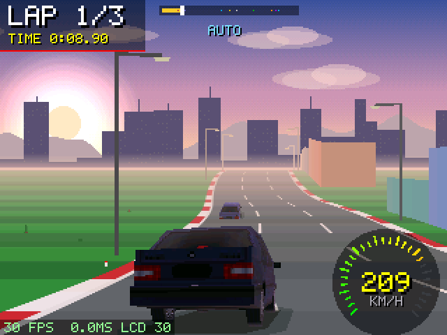
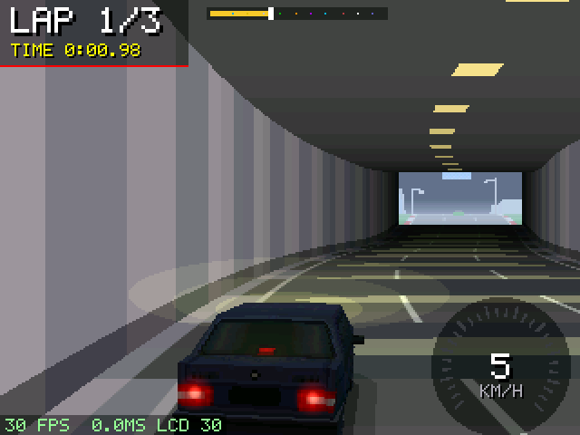
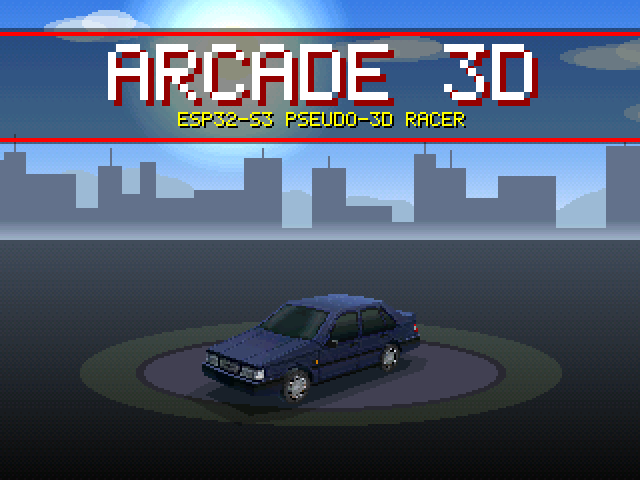

# Graphics & engine overhaul — wiki

This folder documents the `graphics-overhaul` branch: what was wrong in the
original code (commit `11fc9b9` on `road`), what was lost along the commit
history, and everything that changed.

| Day | Sunset | Night |
| --- | --- | --- |
|  |  |  |

| Dawn | Tunnel portal | Inside the tunnel |
| --- | --- | --- |
|  |  |  |

*All screenshots are real frames from the game, rendered by the headless PC
build (`emulator/car_game_headless`). The PC builds draw into the same software
framebuffer as the ESP32, so these are the pixels the panel receives.*

## Pages

1. [Audit of the original code](01-original-code-audit.md) — memory management, rendering, physics, input
2. [Commit history: what was lost and when](02-commit-history.md) — day/night, the car, the unmerged AI competitors
3. [New architecture and memory map](03-architecture.md)
4. [ESP32 display pipeline (from the MGS/SOTN ports)](04-display-pipeline.md)
5. [The 3D car renderer — why the car looked crooked](05-car-renderer.md)
6. [World rendering: sky, day/night, road, buildings, tunnels](06-world-rendering.md)
7. [Physics and input](07-physics-and-input.md)
8. [Build, test and verification status](08-build-and-test.md)
9. [File-by-file change list](09-file-changes.md)

## Summary

- **Own software renderer** (`gfx.cpp`) replaces `TFT_eSprite`: framebuffer in
  internal SRAM, gap-free polygons, blending, additive lights, dithered
  gradients, anti-aliased road edges, bitmap font.
- **Display pipeline from the ports**: 8-line SPI DMA bands, PSRAM snapshots,
  scanout on core 0 while the game runs on core 1, unchanged bands skipped.
  No TFT_eSPI dependency.
- **Day → sunset → night → dawn restored**, now smooth, and it reaches
  everything: sky, sun/moon, stars, clouds, skyline windows, buildings, street
  lamps, headlights, car lighting.
- **Car fixed**: yaw from steering (not lateral position), sane perspective,
  aligned shadow, perspective-correct texturing, smooth normals with
  diffuse + specular + sky reflection, tail/brake lights.
- **Traffic** uses the same textured mesh (repainted), placed exactly and
  seen from its real angle; the autopilot now avoids it.
- **Physics fixes**: frame-rate independence, gravity no longer stops the car
  on hills, dead crash code fixed, real steering + brake, autopilot demo mode.
- **Longer track** (1000 segments in 16 KB, laps ~25 s instead of ~3 s),
  two tunnels with portals, street lamps, scenery.
- **Board support** for the XIAO ESP32S3 Sense handheld (same unit as the
  MGS/SOTN ports) and the original dev board.

## Status

| Item | Status |
| --- | --- |
| PC headless build + rendering | Verified (screenshots above) |
| Raylib emulator frontend | Compiles against raylib 5.0 headers (not run: no Raylib on the dev machine) |
| ESP32 build (Arduino-ESP32 3.x) | **Not yet compiled** — see [build status](08-build-and-test.md) |
| On-device run, real frame times | **Not yet tested on hardware** |
