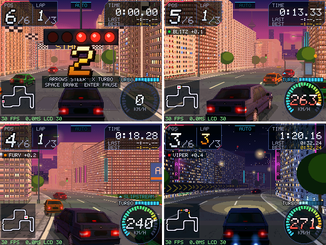
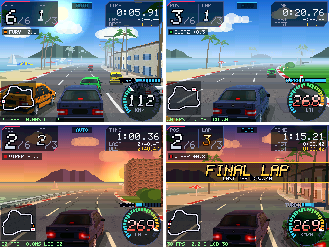
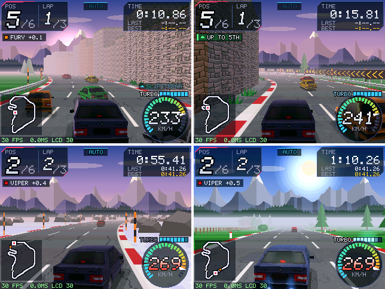
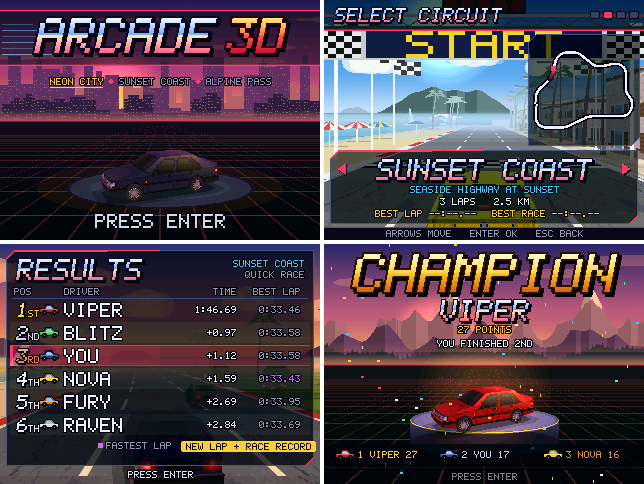

# ARCADE 3D — wiki

This folder documents the game on branch `full-game`: a complete pseudo-3D
arcade racer for the ESP32-S3 handheld (XIAO S3 Sense + ILI9341 320×240,
8 MB PSRAM). Three circuits, five rivals, a Grand Prix, a countdown with
start lights, procedural textures, menus, a HUD and saved records — and the
graphics engine underneath it (pages 1-9, from the `graphics-overhaul` branch).

*Every screenshot is a real frame from the headless PC build
(`emulator/car_game_headless`). The PC builds draw into the same software
framebuffer as the ESP32, so these are the pixels the panel receives.*

## The circuits

**NEON CITY** — a downtown street circuit from dusk into the night: textured
towers, offices, brick and sandstone blocks, shops with neon, zebra crossings,
traffic lights, an underpass, a harbour front.

**SUNSET COAST** — a seaside highway round a headland from the afternoon into
the sunset: beaches, a promenade of villas, sea walls, cliffs, a lighthouse,
a tunnel through the headland.

**ALPINE PASS** — a mountain road from dawn into the morning: switchback
hairpins under rock walls, rails over the drop, forests, a snowy high road,
a lake, two tunnels.

## Pages

**The game** (start here):

10. [Game architecture — the module contract](10-game-architecture.md): flow,
    modules, frame order, every shared header verbatim, conventions, the
    headless harness and tools, test recipes, memory map, measurements,
    deviations from the design brief, known limitations
11. [Rivals, race logic and car physics](11-rivals-ai.md): racing line and
    speed profile, the driver model, overtaking, contacts, turbo, slipstream,
    rocket start, autopilot, how rivals are drawn, balance
12. [City graphics — procedural textures, buildings and road surfaces](12-city-graphics.md):
    texture synthesis, textured facades of every building type, asphalt,
    pavements, water, markings, the start gantry, tunnels and portals
13. [Circuits and themes](13-circuits-and-themes.md): how a circuit is
    described, the three designs, decoration zones and keep-out rules, 26 new
    sprites, theme palettes, backgrounds
14. [Game flow, screens, HUD, controls and saving](14-game-flow-and-ui.md):
    the state machine, every screen, the UI toolkit, the HUD, controls per
    board, save data, platform additions, harness options

**The engine** (graphics overhaul, before the game existed):

1. [Audit of the original code](01-original-code-audit.md) — memory management, rendering, physics, input
2. [Commit history: what was lost and when](02-commit-history.md) — day/night, the car, the unmerged AI competitors
3. [Architecture and memory map of the engine](03-architecture.md)
4. [ESP32 display pipeline (from the MGS/SOTN ports)](04-display-pipeline.md)
5. [The 3D car renderer — why the car looked crooked](05-car-renderer.md)
6. [World rendering: sky, day/night, road, buildings, tunnels](06-world-rendering.md)
7. [Physics and input (engine version; the game's are on pages 11 and 14)](07-physics-and-input.md)
8. [Build, test and verification status](08-build-and-test.md)
9. [File-by-file change list](09-file-changes.md) — the game, then the engine

## Summary

- **A real race**: title → menu → Grand Prix (3 circuits, points 10-7-5-3-2-1,
  standings, champion) or quick race → grid → five start lights and 3-2-1-GO →
  3 laps against 5 rivals → finish → results; pause, restart, an attract demo,
  difficulty EASY / NORMAL / HARD, saved records.
- **Rivals that race**: each follows a racing line with its own personality,
  keeps a gap, overtakes on the side with room and never steers into a car
  alongside; bumps instead of crashes, slipstream, turbo, rocket start. They
  are drawn exactly like the player's car, with brake and tail lights.
- **Three designed circuits** whose minimaps are their true plans, each with
  its own palette through its time of day, background, scenery and sprites.
- **Procedural textures**, generated at boot from code: facades, windows that
  light up one by one at night, asphalt, pavements, sand, animated water, rock,
  snow, tunnel linings, the START / FINISH banner.
- **The engine**: own software renderer into an internal-SRAM framebuffer,
  SPI DMA scanout on core 0 (from the MGS/SOTN ports), perspective-correct
  textured 3D cars, anti-aliased road, day / night palettes, IRAM raster loops.

## Status

| Item | Status |
| --- | --- |
| PC headless build + rendering | Verified: every circuit, every screen, full races, a whole Grand Prix |
| Raylib emulator frontend | Compiles (`-fsyntax-only` against the Raylib headers; Raylib is not installed on the dev machine) |
| ESP32 build | Compiles without warnings with Arduino-ESP32 **4.0.0** for the XIAO handheld and the dev board ([page 10](10-game-architecture.md#109-measurements-end-of-the-integration)) |
| On-device run, real frame times | **Not yet tested on hardware** — read the HUD's `FPS / MS / LCD` and the serial `[mem]` / `[st]` lines first |
